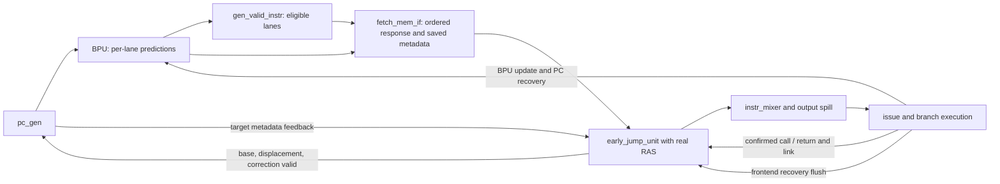

# Early-jump unit and instantiated RAS: black-box verification specification

## Current model contract — 2026-10-28

R09: a nonempty RAS corrects RET only when the saved prediction is not a
taken BTB hit matching the independently known RAS top. Suppression preserves
metadata and does not suppress the accepted RET pop. EJ-T14 checks every active
lane and hit/taken/equality combination, stalls, and subsequent stack witnesses.

R11/EQ07 is approved D: qualified surviving confirmation updates abstract C before
restoring P; offered speculative work on that flush edge is canceled. Both model
profiles retain this rule. `RAS_ORDER=updated` is the sole supported ordering;
`previous` and `unknown` now fail configuration validation (exit 2). EJ-T20 and
the old-state-restoration mutation retain independent recovery checks. Exception
history survival EQ08 remains unresolved.

See the [cross-module change and scenario report](../MODEL_UPDATE_2026-10-28.md)
for validation receipts and problem dispositions. Production RTL is unchanged;
R12 is excluded. Current source selects N=8. Older audit-era configurations,
counts and alternative-policy results below are historical and are superseded
by this dated contract where they conflict. Build launchers exclude repository
`build/` from FuseSoC discovery even with a custom BUILD_DIR, preventing archived
core copies from overriding the live verification sources.


Architecture revision: `architecture-analysis-2026-10-14`; implementation revision:
`early-jump-v1-2026-10-14`. Sections 1–24 retain the architecture investigation and
its evidence classifications. Section 25 records the subsequently implemented
native C++/Verilator checker, adaptations, execution evidence and limitations.
The DUT boundary remains `early_jump_unit` **including its actual `u_ras`
instance**. Only public ports and elaborated static configuration are observed.
The branch is `feat-verification`. Production RTL/configuration and existing
pc_gen verification behavior remain unchanged by this implementation.

Recognition-policy clarification: `approved-minimal-recognition-2026-10-14`.
The user explicitly approved the restricted instruction policy below. This
update changes specification confidence and test/coverage classifications only;
it does not approve unrelated acceptance, correction, stack-boundary or recovery
semantics. It preceded the implementation recorded in §25.

The existing [pc_gen README](../pc_gen/README.md) and
[pc_gen specification](../pc_gen/VERIFICATION.md) supply the framework, reporting,
independence policy and already approved pc_gen consumer contract. They do not
automatically specify this producer's instruction selection or RAS lifecycle.

Audit update: `recovery-audit-2026-10-14`. See [ARCHITECTURE_AUDIT.md](ARCHITECTURE_AUDIT.md)
for the independently traced EQ01–EQ12 decisions, reachable EQ08 exception-history
contamination, proposed reason-specific recovery and focused checker corrections.
EQ04's taken-JAL suppression policy is now explicitly approved D: a hit-and-taken
JAL may suppress correction regardless of target equality. This does not approve
RET redundancy, lane selection, acceptance or exception recovery. Historical
execution totals in §25 remain historical; new validation is in the audit report.

## 1. Evidence policy and scope

| Label | Meaning | Future checking policy |
| --- | --- | --- |
| A | Architectural fact from the ISA | Check the relevant functional relationship; do not turn a predictor optimization into an ISA obligation. |
| D | Explicit requirement/documentation independent of matching RTL | Definitive checks within its stated scope. |
| I | Inferred producer/consumer contract or proposed policy | Explicit named assumption; mismatches remain provisional. |
| O | Current RTL observation only | Characterization, not golden behavior. |
| Q | Specification information is missing | Track unknown values/state and the question ID. |

The user's requirements independently establish two logical RAS histories,
branch-unit-confirmed versus frontend-predictive updates, and restoration of the
predictive history from the confirmed history on misprediction (D). Source-selected
N in {1,2,4,8} and four-byte bundles are D. The approved pc_gen contract establishes
that an applicable older early correction beats a current prediction and does not
wait for memory request readiness (D). It does **not** define when this unit must
offer or finish that correction, or settle simultaneous RAS operations.

The minimal instruction-recognition policy is now an approved design requirement
(D): JAL rd=x1 is a recognized call with predictive push; every other JAL,
including rd=x5, is a direct jump without predictive push; only canonical
`JALR x0,0(x1)` (`0x00008067`) is a recognized return with predictive pop; all
other JALR instructions, including x5 returns, have no early RAS operation.
Full x1/x5 hint processing and coroutine semantics are outside the approved
scope. This decision is independent of RTL agreement. Lane selection and
acceptance timing retain their existing I/Q qualifications.

RAS storage is predictive microarchitectural state, not an architectural register
file or a software stack. In particular, RISC-V RAS hints do not require every
implementation to accelerate every hint. A wrong return prediction is corrigible
by branch execution; it is not automatically an architectural execution failure.

Use independent requirement IDs `EJxx`, `RAxx`, and questions `EQxx` below. Preserve
pc_gen Q1–Q10 as consumer evidence, without reusing their IDs for different issues.
Record evidence, assumption dependencies, known status and disposition separately
for every output field/lane and each abstract history. A passing selected profile
is not full frontend, processor or contract sign-off.

## 2. Active source map

All paths/line numbers below refer to the inspected working tree. Links are
relative to this document; explicit line ranges identify the inspected evidence.

| ID | Source and locations | What was inspected |
| --- | --- | --- |
| S01 | [early_jump_unit.sv](../../../rtl/frontend/early_jump_unit.sv), 16–35, 48–153, 155–239, 244–271 | Entire interface, recognition/selection, correction lifetime, real RAS instance and prediction rewrite. |
| S02 | [ras.sv](../../../rtl/frontend/ras.sv), 15–38, 63–117, 119–167 | Purpose/depth, predictive and confirmed updates, recovery and qualified top output. |
| S03 | [gen_valid_instr.sv](../../../rtl/frontend/gen_valid_instr.sv), 11–64 | Starting-lane exclusion, first **hit-and-taken** cutoff, selected prediction; single-issue specialization. |
| S04 | [fetch_stage.sv](../../../rtl/frontend/fetch_stage.sv), 141–176, 180–228, 230–282 | Every EJU pin, pc_gen feedback, memory-only flush, mixer and downstream spill cell. |
| S05 | [fetch_mem_if.sv](../../../rtl/frontend/fetch_mem_if.sv), 79–85, 88–145, 155–165 | Ordered request/prediction FIFO, frozen response metadata/mask and answer handshake. |
| S06 | [bpu.sv](../../../rtl/frontend/bpu.sv), 39–82; [btb.sv](../../../rtl/frontend/btb.sv), 53–107; [gshare.sv](../../../rtl/frontend/gshare.sv), 43–114 | Per-lane PC/hit/target/direction; independent lane readouts, resolution updates and exception flush. |
| S07 | [instr_mixer.sv](../../../rtl/frontend/instr_mixer.sv), 18–61; [spill_cell_flush.sv](../../../rtl/common/spill_cell_flush.sv), 42–98; [spill_cell_flush_cu.sv](../../../rtl/common/spill_cell_flush_cu.sv), 123–168 | Lane compaction with attached metadata, readiness, held data and synchronous cancellation. |
| S08 | [pc_gen.sv](../../../rtl/frontend/pc_gen.sv), 62–110 | Early operands, redirect priority, combinational target feedback and memory-independent early PC update. |
| S09 | [issue_stage.sv](../../../rtl/expipe/issue-unit/issue_stage.sv), 206–225, 309–338, 544–550; [issue_decoder.sv](../../../rtl/expipe/issue-unit/issue_decoder.sv), 46, 93, 334–345 | Metadata carried with each instruction; hit-and-taken qualification; BU_CALL/BU_RET classification. |
| S10 | [branch_unit.sv](../../../rtl/expipe/exec-units/branch_unit.sv), 109–173, 198–229, 278–281; [branch_cu.sv](../../../rtl/expipe/exec-units/branch_cu.sv), 53–121 | Executed direction/target, faults, registered confirmation payload, correct/mispredicted notification timing. |
| S11 | [branch_rs.sv](../../../rtl/expipe/exec-units/branch_rs.sv), 129–141, 200–226, 286–345 | Ordered branch execution positions, execution versus CDB acceptance and misprediction result. |
| S12 | [datapath.sv](../../../rtl/datapath.sv), 97–159, 197; [backend.sv](../../../rtl/expipe/backend.sv), 233–246, 422–434, 510–519, 590; [exec_stage.sv](../../../rtl/expipe/exec-units/exec_stage.sv), 154–177 | Confirmation/resolution routing and distinct frontend/backend recovery paths. |
| S13 | [issue_cu.sv](../../../rtl/expipe/issue-unit/issue_cu.sv), 169–173, 256–272; [commit_cu.sv](../../../rtl/expipe/commit-unit/commit_cu.sv), 353–370, 404–465; [commit_stage.sv](../../../rtl/expipe/commit-unit/commit_stage.sv), 156–184, 319–357, 409–424; [rob.sv](../../../rtl/expipe/commit-unit/rob.sv), 124–130, 181–199 | Frontend misprediction flush, later commit/backend flush, exceptions/MRET, ROB resolution bookkeeping. |
| S14 | [len5_config_pkg.sv](../../../rtl/packages/len5_config_pkg.sv), 37, 49–57, 119–126; [len5_pkg.sv](../../../rtl/packages/len5_pkg.sv), 21–49, 55–134; [fetch_pkg.sv](../../../rtl/packages/fetch_pkg.sv), 49–73; [instr_pkg.sv](../../../rtl/packages/instr_pkg.sv), 100–101; [expipe_pkg.sv](../../../rtl/packages/expipe_pkg.sv), 227–238 | N/depth, ISA switches, instruction representation and packed prediction/resolution types. |
| S15 | [prio_enc.sv](../../../rtl/common/prio_enc.sv), 17–55; [frontend.core](../../../rtl/frontend.core), [common.core](../../../rtl/common.core), [packages.core](../../../rtl/packages.core) | RAS dependency and supported source/fileset ordering. |
| S16 | [pc_gen framework](../pc_gen/README.md#components-and-independence); [tb_macros.hh](../../verilator/tb_macros.hh), [tb_macros.cpp](../../verilator/tb_macros.cpp), [verilator-common.core](../../verilator/verilator-common.core) | Reusable native verification and exact logger behavior. |

The active module name is lowercase `ras`, in `rtl/frontend/ras.sv`, despite the
task's `RAS.sv` spelling. The active hierarchy is
`u_datapath.u_fetch_stage.u_early_jump_unit.u_ras`. Searches found one active EJU
instance and one active RAS instance. Unsupported [rtl-vm](../../../rtl-vm/README.md)
and old frontend testbenches are not behavioral authorities. No separate complete
early-jump contract or active standalone early-jump testbench was found.

Architectural encoding/arithmetic and hint context were checked against the
[ratified RISC-V base control-transfer specification, §§1.1.2, 1.1.5.1 and Table 2](https://docs.riscv.org/reference/isa/v20260120/unpriv/rv32.html).
Its control-transfer definitions also apply in this RV64 implementation. The
microarchitectural policies below require their own evidence.

## 3. Purpose and instruction flow

The BPU predicts before instruction bits return from memory. It can miss a direct
jump or predict a stale return target. The EJU examines the **returned** instruction
bundle. It can form a direct JAL destination from instruction bits and its saved
PC, or provide a return prediction from predictive RAS. This repairs frontend
control flow earlier than waiting for the instruction to execute in the branch
unit. It also attaches the chosen prediction to the instruction so execution can
detect a remaining direction/target error.



This is a connectivity diagram, not a proposal to instantiate those surrounding
blocks in the standalone testbench. Branch PC recovery also feeds pc_gen directly;
the drawing abbreviates that path.

Flow, with the important boundaries kept separate:

1. BPU produces N prediction records for the current fetch bundle (S06).
2. `gen_valid_instr` determines the prediction-path eligibility mask and the
   earliest eligible taken prediction used by pc_gen (S03/S04).
3. `fetch_mem_if` snapshots **all** prediction records and that mask with the
   accepted request; its FIFO pairs them with an ordered memory response (S05).
4. The answer spill presents stable instruction bits, prediction PCs/metadata and
   mask to EJU until `instr_valid_i && issue_ready_i`, or recovery cancellation.
5. EJU may shorten the mask further, produce an early correction, update predictive
   RAS at bundle acceptance, and rewrite one instruction's prediction (S01).
6. Mixer shifts away a leading invalid prefix while moving instruction, prediction
   and exception records together. The output spill accepts the corrected bundle;
   its readiness is the EJU's `issue_ready_i` (S04/S07). This is **not** backend
   instruction execution, nor necessarily the backend's direct ready signal.
7. Issue stores each surviving instruction PC/target/qualified direction. The
   decoder assigns the instruction to a branch operation. Branch execution later
   emits confirmation, BPU updates, and any misprediction recovery (S09–S13).

An EJU correction flushes the younger instruction-memory path through
`mem_flush_o`. That output does **not** feed the EJU's own `flush_i` or erase its
RAS. Backend frontend recovery/exception supplies that different input. Physical
memory cancellation, issue-queue contents and ROB correctness remain out of scope.

The prediction-validity path was inspected separately from the instruction
decoder: BPU/gshare do not examine instruction words to qualify each prediction.
Consequently the early decoder must use the returned per-lane mask, not assume
that the presence of a jump word or a raw taken bit makes its lane eligible.

## 4. Configuration and public interface

Architecture-analysis source snapshot: `LEN5_MULTIPLE_ISSUES=4`, `RAS_DEPTH=4`,
XLEN=ALEN=64, ILEN=32, C and A disabled, M/F/D enabled (S14). The implementation
phase found the user-selected N=2 (B=8 bytes); see §25. Neither phase changes the
production configuration.
EJU has no top-level parameters; it instantiates RAS with the package depth.
The RAS module's default DEPTH=4 is overridden by that package connection.

Future support must read N={1,2,4,8} from the existing production package; there
must be no second selector. Build only the currently selected configuration.
N=1 uses the single-lane decoder and a one-bit jump-location width (S01:49,
92–104). RAS index width depends on **RAS depth**, not N. `ras`/`prio_enc` use
`$clog2(DEPTH)` vectors; depth=1/non-power-of-two support is not established and
must not be inferred from N=1 support. The selected depth=4 is the initial scope.

`prediction_t` has `pc[63:0]`, `hit`, `target[63:0]`, `taken`, in that declared
packed order (S14). There is no field named prediction `valid`, and no instruction
PC input distinct from prediction `.pc`. A lane's PC remains meaningful even
when `.hit=0`. `instr_t` is a packed 32-bit union; drive raw words, not mirrored
SystemVerilog union members.

| Pin | Width/type | Actual producer or consumer | Public meaning / qualification |
| --- | --- | --- | --- |
| `clk_i` | 1 input | Datapath/fetch clock | State-consuming rising edge. |
| `rst_ni` | 1 input | System reset | Active-low, asynchronously resets EJU control and both RAS valid histories (O, S01/S02). |
| `flush_i` | 1 input | `fetch_stage.flush_i` = frontend misprediction flush OR exception flush; S12/S13 | Recovery epoch/cancellation and RAS restoration; no reason tag. |
| `instr_i[N]` | N × 32 input | `fetch_mem_if.issue_instr_o` | Returned encoded words. |
| `instr_valid_i` | 1 input | `fetch_mem_if.issue_valid_o` | Entire returned bundle offer is present. |
| `issue_ready_i` | 1 input | `u_out_reg.ready_o` (`spill_ready`) | Ability to accept this bundle into output spill; also answer register's ready. |
| `mem_if_pred_i[N]` | N × prediction_t input | `fetch_mem_if.issue_pred_o` | Saved request-time prediction and per-lane PC. Not current BPU outputs. |
| `valid_instr_i[N]` | N input | `fetch_mem_if.valid_instr_o` | Saved mask computed by `gen_valid_instr`; distinct from bundle valid and prediction hit. |
| `early_jump_target_i` | XLEN input | `pc_gen.early_jump_target_o` | Returned target feedback used for corrected issue prediction. May reflect an overriding redirect. |
| `call_confirm_i` | 1 input | branch_unit `fe_call_confirm_o`, routed through exec/backend/datapath | Qualified confirmation pulse for a previously executed BU_CALL; no ready/ID on this port. |
| `ret_confirm_i` | 1 input | branch_unit `fe_ret_confirm_o`, same route | Qualified confirmation pulse for a previously executed BU_RET. |
| `res_link_addr_i` | ALEN input | branch_unit `fe_link_addr_o` | Resolved instruction's PC+4; consumed for confirmed call, irrelevant for confirmed return. |
| `valid_instr_o[N]` | N output | `instr_mixer.valid_i`, then output spill and issue queue | Eligible instruction lanes after early control-flow cutoff. Meaningful for a live offered/accepted bundle. |
| `issue_pred_o[N]` | N × prediction_t output | `instr_mixer.pred_i`, then spill/issue | Prediction records attached to retained instructions. |
| `early_jump_valid_o` | 1 output | `pc_gen.early_jump_valid_i` | Older correction offer; no dedicated acknowledgment input exists. |
| `mem_flush_o` | 1 output | fetch_mem_if flush OR; fetch-stage memory-flush output; datapath memory-flush OR | Early correction's memory-path cancellation request. |
| `early_jump_base_o`, `early_jump_offs_o` | 2 × XLEN output | Corresponding pc_gen early inputs | Target operands, meaningful with an applicable correction. |

There are no EJU pins for `mem_ready`, `bu_res`, mispredict, commit target,
instruction exception, BPU training, RAS fullness, or direct RAS push/pop. Model
their consequences through existing public inputs, with event reasons recorded
as environment metadata only. Do not add test-only runtime peeks at RAS entries,
pointers, validity arrays or EJU implementation control states.

## 5. Valid bits, lane PCs and prediction reachability

This section is central to the oracle and generator. The three distinct notions
are bundle presence `instr_valid_i`, lane eligibility `valid_instr_i[k]`, and a
BTB hit `mem_if_pred_i[k].hit`. None substitutes for the others.

For an instruction-aligned request PC p, define independently:

```
B = 4*N
bundle_base = floor(p/B)*B
start_lane = (p - bundle_base)/4
lane_pc(k) = bundle_base + 4*k                 modulo 2^XLEN
qualified_taken(k) = prediction[k].hit && prediction[k].taken
end_lane = first k >= start_lane with qualified_taken(k), or N-1
request_mask[k] = (start_lane <= k && k <= end_lane)
```

This interval describes S03's inferred integration contract (I), without copying
its loops/bit slices. N=1 has mask 1 for an ordinary aligned request. S06 emits
these per-lane PCs; the response keeps physical bundle positions until the mixer.
EJU is handed `.pc` for every lane, including a miss. It does not reconstruct the
PC by adding k*4 to the current pc_gen output. Partial bundles can start at any
lane; invalid preceding words are still present electrically.

Consequences verified by direct inspection of S03:22–61:

- The **first eligible `hit && taken` lane is included**. Later lanes are masked
  out. Hit-and-taken predictions before the starting lane cannot cut the bundle.
- `hit=1,taken=0` means a valid not-taken prediction. It leaves later lanes eligible.
- `hit=0,taken=1` is possible: gshare direction exists without a BTB target hit.
  It is not an accepted taken prediction and does not cut the bundle.
- The absence of a hit and a valid not-taken prediction are different metadata,
  even though both fail `qualified_taken`. Preserve both cases in coverage.
- Multiple raw hits and multiple raw taken predictions can coexist. Only one
  **eligible taken successor** is selected for the request. Younger records are
  still transported, but their mask bits are zero.
- Lane eligibility follows the **predicted path**. A valid lane after a conditional
  branch predicted not taken can later prove wrong-path when execution resolves
  that branch taken. Do not label such frontend speculation malformed.

Example at N=4, bit strings shown as `[lane3..lane0]`, start lane 0:

| Raw prediction situation | `valid_instr_i` | Consequence |
| --- | --- | --- |
| lane0 hit/not-taken; JAL in lane2, no taken hit elsewhere | `1111` | lane2 is eligible for early decoding. |
| lane0 hit/taken; JAL in lane2 | `0001` | lane2 cannot correct PC or update RAS. |
| lane0 hit/not-taken; lane2 hit/taken | `0111` | lanes0..2 eligible; lane3 excluded. |
| lane0 and lane2 hit/taken | `0001` | Raw second prediction exists but cannot win. |
| start lane2, lane0 hit/taken, no later hit/taken | `1100` | Pre-start prediction ignored. |
| start lane1, lane2 hit/taken | `0110` | lane0 excluded by start; lane3 by prediction. |

For live ordinary responses the mask is a nonempty contiguous interval. A zero
mask, holes, contradictory lane PCs or valid younger lanes beyond an earlier
hit-and-taken record belong in stress/characterization, with an explicit reason.
The future environment generates this mask **independently**; it must not include
`gen_valid_instr` as an oracle or use a DUT-produced mask to choose expected lanes.

The final EJU mask is a subset of the input mask. Under the proposed lane-cutoff
policy it also stops at the oldest eligible recognized unconditional
jump/return, including a predicted JAL that needs no correction. S01:110–138,
271 currently implements that policy (I); confirmation is needed for artificial
contradictory masks and generic JALR cutoff behavior (EQ01/EQ03). The instruction
classes recognized for direct jumps and RAS operations are separately approved D.

## 6. Instruction decoding and ISA context

Architectural context: JAL uses a signed PC-relative displacement and links to
PC+4. JALR uses a signed I immediate added to rs1, clears target bit 0, and also
links to PC+4. Neither has a delay slot. With C disabled, normal executed PCs are
four-byte aligned. EJU has no register operand or exception port, so it cannot
execute general JALR or validate target executability/alignment.
[ISA evidence](https://docs.riscv.org/reference/isa/v20260120/unpriv/rv32.html#_unconditional_jumps).

Independent decoding shall operate on raw words with architectural bit positions:

```
opcode = word[6:0]; rd = word[11:7]; rs1 = word[19:15]
J_unsigned = word[31]<<20 | word[19:12]<<12 | word[20]<<11 | word[30:21]<<1
J_offset = sign_extend(J_unsigned, 21)
J_target = instruction_pc + J_offset         modulo 2^XLEN
link = instruction_pc + 4                    modulo 2^ALEN
```

J offsets span -1048576..1048574 in increments of 2. Successful architectural
traffic with aligned PCs uses offsets divisible by 4; encodable offsets with bit1
set exercise later-fault/robustness context, not successful normal execution.
Use unsigned modular arithmetic to avoid C++ signed overflow. Test immediate
bit positions independently, especially sign/bit11/bit19 rearrangement.

### Approved LEN5 recognition and broader ISA hint context

The first seven rows are approved D recognition/operation rules. Their operation
acceptance timing remains I/EQ05, and return-top/empty behavior remains I/EQ09.
Valid noncontrol words also cannot become RAS calls/returns under the exact D
subset. Other correction and invalid-word handling retain their prior evidence;
this approval does not define them. S01:48,99–123
supports the implementation observations, while user approval supplies D.

| Encoded instruction | Architectural class | Recognition policy / observation | Predictive RAS operation / evidence |
| --- | --- | --- | --- |
| opcode `0x6f`, rd=x1 | JAL/direct call | Recognized CALL (D). | Predictive push (D); lane PC+4 is A; correction/acceptance qualification retains I. |
| opcode `0x6f`, rd=x0 | JAL/direct nonlinking jump | Direct JAL, not RAS call (D). | No predictive push (D). |
| opcode `0x6f`, rd=x5 | JAL/alternate-link call hint | Direct JAL, not RAS call (D). | No predictive push (D); x5 acceleration is intentionally excluded. |
| opcode `0x6f`, other rd | JAL with link destination | Direct JAL, not RAS call (D). | No predictive push (D). |
| raw `0x00008067` | `jalr x0,0(x1)`, canonical RET | Recognized RET (D). | Predictive pop (D); nonempty-top correction policy retains I. |
| `jalr x0,0(x5)` (`0x00028067`) | Alternate-link return hint | Not early RAS-recognized (D); current jump type NONE (O). | No early RAS operation (D). |
| Other valid JALR, funct3=000 | Indirect jump/call/return hint | Not early RAS-recognized (D); current jump type NONE (O). | No early RAS operation (D); eventual branch execution handles the instruction. |
| opcode JALR, funct3 !=000 | Unsupported/reserved encoding | Current jump type NONE (O). | Raw encoding characterization; no expanded RAS hint semantics. |
| BEQ/BNE/BLT/BGE/BLTU/BGEU | Conditional branch | No RAS call/return recognition (D); current jump type NONE (O). | No RAS operation under the exact approved subset (D); no instruction-derived early target remains I. BPU metadata can still cut the input mask. |
| Integer R/I/U operations, loads/stores, fences, CSR/system, enabled M/F/D operations | Other supported instruction | No RAS call/return recognition (D); current jump type NONE (O). | No RAS operation under the exact approved subset (D). Preserve prediction metadata subject to existing relevance assumptions. |
| C/A words, reserved opcodes, arbitrary raw words | Unsupported/invalid in selected core | No full legality checking (O). | Characterize; never invent an EJU illegal-instruction exception. |

The backend matches this restricted classification: JAL rd=x1 becomes BU_CALL;
other JAL becomes BU_JAL; only the exact RET becomes BU_RET; other JALR becomes
BU_JALR (S09:334–345). Therefore an indirect call does **not** currently cause a
confirmed push merely because it is semantically a call in software.

Architectural hint context uses link registers x1/x5. For JALR the hint actions are:

| rd is a link register | rs1 is a link register | Relation | Hint action |
| --- | --- | --- | --- |
| No | No | Any | None |
| No | Yes | Any | Pop |
| Yes | No | Any | Push |
| Yes | Yes | Different | Pop then push |
| Yes | Yes | Same | Push |

This table is ISA context only, not a second LEN5 oracle or a future feature plan.
EQ03's recognition-policy question is resolved by user approval: do not implement
x5 RAS acceleration, indirect-call RAS updates, noncanonical-return pops or
coroutine pop/push semantics. Valid instructions carrying those excluded hints
are definitive **no-early-RAS-effect** tests, including architectural cases when
their histories/protocols are valid. Their absence of RAS activity is not merely
characterization and must not make expected P unknown. Raw/invalid encodings and
unrelated lifecycle questions retain their previous classifications.

### False-positive and near-miss plan

Current call detection checks both **JAL opcode and rd=x1**; it does not blindly
push whenever bits11:7 are 1. The RET match checks all 32 bits. Nevertheless test
ordinary ADDI/ADD/AUIPC/LUI/load/store/FP/CSR words with rd=x1/x5, rs1=x1/x5,
RET-like immediate fields, and individual opcode/funct3/rd/rs1/immediate bit flips.
For example `ADDI x1,x0,0` (`0x00000093`) must not become a speculative call under
the minimal decoding contract. Reserved JALR funct3 and RET-with-nonzero-immediate
must not be silently treated as the exact supported RET. Invalid lanes containing
valid jump words are a separate qualification test, not decoder-encoding coverage.

## 7. Jump recognition, correction and output metadata

Recognition, bundle cutoff, correction offer and RAS update are separate events.
Instruction recognition and the selected RAS operation follow approved D policy.
The hit-and-taken JAL suppression policy is approved D, for both correct and
incorrect predicted targets. A BTB hit identifies a matching source-PC entry,
not proof of decoded target equality. Other correction qualification, RET
redundancy, acceptance and cutoff rules keep their existing I/Q classifications;
EQ05 remains open.

| Oldest eligible recognized instruction | Its saved prediction | Correction policy | RAS/retained lanes |
| --- | --- | --- | --- |
| JAL/CALL | hit=0, either direction | Offer exact JAL arithmetic target. | Cut younger lanes; CALL pushes only at bundle acceptance. |
| JAL/CALL | hit=1, taken=0 | Same correction; valid not-taken prediction is repaired. | Same. |
| JAL/CALL | hit=1, taken=1, correct target | Suppression permitted by approved D policy. | Cut younger lanes; CALL still pushes at acceptance. |
| JAL/CALL | hit=1, taken=1, wrong target | Suppression permitted by approved D policy; normal branch execution corrects the wrong target. | Same push/cutoff; no EJU target comparison required. |
| RET, predictive RAS nonempty | Any prediction state/target | Current RTL always offers RAS top, even when BPU already matches. | Cut younger lanes; pop at acceptance. |
| RET, predictive RAS empty | Any | Current RTL offers no RAS-derived correction; preserves incoming prediction. | Cut younger lanes; empty pop semantics EQ09. |
| No recognized instruction | Any | No instruction-derived correction. | Preserve live lanes and metadata; no speculative RAS operation. |

The per-lane correction decision uses the **selected instruction's saved record**,
not a bundle-wide OR of hits/taken bits. A BPU hit at an earlier not-taken branch
does not suppress a later eligible JAL correction. A younger prediction cannot
outrank an older selected JAL (S01/S03). Current code only compares hit/direction
for JAL, not target equality; the commented return target-equality optimization
at S01:148 is inactive. JAL suppression is D microarchitectural policy, not an ISA mandate; RET redundancy remains I/Q.

Observable operands currently are JAL `{base=lane.pc, offs=signed J immediate}`
and RET `{base=0, offs=predictive_top}` (S01:244–255). The functional target sum is
the required arithmetic relationship; the exact decomposition is an interface
assumption EJ04. Values without an applicable correction are not automatically
meaningful. In particular, NONE currently derives unused operands from a default
lane; a two-state zero or this implementation fallback is not a requirement.

For retained lanes, unchanged metadata must keep pc/hit/taken/target together.
For a corrected selected lane the current interface forwards `early_jump_target_i`
as target, makes hit/taken true, and retains that lane's PC (S01:264–269). The future
checker must separately verify target **feedback propagation** and independent
JAL/RAS arithmetic. It must not compute expected target by reading the DUT's
operands and adding them. An intentionally inconsistent feedback input belongs
in characterization: it tests propagation but does not create a valid corrected
architectural prediction.

pc_gen gives reset/commit/recovery priority over early correction. If its feedback
contains a winning commit target, corrected early metadata can be irrelevant due
to cancellation (approved pc_gen Q4). Branch-overridden sideband timing is still
an integration question. EJU has no redirect qualifier to identify either case.
The environment must tag canceled/consumed records independently, while the
scoreboard leaves unused fields don't-care and unresolved consumer windows Q.
Do not infer cancellation from an observed unexpected target.

## 8. Multiple predictions and bundle interaction matrix

Here `NT` means hit=1/taken=0, `T` means hit=1/taken=1, `M` means hit=0;
`a<b` are physical lanes at/after the start. Masks are generated as in §5 before
EJU selection. Rows with N too small are excluded by construction. Effects are
the proposed selection/correction policy (I), with approved D recognition/RAS
operation classes, A arithmetic and D restoration retained.

| Bundle situation | Eligibility/selection | Correction | RAS and younger instructions | Campaign |
| --- | --- | --- | --- | --- |
| Branch NT at a, JAL at b | Both input-valid; select JAL b. | Yes unless JAL b itself has T. | CALL at b pushes once; lanes after b removed. | Architectural; earlier branch may later recover. |
| Branch T at a, JAL at b | Input mask ends at a; b excluded. | None from b. | No b push/pop; younger words unused. | Architectural. |
| Several branch NT records | No taken cutoff; all post-start lanes remain. | None without a recognized jump. | No RAS changes from conditional branches. | Architectural. |
| Several raw branch T records | Mask ends at first eligible T. | None from later jump words. | Only earliest taken successor; later raw predictions irrelevant. | Architectural raw BPU metadata. |
| Mixed NT/T records | NT leaves reachability; first eligible T ends it. | Depends only on an eligible recognized jump before/at cutoff. | Preserve older NT branch metadata. | Architectural. |
| Correctly T-predicted JAL a | a eligible; input mask already ends there. | Suppressed under minimal policy. | CALL still pushes; earlier lanes retained. | Architectural. |
| Unpredicted JAL a | a eligible; cut final mask at a. | Exact signed target. | CALL pushes once at acceptance. | Architectural. |
| T-predicted JAL a, unpredicted JAL b | b input-invalid. | No b correction; a suppressed. | At most a's RAS action. | Architectural. |
| NT-predicted JAL a, unpredicted JAL b | Both may be input-valid; select a. | Correct a. | b removed, no b action. | Architectural speculation. |
| Unpredicted JAL a, later predicted branch b | JAL a wins decoded order even if b was selected at request time. | Correct a; target distinct from b's. | Later b removed and younger memory flushed. | Architectural. |
| Branch NT a, RET b | b eligible and selected. | RAS top if known nonempty. | Pop only on acceptance. | Architectural. |
| Branch T a, RET b | b excluded. | None from b, regardless of RAS top. | No b pop. | Architectural. |
| CALL a, RET b | Select CALL a only, regardless of a's correction suppression. | Per a's record. | One push, no same-bundle pop; b removed/refetched if reached later. | Architectural incoming speculative words. |
| RET a, CALL b | Select RET a only, even if RAS empty. | Top if available; otherwise no RAS correction. | At most one pop; b removed. | Architectural. |
| Several calls/returns/JALs | Oldest eligible recognized instruction only. | Not the oldest instruction needing correction after skipping a recognized predicted jump. | At most one predictive operation per accepted bundle. | Architectural with proper input mask. |
| JAL rd=x5 or other non-x1 rd | Approved direct-jump class (D); existing lane selection/cutoff remains I. | Taken-hit suppression D; remaining JAL qualification I; signed target arithmetic A. | No predictive push (D); later return probes must expose unchanged RAS history. | Architectural with coherent bundle/history; not hint characterization. |
| Valid noncanonical JALR, including x5 return/indirect-call/coroutine hint encoding | No approved early RAS call/return operation (D); generic-JALR cutoff remains separate EQ03. | Existing general-JALR correction observations not promoted by this decision. | No predictive push/pop (D); no full hint or coroutine model. | Architectural with coherent bundle/history, or interface stress; no-RAS-effect check remains D. |
| Ordinary words and NT/M metadata | No recognized jump. | None. | No instruction-derived push/pop. | Architectural. |
| Ordinary word with T metadata | Input mask can still end at that prediction. EJU is not a BTB validator. | No instruction-derived correction. | Preserve metadata; stale prediction behavior is integration-limited. | Stress/characterization unless justified producer history. |
| Jump word before start/after first T | Input-invalid, never selected. | None from invalid word. | No RAS change. | Architectural qualification corner. |
| Mask claims b valid after T at a | Contradicts S03 for that request. | Defined assumptions separated from raw observation. | Do not pretend b is an architectural live instruction. | Interface stress; contradictory protocol characterization. |

Multiple raw predictions are therefore not universally artificial. What is
artificial is claiming multiple simultaneously consumed taken successors from one
linear bundle, or ignoring the generated validity mask to close a coverage bin.
Likewise unrecognized general JALR may have eligible younger speculative lanes
under a miss; those can be squashed by later execution. Whether EJU should shorten
that bundle proactively remains the separate lane-cutoff detail in EQ03, not
settled by approval of its no-early-RAS-operation rule or ISA no-delay-slot semantics.

## 9. Predictive and confirmed RAS semantics

Represent each logical history as an abstract sequence of return addresses in
oldest-to-newest order, with known depth/content status. `top` is newest, and only
a known nonempty history supplies a known return prediction. No oracle pointers,
priority encoders, bit-valid arrays or physical array layout are permitted.

### Predictive history P

Under the approved D recognition/operation policy and existing I bundle-acceptance
contract, a **bundle accepted into output spill** containing the selected eligible
JAL rd=x1 appends its PC+4 to P; selected canonical RET removes P's newest address.
Other JAL instructions, including rd=x5, do not push, and other JALR instructions
do not perform an early RAS operation (D). The inferred implementation contract
applies the selected operation even if the call has a taken BPU prediction
and creates no correction, or RET creates no correction because P is empty
(S01:202–222). A stalled unaccepted offer must not repeatedly push/pop. No lower
priority recognized instruction in the same bundle supplies a second operation.

The return correction uses the **pre-acceptance top**. After its consuming edge,
the same electrical RET inputs may expose the next top combinationally. The
driver must not expect the just-consumed top forever on a post-edge snapshot.
Likewise a call changes hidden P at its consuming edge, not when combinational
recognition first occurs.

For a distinguishing temporal example, accept calls at PCs `0x104` and `0x208`:
the predicted links are `0x108` and `0x20c`. Two later accepted canonical returns
should expose `0x20c`, then `0x108`, under the minimal LIFO contract. If only the
first call has been confirmed, a subsequent misprediction F should restore the
confirmed history containing `0x108`; a new return must expose that value instead
of the unconfirmed `0x20c`. These addresses come from generated instructions,
not a DUT-observed stack top. Run the recovery example before draining P, or use
an independent fixture, so probe-induced pops cannot obscure its purpose.

### Confirmed history C

The user defines C as branch-unit-confirmed history (D), not retired/commit-proven
history. The real producer checks valid execution, BU_CALL/BU_RET operation and
absence of a jump alignment fault (S10:127–136). It captures confirmation flags
and link PC+4 alongside the resolution, then qualifies the registered flags with
the CU's confirmation enable (S10:198–210,278–281). An ordinary branch, BU_JAL,
generic BU_JALR or faulting call/RET must not be manufactured into a confirmation
by the abstract environment.

`call_confirm_i` is an operation pulse plus address `res_link_addr_i`; return
confirmation is an operation pulse with no required address payload. Both have
no ready/ID/mispredict field at EJU. Confirmations update C independently of EJU
bundle validity/readiness (I, S02:88–117). They do not, by themselves, duplicate
the corresponding speculative update into P. Fault qualification is a **producer
guarantee**, not independently observable fault detection in EJU.

Correctly predicted BU_CALL/BU_RET confirms as well as a mispredicted one. S10 CU
UPD_FE enables confirmation and BPU update; MIS enables confirmation once before
PC recovery. Thus confirmation is neither synonymous with a misprediction nor
with an instruction merely traversing a module. Back-to-back confirmations can
refer to different records; a held high pulse is not a ready/valid retry protocol.

### Recovery and ordering

The intended restoration P <- C on branch misprediction is D. At this boundary
the command implementing it is `flush_i`; there is no separate misprediction pin.
Current frontend routing delays it relative to branch discovery (see §10).
The current RAS uses the same copy behavior for every `flush_i`, including exception
flush (O/I); this exception policy needs EQ08 approval.

At a flush edge, the approved contract ignores new speculative operations,
applies any qualified surviving confirmation to C, then restores P from the
resulting history (D, EQ07 approved 2026-10-28). This rule is implemented using
abstract history events in the model. Both model profiles preserve it. The normal
producer confirms one interval before recovery; EJ-T20 separately checks the
same-edge interface contract. Qualification and exception survival retain their
separate ENV02/EQ08 dependencies.

### Boundaries and otherwise unspecified cases

| Situation | Current observation | Oracle policy before approval |
| --- | --- | --- |
| Normal nonfull push/nonempty pop | Newest-first LIFO behavior in each history. | RA02/RA03, I abstract sequence semantics. |
| More than RAS_DEPTH pushes | Discard oldest; keep most recent DEPTH addresses, independently for P/C (S02:73–78,94–99). | Named `drop_oldest` assumption, RA06/I; EQ09. |
| Pop empty history | No entry becomes valid; address output is unqualified. | Proposed no-op, RA07/I; no expected empty return address. |
| Both confirmed call and return | XOR gate means C holds in current RTL (S02:93). | Producer-illegal; characterize, do not mandate hold. |
| Direct RAS push and pop together | RAS replaces current top address without setting its validity (S02:71–72). | Not reachable through EJU's mutually exclusive decoder actions; no coverage denominator or wrapper pins for it. |
| Reset | Both validity histories cleared asynchronously; data contents not reset (S02:64–65,111–112). | Empty histories under reset assumption; never require zeroed unused addresses. |
| Branch-confirmed return with different executed target | Confirmation only pops C; target is not carried here. | Model operation, not fictional push/repair to executed target. |

Nested calls A,B,C and later returns should expose C,B,A in order, subject to
declared depth policy. Confirmed-only changes are hidden until recovery and a
subsequent return. Recovery can overwrite an erroneous speculative history; a
test that restores immediately after every push can hide a predictive bug.
Probe both before and after recovery, and drain enough returns to expose lower
entries, occupancy, order and overflow history.

## 10. Recovery, reset, stalls and timing

### Actual branch-to-flush sequence (O/inferred integration, not a copied FSM oracle)

An illustrative source sequence at the current zero-latency BU setting:

| Interval | Public producer actions | Effect relevant to EJU |
| --- | --- | --- |
| Executing branch cycle | Branch result and misprediction computed/captured. | No direct EJU misprediction input. |
| Following misprediction notification cycle | `issue_mis_o` and call/return confirmation if applicable (S10 CU MIS). | C can update; frontend cancellation has not automatically occurred yet. |
| Frontend recovery cycle | Issue CU supplies `fetch_mis_flush_o`; BU offers pc_gen recovery (S10 MIS_LOAD_PC; S13 S_FLUSH). | EJU `flush_i` restores P and cancels pending correction; pc_gen recovery overrides early. |
| Later backend recovery at commit | CDB/ROB misprediction reaches commit; `ex_mis_flush`/issue resume clear execution state. | This backend flush is **not itself** EJU's misprediction input; branch confirmation is suppressed during BU flush. |

S13/S12 show issue-stage frontend flush and commit-stage backend flush are
different wires. Do not restore P on every BPU update, every confirmation,
every `bu_res.mispredict` payload, or a guessed same-cycle execution event.
Standalone driving uses public `flush_i` with an independently generated reason,
confirmation ordering and epoch. The exact integrated schedule is I and not a
frontend integration test.

### Stalled correction versus accepted bundle

S01:155–197 currently offers a correction while a live applicable bundle is
stalled, remembers that it is pending, keeps correction valid until downstream
readiness, and asserts memory flush when readiness arrives. The source instruction
and operands are not separately buffered there: stability relies on the answer
spill's held bundle. Predictive RAS changes only on bundle acceptance.

Therefore these are distinct:

- A combinational correction offer can be used by pc_gen at multiple rising edges
  before issue readiness. There is no pc_gen acknowledgment pin back to EJU.
- Bundle acceptance is the rising-edge transaction `instr_valid_i && issue_ready_i`
  in normal operation, not the initial correction offer.
- `mem_flush_o` currently accompanies completion into the output spill, not every
  stalled correction cycle; it does not restore RAS.
- Backend confirmations can arrive during this frontend stall and alter C while
  P remains held. Recovery can cancel the held bundle.

These timing/held policies are EJ06/RA04 I and EQ05, not automatically approved
because pc_gen already accepts early correction independently of memory readiness.
Hold raw words, lane PCs, mask and saved predictions stable under a live stall.
By contrast, current BPU predictions for a **new request** may change while memory
request ready is low (approved pc_gen Q8). Such BPU changes are not permission to
change `mem_if_pred_i` for a buffered stalled EJU response. Only inactive payload
noise or a new/canceled transaction permits replacement in architectural traffic.

### Reset and flush windows

Current EJU suppresses correction and memory flush in its reset control state,
including until the first rising edge after release (S01:158,179–197). The connected
spill cells also have reset startup behavior. This observed one-edge suppression
is **not** an independently approved EJU reset latency; EQ02 must settle a live
bundle offered immediately on release. Under normal integrated initialization,
answer-valid is absent until the spills can present a response.

`flush_i` is synchronous. The current combinational correction output does not
directly gate off on flush; pending control is canceled at the edge. The output
spill lowers readiness on flush (S07:126,133,140), preventing ordinary bundle
acceptance in the integrated path, although answer-valid can still be asserted
before the edge. These combinational signals are not proof a canceled instruction
was consumed. Record the window, check cancellation and restoration after the edge,
and retain EQ06 for artificial flush+ready/live-bundle inputs.

No full validity mask/prediction reset-to-zero requirement follows from RAS reset.
EJU combinational decoding remains connected to inputs. Outputs for inactive or
canceled lanes are don't-care unless a separate contract specifies them.

## 11. Requirement ledger for the future checker

Evidence can be mixed: an ISA arithmetic relationship A does not by itself
mandate a particular microarchitectural offer or handshake. Dependencies must be
carried into later state-dependent checks, rather than erased after a good sample.

| ID | Observable requirement or proposed contract | Evidence and dependency |
| --- | --- | --- |
| EJ01 | Source N in {1,2,4,8}, B=4N; source-derived static configuration agrees with elaboration. | D/user; XLEN/ILEN scope S14. |
| EJ02 | No input-invalid lane selects a correction or predictive RAS operation; retained mask is a subset; supported earliest jump truncates younger lanes. | I/S03/S01; EQ01/EQ03 for unusual masks/general JALR. |
| EJ03 | A selected direct JAL's target is its own lane PC plus signed J displacement, modulo XLEN. | A arithmetic; I applicability/selection. |
| EJ04 | Meaningful operands encode that target; JAL base=PC/offset=J displacement, supported RET base=0/offset=old P top. | I interface decomposition; RET target depends on RAxx. |
| EJ05 | Correction uses selected lane's hit/taken, no bundle-wide hit suppression; current minimal JAL/RET correction policy in §7. | D/user for hit-and-taken JAL suppression independent of target equality; I for remaining qualification/RET policy, EQ04 residual. Never elevate this optimization to A. |
| EJ06 | Live correction is offered while stalled, held under stable response, memory flush at correction completion; normal bundle consumes once. | I/S01/S05/S07; EQ05/EQ06. |
| EJ07 | Retained prediction PCs preserved; corrected selected metadata uses supplied feedback with hit/taken true; other retained records unchanged. | I/S01/S09; canceled feedback disposition EQ10. |
| EJ08 | Approved exact instruction subset: JAL rd=x1 is CALL/push; other JAL, including x5, is a direct jump without push; only `0x00008067` is RET/pop; other JALR has no early RAS operation. Valid noncontrol words must not become RAS calls/returns. | D/user recognition and operation classes, EQ03 recognition resolved. Existing I no instruction-derived correction for noncontrol/unsupported words and O/Q invalid-word handling remain separate. |
| EJ09 | Synchronous state changes at rising edge only; async reset has priority; no invented additional reset delays. | I reset/output timing S01/S02; EQ02. |
| EJ10 | No stale pending correction reappears after a recovery edge once canceled input is removed. | I cancellation S01/S07; EQ06. |
| RA01 | Maintain distinct branch-confirmed and speculative frontend histories. | D/user. |
| RA02 | JAL rd=x1 is the approved predictive-push class; other JAL including rd=x5 does not push. Under the existing acceptance contract, an accepted selected call pushes lane PC+4, independent of whether BPU already took it. | D/user recognition/push selection; A link address. Acceptance, BPU/correction coupling and stack-boundary details retain I/EQ05/EQ09; no provisional hint-policy assumption. |
| RA03 | Only canonical `JALR x0,0(x1)` (`0x00008067`) is the approved predictive-pop class; other JALR, including x5 returns, has no early RAS operation. Under the existing acceptance contract, the selected return uses old P top if available, then pops once. | D/user recognition/pop selection and excluded-instruction no-op. Old-top timing, acceptance and empty/boundary semantics retain I/EQ05/EQ09; no provisional hint-policy assumption. |
| RA04 | No predictive push/pop solely from an unaccepted held offer; confirmation still proceeds during frontend stalls. | I boundary meaning S01/S02/S05. |
| RA05 | Confirmed call pushes supplied resolved link to C; confirmed return pops C; ordinary bundle input cannot confirm itself. | D separate-history intent; I detailed pulse qualification. |
| RA06 | Each history retains the most recent DEPTH links on overflow. | I bounded history policy, explicit source comments; EQ09. |
| RA07 | Empty pop leaves history empty; unused top value is don't-care. | I empty policy; EQ09. |
| RA08 | On misprediction recovery command, restore P from C, overriding new speculative update. | D restoration; I boundary mapping/precedence. |
| RA09 | Confirmation and speculative update operate independently in the absence of recovery. | I/S02; EQ07. |
| RA10 | Same-edge qualified surviving confirmation precedes restoration; P receives resulting C. | D, EQ07 approved 2026-10-28; confirmation qualification and history provenance remain explicit. |
| RA11 | Reset establishes empty P and C; inactive storage values are irrelevant. | I async reset/empty startup; EQ02. |
| RA12 | Exception recovery restores P from C and preserves C under the same input. | I current interface-compatible proposal; EQ08. |
| ENV01 | Saved response PCs, instructions, masks/predictions are coherent and stable; no duplicate/canceled confirmation identities. | I causal environment constraints S03/S05/S10; tested as environment errors, not RTL errors. |
| ENV02 | Architectural confirmations are ordered resolved BU_CALL/BU_RET, one operation per record, not faulting/squashed records. | I producer constraints S09–S13; architectural history, not EJU internal checks. |

Before low-level architectural decisions, provide an `established` profile that
keeps A/D relationships whenever applicable state is established independently,
and a named `len5_minimal` proposed profile enabling the remaining I rules above.
Both profiles must retain the approved D recognition policy, including exact
negative checks for valid excluded JAL/JALR classes. No profile may enable full
x1/x5 hints or make the approved no-RAS-effect cases unknown. Report both
the meaningful checks actually performed and unresolved obligations. Do not let
the established profile claim comprehensive RAS correctness after unknown
overflow, restoration-order or lifecycle behavior. O choices have observations
and alternative hypotheses, not silent passing comparisons.

## 12. Complete discovered external event catalog

Conventions used throughout the catalog: V=`instr_valid_i`, R=`issue_ready_i`,
F=`flush_i`, C+=`call_confirm_i`, C-=`ret_confirm_i`; `accept` means a live uncanceled
bundle at a consuming rising edge with V&&R. P+/P- are semantic operations induced
by encoded selected instructions, **not DUT input pins**. Every synchronous input
is stable around its consuming edge; physical setup/hold is outside Verilator.

Universal qualifications: reset dominates state; normal accepted records are
tracked once by transaction identity; held live response fields stay stable;
confirmation has no ready handshake and is consumed per pulse/edge; recovery
invalidates affected environment records. Sources and lifetime rules below are
part of each event definition, including when no electrical qualifier exists.

### Source, acceptance, timing and stability

| ID / event | Source and relevant inputs | Preconditions and acceptance | Stall / lifetime rule | Status |
| --- | --- | --- | --- | --- |
| Z reset assert/hold | System; rst_ni=0 | Async assertion, then hold including active inputs. | Allowed anytime; dominates every event. | I/EQ02 precise output/release timing. |
| U reset release | System; rst_ni rises | New epoch startup; first eligible response timing separate. | No old confirmation/bundle may resume normally. | I/EQ02. |
| O bundle offer | Fetch answer; V=1, words/mask/predictions | Coherent saved request and live response. | May remain offered with R=0. All live payload stable. | I/ENV01. |
| A bundle acceptance | Same; V=1,R=1 | Normal uncanceled edge. | Once per response identity; R means output spill acceptance. | I/EQ05/EQ06. |
| H idle/inactive payload noise | Fetch; V=0 or masked lanes | No live bundle operation. | Inactive fields may vary; not a valid held transaction. | I qualification. |
| S stall onset/hold | Output spill; R=0 | Live or idle; no accepted bundle. | Random duration; preserve offered payload. | I. |
| L stall release | Output spill; R rises | Accept current live bundle if not canceled. | Held correction completes; no repeated operation afterward. | I/EQ05. |
| PM saved metadata offer/update | Fetch answer; mem_if_pred_i, PCs/mask | New response, or inactive payload; live update forbidden while held. | Current-request BPU changes are represented as later new response metadata. | I/ENV01; violating updates characterization. |
| PN hit/not-taken | BPU saved via memory; hit=1,taken=0 | Eligible lane; branch/JAL/other classification separate. | Does not end request mask. Stable with held response. | I/S03. |
| PT hit/taken | Same; hit=1,taken=1 | First eligible PT ends request mask inclusively. | Raw later PT records allowed, but masked. | I/S03. |
| PH prediction miss/raw direction | Same; hit=0,taken=0 or1 | No taken successor qualification. PC still meaningful. | Later eligible jumps allowed. | I/S06. |
| MP multiple predictions | Same; per-lane hit/taken/targets | Coherent first-PT mask, start lane. | Records frozen with accepted request, not consumed independently. | I/S03/S05. |
| JD direct JAL recognition | Encoded fetched JAL in input-valid lane | Oldest eligible supported recognized instruction. | Recognition can precede acceptance. | A encoding; D direct-jump class; I selection. |
| JC supported direct call | Same, JAL rd=x1 under approved minimal policy | Same as JD; linking return PC supplied by saved lane PC. | P+ at acceptance, even if correction suppressed. | D recognition/push class; I selection/acceptance/correction coupling, EQ05. |
| JR supported return | Same, exact `0x00008067` canonical RET | Oldest eligible supported recognized instruction. | P- at acceptance; correction requires known nonempty P. | D recognition/pop class; I selection/acceptance/top behavior, EQ05/EQ09. |
| JP already taken JAL | JD/JC plus selected saved PT | Recognized but no correction under current minimal policy. | Cutoff and call push still apply. | D suppression policy; I selection/acceptance. |
| JE early correction offer | JD/JC without PT; or JR with P top | Applicability determined independently, V live. | Can persist while R=0; no invented PC acknowledgment. | I/EQ04/EQ05. |
| JA correction completion / early memory flush | Held/live JE, R=1 | Accepted correction bundle. | Memory cancellation event; not F and not RAS restore. | I/EQ05. |
| C+ confirmed call | Branch-unit pulse; call_confirm, resolved link | Previously accepted/executed supported live call, nonfaulting. | Allowed with V=0 or R=0; no retry/ready handshake. | D history role; I pulse protocol. |
| C- confirmed return | Branch-unit pulse; ret_confirm | Previously accepted/executed supported live return, nonfaulting. | Same; res_link payload irrelevant. | D history role; I pulse protocol. |
| BC ordinary/correct branch resolution context | Branch unit/BPU outside boundary | BPU update may happen without C+/C- or F. | No EJU event pin; environment may complete a causal instruction. | I producer context. |
| BM misprediction discovery context | Branch unit outside boundary | Older live executed branch/jump mismatches generated prediction. | Schedules confirmation if appropriate and later F; does not restore immediately. | D restoration intent; I scheduling. |
| FM frontend misprediction recovery | Issue CU via fetch; F=1 | Independently tagged BM recovery, usually after confirmer pulse. | Cancels stalled bundle/pending correction; edge-based restoration. | D/RA08 plus I boundary. |
| FX exception/MRET/interrupt recovery context | Commit/backend via fetch; F=1 | Independently tagged exception epoch, no reason pin. | Same electrical F; C policy remains EQ08. | I/Q. |
| TF target feedback | pc_gen; early_jump_target_i | Relevant corrected metadata or overridden/unused target. | No EJU feedback ack; can change with consumer redirect. | I/EQ10. |
| QW timing probe | Harness; between-edge qualified pulses | Clock stopped/falling probes without consumption. | RAS histories unchanged except async reset; combinational outputs may react. | I/EJ09. |
| BAD malformed port/history case | Standalone stress driver | Holes, wrong PCs, stale/duplicate confirms, C+&&C-, unstable held inputs, raw encodings/addresses. | Explicitly artificial; do not create architectural history. | Q/characterization; established invariants still checked. |

### State effects, cancellation, overlaps and visibility

This companion table completes the effects/ordering portion of the catalog. All
rows inherit reset dominance and input stability above; §13 gives explicit overlaps.

| Events | Predictive / confirmed state | Early-output effect and visibility | Cancellation / simultaneous-event rules |
| --- | --- | --- | --- |
| Z/U | Z empties both under reset policy; U does not invent entries. | Suppressed correction/memory flush during reset; immediate-release latency EQ02. | All competing events lose to Z; new records only after U. |
| O/PM/PN/PT/PH/MP | No RAS mutation merely from offering metadata. | Select recognition/qualification/mask combinationally for live bundle. | May coexist with independent confirmations; invalid lanes never become selected. |
| A with JC | P append link; C untouched without confirmation. | Per JP/JE decision, final mask ends at call. | One P action only; F cancels or overrides per EQ06. |
| A with JR | P pop; C untouched without confirmation. | Pre-edge top produces return correction if known nonempty. | Same; direct RAS push+pop not reachable here. |
| A without JC/JR, JD/JP | No P operation for noncall JAL; C independent. | JAL arithmetic/correction or suppression; mask cutoff still applies. | Independent C pulse allowed. |
| H/S | P holds without accepted instruction; C may still update. | Pending correction can remain valid; inactive metadata not consumed. | Recovery/reset may cancel held offer. |
| L/JA | Accepted JC/JR applies once; JA itself does not restore either stack. | Flush memory at completion, then next live transaction. | Higher recovery must cancel old transaction rather than treating it as normal. |
| C+/C- | C push resolved link/pop; P independent except F restore. | Usually no immediate EJU output change; later returns after F expose C. | Different older instruction from simultaneous new speculative action; no squash/duplicate pulse. |
| BC | Neither stack from branch merely being correct/resolved. | New future saved metadata only; not an EJU training input. | May coexist with a bundle; don't invent confirmation. |
| BM | Neither stack merely from discovery; qualifying C pulse may be scheduled. | No immediate EJU pin implication. | Preserve order before FM; no new normal confirmation from canceled younger records. |
| FM | P restored from C; C persists or accepts valid same-edge confirmation per profile. | Cancel pending correction after edge; subsequent JR exposes recovered top. | Override speculative operation; same-edge C ordering EQ07. |
| FX | Current proposal as FM; exception validity of C unresolved. | Cancellation same port; trap target calculation outside boundary. | Producer invalidates confirmations; older-unretired confirmed operations EQ08. |
| TF | No stack mutation by target feedback alone. | Corrected issue target uses feedback; arithmetic operands checked independently. | Overridden target may be unused; consumer window EQ10. |
| QW | No synchronous P/C update. | Observe settled output reactions/timing; no fictitious accepted event. | Async Z is the exception. |
| BAD | Affected expected history may become unknown, never repaired from outputs. | Known invariants versus unresolved observations reported separately. | Never add malformed cases to architectural denominator. |

## 13. Simultaneous-event interaction and priority

There is no single pc_gen-like redirect-priority mux inside this DUT boundary.
Use three independent orderings: lane order, correction lifecycle and P/C update
ordering. A confirmation can update C at the same edge as a new frontend action
updates P. Both can matter, rather than choosing a single winner.

### State-update decision matrix

`s` is none/push/pop induced by an accepted selected instruction, `c` is
none/call/return. `step(H,op)` is the abstract sequence operation under the named
boundary policy. Q values remain unknown if the policy is not enabled.

| Reset active | F | c | s | Expected abstract next state | Evidence / class |
| --- | --- | --- | --- | --- | --- |
| Yes | Any | Any | Any | P=C=empty; no normal acceptance. | Reset I; all overlaps stress/reset interruption, EQ02. |
| No | 0 | none | none | P,C hold. | I ordinary idle/stall. |
| No | 0 | none | push/pop | P'=step(P,s), C'=C. | D separate histories; I operation policy; architectural. |
| No | 0 | call/return | none | C'=step(C,c), P'=P. | D confirmation history; I operation policy; architectural including stalls. |
| No | 0 | call/return | push/pop | C'=step(C,c), P'=step(P,s), independently. | I/RA09; architectural with older live confirmer. |
| No | 1 | none | none or offered speculative op | P'=C, C'=C; speculative operation canceled. | D restoration, I F precedence; architectural normal recovery. |
| No | 1 | call/return | any | C'=step(C,c), P'=C'; speculative operation canceled. | D/RA10, EQ07; qualified surviving identity required. |
| No | Any | both call and return | Any | No producer-approved C operation; C becomes unknown in established checking. | Characterization; current XOR-hold is O. |

This covers all meaningful combinations of the state-changing qualifiers after
semantic selection. V/R split produces offer versus acceptance variants; §12
records both. No enum row implies simultaneous EJU-generated P push and pop.

### Important interaction rows

| Overlap / sequence | Ordering, outputs and timing | Reachability and checking |
| --- | --- | --- |
| Speculative push + C+ | New call accepted at edge pushes P; older call confirmation pushes C. | Architectural if distinct causally valid instruction IDs. |
| Speculative push + C- | P appends new link; C removes older resolved return. | Architectural with proper history, not a fixed opcode-pair exclusion. |
| Speculative pop + C+ / C- | Output uses old P top; edge pops P while older operation updates C. | Architectural, pre/post observations separate. |
| Confirmation + frontend idle/stall | C updates regardless of V/R; P holds without acceptance. | Architectural; essential hidden-state test followed by F/RET. |
| Mispredicted call/RET confirmation, then F | Confirm operation first in real producer sequence; restore that updated C. | Architectural, source-timing evidence S10/S13; RA08 definitive restoration relative to independently known C. |
| F + confirmation same edge | Apply qualified confirmation before restoration. | D ordering; interface stress producer schedule; exception survival remains EQ08. |
| F + offered call/RET with R=0 | Cancel pending bundle at recovery edge; P restored. | Architectural because output spill withdraws ready on flush. Pre-edge correction may remain asserted. |
| F + V&&R and selected call/RET | Restoration versus speculative acceptance must be explicit; current RAS chooses restoration. | Standalone stress; contradictory to normal spill ready on flush, EQ06. |
| Early memory flush + accepted call/RET | Correction completion can push/pop P; C unaffected; do not apply F restoration. | Architectural; JA is output, F is distinct input. |
| Reset + confirmation/speculation/flush | Reset dominates histories; inactive operand contents irrelevant. | Reset interruption architectural; arbitrary release combinations stress. |
| Stall + changing live saved prediction | Violates buffered response stability, even if V remains true. | Characterization; do not import pc_gen current-request P-change permission. |
| Stall + new current-request prediction | At EJU represented only when new response arrives later; cannot alter held response. | Architectural abstract request queue, no new DUT pin. |
| Several raw PT/PN records | First eligible PT bounds input mask; PN records do not. | Architectural, §8. |
| Multiple supported calls/returns | Oldest eligible recognized instruction only; at most one speculative operation. | Architectural input words; second operation same accepted bundle is not legal under minimal policy. |
| Correctly predicted call + no early correction | Acceptance still updates P; later C+ can occur. | Architectural; prevents incorrectly coupling RAS push to correction-valid. |
| Empty return + later call | RET selected/cutoff despite missing top; later call not selected. | Architectural corner under minimal cutoff; empty policy EQ09. |
| Consecutive independent accepted call/RET bundles | Each accepted bundle applies its own operation, use pre-edge top. | Architectural when response flow permits; held identical offer is not a new identity. |
| Consecutive F pulses | Recopy C each edge; whether new speculative operation can occur between episodes depends on ready/epoch. | Pin stress; real misprediction producer waits backend resume, not arbitrary independent one-cycle recoveries. |
| Recovery then new prediction/return | Cancel old bundle; new response/epoch can observe restored history. | Architectural with new response latency; immediately fabricated response belongs in stress. |
| Commit override and branch recovery | Outside EJU qualifiers; supply F and independently chosen feedback/epoch. | Correct pc_gen priority already D; EJU consumer window EQ10, not full integration proof. |

## 14. Independent behavioral model design

The model must accept stimulus/configuration only. Its API must not accept the
Verilated DUT handle, actual outputs, `ras_valid`, internal stack top or any
observed value as a state-restoration source. The existing pc_gen model likewise
never receives an `Outputs` object. Use its pattern, with new EJU semantics.

Required state:

- Independent source configuration N/B/XLEN/ALEN/ILEN/RAS_DEPTH.
- P and C abstract bounded histories, each with known occupancy/content and
  accumulated assumption provenance. Individual entry knowledge may be retained
  when it permits a known top without pretending the whole history is known.
- Live bundle identity/epoch, raw words, independent architectural decode result,
  PCs, request-time prediction records, supplied mask and independently calculated
  expected interval mask. Track prefix-invalid, prediction-excluded and
  early-excluded lanes separately.
- Outstanding accepted instruction ledger: age, decoded class, speculative
  operation, corrected prediction, executed outcome/fault context, confirmed or
  canceled status. Confirmation identity is environment metadata, not a DUT port.
- Held bundle/correction transaction and whether it has been accepted/canceled;
  no copied RESET/IDLE/WAIT_ISSUE enum. Track a semantic pending offer instead.
- Recovery reason/epoch and pending producer events; response queue and abstract
  ordered confirmation latency. C can persist across recovery while younger
  instruction identities are canceled; reset clears both.
- Per-output expected/known/disposition values and applicability dependencies,
  separate from scoreboard observations and coverage matches.

Conceptual processing:

1. Independently decode each word from architecture bit fields. Validate producer
   coherence without silently rewriting erroneous stimulus. Apply the approved D
   restricted RAS classes; excluded valid JAL/JALR hints are known no-ops for P,
   not unknown alternative hint policies.
2. Use the supplied lane-valid mask for public input qualification; in the
   architectural campaign also validate it against the independently generated
   start/first-PT interval. Do not select lanes from actual `valid_instr_o`.
3. Select the oldest eligible supported recognized instruction under the named
   policy, derive expected final mask, correction applicability and operands from
   its PC/immediate or independent pre-edge P top.
4. Calculate corrected metadata per retained lane from the **supplied** feedback
   input and expected correction applicability. Determine when the feedback is
   relevant from environment ownership, not an actual output equality.
5. Plan C update from qualifying confirmation inputs and P update from independent
   expected acceptance. Reset/recovery ordering follows the selected documented
   policies. A stalled offer is not an accepted operation.
6. Advance model state at the consuming edge; then independently recompute expected
   combinational outputs for post-edge state/input conditions. Retain a pre-edge
   snapshot for the return target consumed on that edge.
7. Update the environment's instruction/confirmation ledger from planned accepted
   actions, never observed DUT validity/mask/prediction outputs.

The independently supplied target-feedback value can be the model's computed
JAL/P-top target in normal traffic. Standalone modeling does not instantiate
pc_gen or drive feedback from the DUT's base/offset. When verifying direct feedback
propagation use deliberately distinct values and declare whether they are consumed
or artificial. For post-edge return observations, keep the driven feedback stable
for the original phase or update it in a **separate** combinational settlement
using the new independent model top. Do not race a feedback change with a sample.

### Uncertain state and confidence

An unresolved stack operation can invalidate P, C or both. Mark affected history
unknown; continue instruction-only known comparisons. Unknown P must not become
known by copying a return address output. Recovery can reestablish P only from
independently known C under a known restoration rule. An ambiguous same-edge
confirmation/recovery keeps P unknown if the hypotheses differ. Reset under its
declared empty policy establishes both histories. A subsequent known push can
establish a top only if its placement/overflow policy is sufficient; it must not
claim an unknown lower history has become fully known.

Always keep exact output checks when expected values are known. Supplemental
"wrong lane/priority/RAS order" diagnoses require verified pre-edge context:
matched relevant prior observations, distinguishable targets and known history.
The pc_gen C9 confidence lesson applies here: prior divergence cannot prove a
second priority defect. A later exact target mismatch remains a mismatch, with
dependency provenance; do not disable it to avoid cascaded failures.

## 15. Environment and causal histories

The new environment must encode real instructions before constructing events.
Do not reuse pc_gen's abstract DirectJump/Return records as if they already model
instruction decoding, a real RAS, multiple predictions or confirmed operations.

Architectural environment components:

- Small ordered request/response ledger: selected request PC, full per-lane
  prediction snapshot, §5 mask, random response delay, epoch and encoded words.
  It need not implement BTB/gshare/memory internals.
- One current response offer held until expected acceptance/cancellation. Readiness
  models output-spill capacity abstractly; it is not memory request grant.
- Ordered accepted branch/control ledger, matching the scalar real BU producer.
  Model instruction execution outcomes independently, including correct prediction,
  direction/target misprediction and faulting jumps.
- Confirmation scheduler emitting one pulse per qualifying resolved supported
  call/return, with correct PC+4 and no duplicate held request. Confirmation can
  coincide with a new bundle or its stall. There is no EJU confirmation ready.
- Misprediction discovery/recovery episode: optional qualifying confirmation, later
  frontend F, cancellation of younger records and eventual abstract backend resume.
  Do not relabel the backend's later commit flush as a second mandatory EJU F.
- Exception episode: independently mark records canceled and F; keep the exact
  confirmed-history survival/ordering assumption EQ08 explicit.

For integrated-style traffic, confirmations cannot refer to a never-accepted,
already-confirmed, canceled, faulting or inappropriate instruction. Ages/IDs are
monotonic abstract identities, not ROB indices peeked from RTL. Earlier unaffected
records survive branch recovery as justified by the selected epoch policy; a new
epoch does not automatically erase still-valid C. Wrong-path accepted calls can
exist before an older NT branch proves taken; they must not later receive normal
confirmations after cancellation. No coverage guidance may manufacture those
confirmations. Malformed histories are injected only in their separate campaign.

Boundary limits of this causal environment are documented policies, not simulated
issue/ROB algorithms. It cannot prove physical flush delivery, precise exception
retirement, target executability, full branch timing or predictor learning.

## 16. Cycle driver and scoreboard plan

Adapt the pc_gen driver sequence: initialize every input deterministically with
clock low, establish a real high-to-low reset assertion, drive stable stimulus,
settle combinational logic, snapshot pre-edge, plan/advance independent state,
rise/evaluate, snapshot post-edge, fall/evaluate. Normal clock uses two context
ticks per cycle; stopped-clock probes add ticks but no consumed cycles. Cycle is
zero-based rising edge including reset, not logger timestamp.

Flat wrapper must connect raw instruction/prediction fields **by name** and expose
only these public outputs plus static N/depth/XLEN/ALEN/ILEN/derived constants.
Read back driven input ports to catch packing/lane-order mistakes. Do not replace
or mock `u_ras`, or expose its dynamic internals.

Compare independently known fields when relevant:

| Output | Relevant comparison |
| --- | --- |
| `early_jump_valid_o` | Live correction offer/lifetime/reset/recovery policy; including no-jump/inactive cases. |
| `mem_flush_o` | Completion/readiness and reset/cancellation policy; distinct from restoration F. |
| base/offset | Exact interface decomposition when specified; independently computed sum relationship; unqualified payload don't-care. |
| `valid_instr_o[k]` | Live bundle subset, prefix preservation, selected cutoff and invalid-lane exclusion. |
| `issue_pred_o[k].pc/hit/taken/target` | Every retained relevant lane, pass-through or correction; not just selected target. |
| Future return outputs | Temporal P/C history, recovery, order, depth and stale-entry exposure. |

Unretained lane payloads and inactive operands remain don't-care unless separately
specified. A live stalled bundle still permits relevant combinational checks;
"not accepted" must not mean "no checking". Distinguish pre-edge consumed metadata
from post-edge recalculation after a stack mutation. RAS outputs are indirect here;
neither a passing offer nor an attempted generated operation proves hidden state.

Preserve distinct confirmed/provisional/injected output errors, environment errors,
framework errors and unresolved behavior. Per-sample transactions, per-field
comparisons, consuming cycles and delayed RAS obligations are separate counters.
No meaningful checks or missing required temporal observation yields incomplete,
not success. Exact requirements retain their confidence even in characterization;
unknown observations are not implicitly correct.

## 17. Directed scenario plan

These EJU-specific scenario IDs are distinct from pc_gen T01–T22. The implemented suite and refinements are recorded in §25. Each
must run with the selected N; every lane loop uses N, and ordered lane pairs use
`0 <= a < b < N`. Report exclusions for N=1 instead of requiring fictitious lanes.
Do not remove or modify pc_gen's existing scenarios.

| ID | Scenario and observations | Requirements / question |
| --- | --- | --- |
| EJ-T01 | Async reset assertion/hold with live bundles, confirmations and F; later RET proves both histories empty. | EJ09/RA11, EQ02. |
| EJ-T02 | Release with no response, then first valid response; separately immediate-release live offer. | EJ09, EQ02 characterization. |
| EJ-T03 | JAL rd=x0/x1/x5/other from every eligible lane; zero/positive/negative immediate, crossing bundle; x1 push versus definitive no-push for every other rd. | EJ01–05/EJ08/RA02; recognition/operation classes D, selection/acceptance unchanged I. |
| EJ-T04 | Immediate bit walking, signed extrema, 32-bit/sign/64-bit modular boundaries; PC+4 link at final lane. | EJ03/EJ04/RA02. |
| EJ-T05 | Partial starting bundles, every start lane, pre-start jump words and PT predictions. | EJ02/ENV01. |
| EJ-T06 | Exact RET versus valid rs1/rd/imm near misses; ordinary words with x1/x5 fields; separately raw funct3/opcode-invalid encodings. | EJ08/RA03: exact RET/pop and valid excluded-JALR no-RAS-effect D; raw invalid-word characterization and other I qualifications preserved. |
| EJ-T07 | Noncontrol instruction families and inactive lanes containing real JAL/RET; mutate ignored payloads. | EJ02/EJ08. |
| EJ-T08 | JAL miss with taken=0/1; hit/not-taken; correct hit/taken; wrong-target hit/taken. | EJ05/EJ07, EQ04. |
| EJ-T09 | NT branch then JAL, T branch then JAL; distinguish target addresses and verify masks. | EJ02/EJ05/EJ07. |
| EJ-T10 | Multiple PN/PT/mixed prediction records; first eligible PT included, later lanes invalid; records before start ignored. | EJ02/ENV01, §8. |
| EJ-T11 | Predicted JAL then unpredicted JAL; unpredicted JAL then predicted branch; multiple recognized jumps. | EJ02/EJ05/RA02. |
| EJ-T12 | RET after PN/PT branch; CALL+RET and RET+CALL bundle order, including empty P. | EJ02/RA02/RA03/RA07. |
| EJ-T13 | Corrected lane metadata plus all retained older lanes; supplied feedback distinct from arithmetic in stress. | EJ03/EJ04/EJ07, EQ10. |
| EJ-T14 | Predicted calls still push; matching taken BTB/RAS RETs suppress correction but accepted RETs still pop. All hit/taken/equality combinations, active lanes, stalls and later return witnesses. | EJ05/RA02/RA03/RA04. |
| EJ-T15 | Nested unconfirmed calls then returns expose newest-to-oldest P; no automatic C updates. | RA01–03. |
| EJ-T16 | Confirmed calls/returns with V=0 and during R=0; observe through F and future returns. | RA04/RA05/RA08. |
| EJ-T17 | Correctly predicted call/RET confirmation versus mispredicted confirmation; noncall branch never confirms. | ENV02/RA05/RA08. |
| EJ-T18 | All four speculative push/pop × confirmed call/return overlaps with distinct live older IDs. | RA09. |
| EJ-T19 | Confirm operation before misprediction F; recovery of divergent P/C, then drain returns. | RA01/RA08. |
| EJ-T20 | Same-edge F plus C+/C-, each with offered speculative call/RET and both ready states. | RA08–10, EQ06/EQ07. |
| EJ-T21 | Stall unpredicted JAL for 1/2/N/N+1/long cycles, then accept once; correction versus memory-flush timing. | EJ06/RA04, EQ05. |
| EJ-T22 | Stall RET while older confirmations arrive; stable old P top until acceptance or F; post-edge next-top observations. | EJ06/RA03/RA04/RA05. |
| EJ-T23 | F cancels held correction; remove canceled bundle, verify no stale offer; return exposes restored state. | EJ10/RA08, EQ06. |
| EJ-T24 | Accepted early memory flush preserves applied predictive call/return; distinguish from F restore. | EJ06/RA02/RA03/RA08. |
| EJ-T25 | P and C at empty/one/DEPTH-1/DEPTH/DEPTH+1/2*DEPTH+1; drain retained history. | RA06/RA07, EQ09. |
| EJ-T26 | Empty return, repeated empty returns; confirmed underflow; don't-care empty addresses. | RA07/EJ05, EQ09. |
| EJ-T27 | Consecutive accepted call/return bundles, repeated held offers, back-to-back distinct confirmations. | EJ06/RA02–05, ENV02. |
| EJ-T28 | Exception/misprediction F equivalence at ports, older-unretired confirmer context and canceled younger records. | RA12/ENV02, EQ08; no integration claim. |
| EJ-T29 | Feedback override by commit/recovery-shaped value and simultaneous F; meaningful versus unconsumed metadata. | EJ07/EJ10, EQ10. |
| EJ-T30 | Stopped-clock synchronous pulses versus async reset; falling/post/pre sampling consistency. | EJ09/RA04. |
| EJ-T31 | Valid x5/indirect-call/coroutine-hint JALR encodings and noncanonical returns must leave predictive RAS unchanged; probe with later canonical returns. | EJ08/RA03 D negative recognition tests; architectural when causal/protocol-valid, otherwise interface stress. No full hint/coroutine semantics or provisional recognition mismatch. |
| EJ-T32 | C+&&C-, holes/zero mask, incoherent lane PCs, stale/duplicate confirms, changing held response. | ENV01/ENV02 negative checks; public characterization separately. |
| EJ-T33 | Two consecutive recoveries, confirmation-only gaps, restoration then new return/call. | RA08–10/EJ10, timing-class exclusions. |
| EJ-T34 | Encode valid but fault-prone JAL displacement/return context; suppress causal confirmations from generated faults. | EJ03/ENV02, EQ11; no EJU exception expectation. |

Temporal tests use separate runs or identities so return probes are themselves
accounted-for pops. To examine confirmed history without contaminating later
cases, restore between independent probes or maintain each probe in the abstract
state. Final coverage must report whether an operation was merely offered,
accepted, or verified through a later distinguishing return.

EJ-T03/T06/T31 now verify approved positive and negative recognition rules (D),
not competing hint-policy hypotheses. Valid excluded instructions can occur in
architectural traffic; "not accelerated by RAS" does not mean invalid ISA encoding
or malformed stimulus. Invalid words and protocol violations remain separate
characterization cases. Do not promote their unresolved correction/lifecycle
fields merely because the no-RAS-effect check is definitive.

## 18. Constrained-random instruction/event plan

Reuse pc_gen's separate deterministically seeded event, payload and latency
`mt19937_64` streams and integer weighting policy. Version the new generation
policy independently (e.g. `early-jump-v1`) and record exact configuration/profile,
seed/weights/guidance/cycles/feedback policy. Same configuration/policy/seed must
replay identically regardless of worker count, logs or FST.

Randomize actual encoded instructions: architectural J/I/B/R/U/S layouts,
rd/rs1/rs2/funct fields, signed immediate bits, instruction PCs/start lanes,
predictions/hits/directions/targets, validity interval, confirmation operation and
link, confirmation/response latency, stalls, recovery timing and depth histories.
Do not generate an abstract "call" while feeding an unrelated raw word. Include
valid integer/memory/system/enabled extension examples, near misses and raw invalid
encodings. A small independent encoder is sufficient; do not add an assembler,
Spike, firmware or whole-core decoder dependency.

### Architectural campaign

Build coherent requests and ordered responses, calculate masks from start/first PT,
then decode words to find the selected instruction. Randomly generate multiple
raw predictions, NT branches before jumps, predicted calls without corrections,
wrong-path speculative calls before an older branch resolves, correct/mispredicted
calls/returns, deep nesting, independent P/C lag, recovery and new epochs.
Also generate valid JAL rd=x5/other-rd and noncanonical JALR instructions as D
no-RAS-effect cases. Preserve P across these instructions and expose any forbidden
operation through later supported returns; do not apply architectural x1/x5 hint
or coroutine actions to the oracle.
Confirmations refer to accepted eligible nonfaulting decoded records in the
producer-supported subset and order. Long stalled responses stay stable while
confirmed history can advance. Fault-prone control flow is separately labeled,
not counted as successful architectural execution.

### Interface-stress campaign

Retain electrically valid pin combinations with sparse/unusual masks under a
declared mask policy, rare simultaneous operations, F+confirmation, F+ready/live
call/RET, consecutive recovery, immediate-release offers and equal/conflicting
metadata targets. These do not have to be reachable through today's spill/BU
schedule. They also do not acquire fabricated architectural IDs. Targets chosen
to diagnose lane precedence must be distinguishable from each other and any
known old top; equal targets exercise equivalence without proving priority.

### Characterization campaign

Exercise unresolved correction/boundary hypotheses, both confirmer bits,
unstable live transactions, inconsistent PCs/predictions/masks, raw reserved words,
halfword/misaligned/raw feedback and reset/recovery consumer windows. Check only
established invariants and explicitly enabled assumptions. Unknown stack histories
are tracked and later restored from independently known state; observations cannot
repair the oracle. Any failure of an established requirement remains a failure
even here; disagreement between unresolved alternatives is not a confirmed bug.
The approved restricted recognition/no-RAS-effect policy remains D in this
campaign too. Full x1/x5 hints and coroutine actions are not alternative oracle
profiles; valid excluded encodings do not create unknown P merely from their class.

### Guidance

At bounded scheduling opportunities choose under-covered **legal semantic
episodes**, preserving producer constraints: create a live call before asking for
its confirmation, generate a response mask permitting a later JAL after PN, fill
P/C before probing depth/restoration, or schedule an accepted return to expose a
previous operation. Use counts of exercised inputs and matched outcomes, not DUT
addresses to generate expected PC/history. Record infeasible/temporarily unavailable
goals instead of ignoring history to satisfy them. Compare guided versus unguided
closure; never claim exhaustive verification from declared-bin completion.

## 19. Functional coverage plan

Coverage is split by architectural/stress/characterization and contract profile.
Sample driven/read-back public conditions at consuming edges; count combinational
probes separately. Distinguish offers, accepted operations, matched outputs,
unknown/don't-care fields, and temporal RAS obligations fulfilled by future returns.
An attempted generator choice is not coverage. Failures do not earn matched
outcome bins, and a masked jump word does not earn a selected-jump bin.

| ID | Bins / useful crosses | Required denominator / exclusions |
| --- | --- | --- |
| EV01 | All §12 event types and accepted versus stalled/idle/canceled variants | No fictional DUT event pins; BC/BM are environment-context bins. |
| EV02 | Start/selected/cutoff lane; input/final mask interval length; skipped prefix/tail | Lanes 0..N-1; pair/triple lane scenarios excluded for insufficient N. |
| EV03 | Selected JAL rd class, canonical RET, valid noncontrol family, near-miss class; matched push for x1, pop for exact RET, and no RAS operation for other JAL/JALR classes | Approved recognition/action bins D; valid x5/indirect-call/coroutine-hint/noncanonical-return encodings are required negative cases, not unresolved hint bins. Raw invalid encodings remain characterization. |
| EV04 | hit/taken four pairs × selected instruction class; target correct/wrong/equal; no-hit PC valid | hit=0/taken=1 required as miss-direction case, not taken successor. |
| EV05 | Raw prediction count 0/1/2/many; PT count; PN-before-JAL, PT-before-JAL, jump-before-later-PT | Count 2 only if N>=2, many only if N>=3; later PT validity contradiction excluded architecturally. |
| EV06 | Selected jump versus offered losing jumps/predictions; distinct/equal targets; invalid jump location | Equal targets cannot cover distinguishing priority outcomes. |
| EV07 | Meaningful per-lane pc/hit/taken/target pass-through/correction; feedback normal/overridden/artificial | Invalid output lanes don't-care; branch-overridden consumer window Q. |
| EV08 | Stall onset/hold/release, lengths 1/2/3..N/>N/long, accepted-once and recovery/reset interruption | Empty length ranges excluded; separate unfinished/interrupted bursts; no bridge across campaigns. |
| EV09 | Predictive operation none/push/pop × confirmation none/call/return × recovery/no recovery | Full 3×3×2 semantic stress matrix; architecture denominator filtered by live identities/producer timing, both-confirm bits excluded. |
| EV10 | P/C occupancy empty/one/interior/full/overflow, nested depth and relative lag | DEPTH-dependent ranges, no internal DUT occupancy observation; expected history plus later matched probes. |
| EV11 | Confirmation correct/mispredicted, call/return, age bins, while stalled/idle/accepting | Producer-ineligible opcodes/faults/stale identities negative environment goals. |
| EV12 | Restoration C empty/nonempty; confirm before/same/after F; push/pop offered on F | Same-edge policy confidence separate; count post-F matched return observation. |
| EV13 | Temporal witnessed call→return, pop→next return, C+→F→return, C-→F→return, overflow→drain | Required delayed obligations distinguish order/depth; uncovered if reset/campaign end cancels witness. |
| EV14 | J immediate zero/positive/negative/extrema/bit walking; link/target bundle and 32/63/64-bit boundaries | Full arithmetic range versus successful aligned targets reported separately. |
| EV15 | Reset assertion/release with V/R/F/confirmation and pending correction; stopped-clock phase | Raw stress reset rows distinct from reachable architectural startup/recovery policy. |
| EV16 | P/C known→unknown/known restoration; outputs checked/don't-care/unresolved; requirement A/D/I/O/Q counts | Unknown fields never contribute correctness hits; established required checks cannot disappear. |
| EV17 | Selected event/operation adjacent sequences; consecutive calls/returns/confirmations/recoveries | Only contiguous consuming cycles in same campaign/epoch; exclusions explain producer scheduling. |
| EV18 | Current configuration/source/elaboration, static lane/depth-derived goals and replay guards | Only selected DUT configuration executed; pure all-N encoder/collector fixtures labeled as such. |

Use these marginal and limited pairwise crosses plus the semantic interaction
matrix, not all raw words × all masks × all prediction vectors × all stack states.
Each declared required goal records requirement/evidence, gate and exclusion reason.
Publish missing bins and unresolved observations; keep random-only closure separate
from directed contributions. Architectural exclusions include masked younger taken
successors, pre-start selection, same-instruction speculative+confirmation in its
first acceptance edge, same-bundle two RAS operations, both confirmer bits,
stale confirmations and live response changes during stall. These are protocol
constraints or explicit generator policy, not claims every raw pin combination is
electrically impossible.

## 20. Model-confidence and mutation plan

Pure C++ tests must precede DUT comparison and use hand-calculated examples:
encoder/decoder round trips plus independent fixed words; J immediate extrema and
bit layout; §5 mask examples at all four mathematical N; oldest eligible selection;
none/invalid input qualification; abstract LIFO order, distinct P/C updates,
confirmation-before-recovery and each named same-edge hypothesis; unknown history
propagation; delayed obligation completion/cancellation; per-lane packing/readback.
Round trips alone are insufficient because encoder and decoder can share a bug.

Adapt the existing synthetic confidence checks to: a known matched prior P top,
an unverified/provisionally divergent top and an exact independent JAL result that
remains checkable despite unknown P. Coverage fixtures must reconstruct edge counts,
stall lengths, mask classes, accepted operations and delayed witness counts from
public journals, without using observations to rebuild expected state.

Future controlled mutations use disposable RTL copies only:

| Mutation target | Detecting scenario / requirement |
| --- | --- |
| Remove JAL opcode qualification; treat ordinary rd=x1 as call | EJ-T06/T07, EJ08/RA02 temporal return. |
| Add forbidden x5 JAL push or noncanonical/indirect/coroutine-hint JALR push/pop | EJ-T03/T06/T31, EJ08/RA02/RA03 approved D recognition/no-RAS-effect rules; delayed witness keeps its separate state/acceptance provenance. |
| Select newest instead of oldest eligible jump; ignore lane-valid mask | EJ-T05/T09–T12, EJ02–05. |
| Treat a PN hit as taken cutoff or suppress later JAL from unrelated hit | EJ-T09/T10, EJ02/EJ05. |
| Corrupt J immediate sign or bit placement; use bundle PC or link instead of lane PC | EJ-T03/T04, EJ03/EJ04. |
| Push only when correction asserted; push/pop while stalled or twice on release | EJ-T14/T21/T22/T27, RA02–04. |
| Pop before returning the selected old top; reverse stack order | EJ-T15/T22/T25, RA03 temporal witness. |
| Confirm wrong operation/link, gate confirmation on frontend ready, or mutate P on C+ | EJ-T16/T18/T19, RA01/RA04/RA05/RA09. |
| Restore from P instead of C; omit restore; apply speculative op after F | EJ-T19/T20/T23, RA08. |
| Lose same-edge confirmed operation | EJ-T20, RA10, approved D ordering; retain explicit history/qualification dependencies. |
| Incorrect overflow/empty/reset policy | EJ-T01/T25/T26, RA06/RA07/RA11 with provenance. |
| Wrong corrected lane metadata or flush/held-correction lifetime | EJ-T13/T21/T23/T24, EJ06/EJ07/EJ10. |

Compile, execute and record first detecting requirement/scenario/classification for
each mutant. Build failures are not detection. Surviving mutants must be explained
or trigger a checker improvement, not removed to inflate the rate. Verify unchanged
original before/after. Mutation detection under I policies does not approve them.
No mutants were run during the architecture-only phase; §25 records the subsequent disposable mutation audit.

## 21. Concrete pc_gen framework reuse plan

Inspected components include the complete current README/specification, independent
model/environment, phase driver, scoreboard/coverage/guidance, directed catalog,
configuration adapter/parser, validators/replay, regression, mutation and suite
orchestrators. Reuse the architecture; preserve the working pc_gen implementation.

| Existing component | Reuse decision for implementation phase |
| --- | --- |
| `tb/verilator/tb_macros.hh/.cpp` and `polito:len5:verilator-common` | Compile/reuse unchanged directly; one logger instance in new native harness. |
| `pc_gen_model.hh/.cpp` generic Field/evidence/hex/JSON patterns | Adapt those small value/serialization patterns into EJU namespace. Do not import the PC transition oracle as the EJU model. A tiny shared utility extraction is optional only if it demonstrably reduces duplication without changing pc_gen. |
| `pc_gen_environment.hh/.cpp` | Reuse identity/epoch/cancellation/held-transaction concepts; new encoded-bundle and confirmation ledger is required. Its abstract saved return target is not a real RAS model. |
| `pc_gen_driver.hh/.cpp` | Copy/adapt phase ordering, context/FST lifecycle, deterministic initialization, input readback and configuration audit. Replace port packing and model/environment types; keep pre/post snapshots. |
| `pc_gen_scoreboard.hh/.cpp` | Adapt comparison/provenance, eight-sample bounded journal, status/count/report conventions and confidence gating. Replace PC fields/matrix with per-lane outputs and temporal RAS obligations. |
| `pc_gen_random.hh/.cpp` | Reuse independent streams, weights, semantic episodes, bounded guidance and replay/digest approach. New instruction encoders, response stability, per-lane predictions and call/confirmation histories required. |
| `pc_gen_tb.cpp` | Adapt CLI and per-scenario startup/completion; implement new EJ-Txx, not copied PC-address scenarios. |
| `pc_gen_unit.cpp`, `pc_gen_scoreboard_unit.cpp`, `validate.py`, `validate_random.py` | Adapt pure-model/environment tests, synthetic confidence, journal reconstruction, logger assertions, expected-negative failure/replay/configuration checks. Requirement and status hardcodes are module-specific. |
| `regress.py`, `suite.py`, `suite_unit.py` | Reuse process scheduling/isolation/result aggregation patterns. They contain pc_gen-specific paths/options/matrix assumptions and cannot all run unchanged. A small module-neutral scheduling helper may later be justified; no wholesale framework refactor now. |
| `mutate.py` | Adapt disposable-copy build/detection/original-hash policy, replace DUT source/site/scenario mapping and include real RAS source. |
| `configuration.py`, `pc_gen_configuration.cpp/.hh`, `pc_gen_tb.sv`, build helper | Reuse source parsing, fingerprints, snapshots/static elaboration audit and replay guards, adapt module/depth paths and fields; no BOOT_PC parameter belongs to this DUT. |

### Planned organization, dependencies and commands

New module-specific files stay under `tb/frontend/early_jump_unit/` with `.cpp/.hh`
pairs matching pc_gen responsibilities. The future flat `early_jump_unit_tb.sv`
instantiates unchanged `early_jump_unit`, which instantiates unchanged `ras`.
Expose N raw words, per-lane pc/hit/target/taken, masks, existing scalar controls,
outputs, and **static** config N/RAS_DEPTH/ILEN/XLEN/ALEN/derived widths. No extra
dynamic RAS visibility or push/pop ports; confirmed history is witnessed through
recovery and returns. A separate direct-RAS test target, if later requested, is a
different scope and does not substitute for the real instantiated RAS here.

Proposed core: `polito:len5:early-jump-unit-tb`. Dependencies are LEN5 packages and
verilator-common. List only production `early_jump_unit.sv`, `ras.sv`,
`common/prio_enc.sv` and the wrapper in its DUT fileset; do not depend on the whole
frontend fileset, BPU, pc_gen, memory, backend, ROB or firmware. Alternatively the
common core provides prio_enc but brings unnecessary unrelated sources; prefer the
small explicit dependency like pc_gen's focused core. Preserve package order and
apply existing relevant waivers only where justified, never hide new warnings
without review. Existing C++17/compiler/Verilator/FST/FuseSoC tools suffice.

Planned (not yet installed) targets follow current naming:

- `early-jump-unit-build`;
- `check-early-jump-run SCENARIO=EJ-Txx` for directed/focused execution;
- `check-early-jump-unit-framework` and `check-early-jump-unit-random-framework`;
- `check-early-jump-unit-random`, `check-early-jump-unit-regression`,
  `check-early-jump-unit-mutations`;
- `check-early-jump-unit` for build-once parallel groups and aggregate result.

Use current SEED/SEEDS/CYCLES/JOBS/TEST_JOBS/LOG_LEVEL/DUMP_WAVES/GUIDED/WEIGHTS/
JOURNAL/REQUIRE_MATRIX/BUILD_DIR conventions, with module-specific contract
selection. Start with focused compilation/pure checks/directed/smoke before
100×10000 regression and disposable mutations. Do not run `make check` here,
because it formats production RTL in place. No new Make targets are implemented
in this phase.

Build roots should be `build/early-jump-unit/model/issues-<N>-ras-<depth>-<fingerprint>/`,
with a per-model lock. Hash source-selected package constants and **all compiled**
production EJU/RAS/prio_enc/package files, adapter, native sources/headers, core,
logger, configuration reader and build helper. Verify unchanged source fingerprint
after build, snapshot packages, and check source-derived N/depth/widths against
elaborated wrapper constants before simulation. No runtime N/depth selector; replay
`expect_issues`/`expect_ras_depth` are compatibility assertions only. Do not carry
pc_gen's BOOT_PC cache dimension into EJU, which has no reset PC parameter.

Use isolated `build/early-jump-unit/{run,validation,regression,mutation,suite}/`
roots, unique run suffixes and private per-seed directories. Native run logs contain
`report.json`, `coverage.json`, `samples.jsonl`, `characterization.jsonl`, optional
`waves.fst`; retain `console.log` and separate build logs. Report schemas retain
pc_gen's status/reason/counters/config/provenance/digest/replay/history fields and
add per-lane records, P/C expected knowledge, accepted operations and temporal
obligations. Parallel runs must not overwrite shared logs or setup the same DUT
build concurrently. Full-suite/mutation compilation cost remains optional for
focused debugging commands.

## 22. Logging compatibility and inspected evidence

The actual existing evidence inspected in this phase is
`build/pc-gen/suite/all-0k926j_z/summary.json`, its `directed.log`/native report,
`regression/all-proposed-6z7kxu2d/summary.json`, and
`mutations/audit-vb5y8u2z/summary.json`. These are ignored local historical artifacts,
not new EJU results. The suite reports seven successful groups, N=4; directed
1333 cycles/8929 comparisons/zero mismatches, seeded regression 100×10000 cycles,
6946924 comparisons/zero mismatches, and eight compiled/detected mutations.
Architectural/stress/characterization declared combinations/features are complete
for that pc_gen workload. None provides RAS/EJU correctness evidence.

Preserve shared `TbLogger` formatting rather than implementing a lookalike:

| Macro | Prefix / output | Gate and time |
| --- | --- | --- |
| TB_LOG | `[LOG   ] basename:line >`, stdout, uncolored | Named level gate; `[%5lu]` context timestamp, prefix minimum width 35. |
| TB_SUCCESS | `[OK!   ] basename:line >`, stdout, bold green | Same gate; context timestamp; colored prefix minimum width 46. |
| TB_CONFIG | `[CONFIG] basename:line >`, stdout, bold | Always; no timestamp; colored prefix minimum width 44. |
| TB_WARN | `[WARN  ] basename:line >`, stderr, bold yellow | Always; context timestamp; colored prefix minimum width 46. |
| TB_ERR | `[ERR!  ] basename:line >`, stderr, bold red | Always; context timestamp; colored prefix minimum width 46. |

ANSI sequences and padding are already implemented in `tb_macros.cpp`; retain
them, including colors in captured files. Levels are LOG_NONE/LOW/MEDIUM/HIGH/
FULL/DEBUG=0..5. Configuration and errors print even at LOG_NONE, successful
LOG_LOW summaries do not. Canonical names are preferable to numeric-string or
obsolete LOG_NORMAL quirks. Keep `REQ >`, `RSP >`, `SCB >`, `-->`,
`(expected: ...)`, zero-padded `0x%016` 64-bit addresses and eight-digit raw words.

LOW reports startup/scenario/group/final completion; ordinary random runs have
no per-cycle success logging. HIGH can show individual stimuli/transactions;
FULL snapshots/journals and DEBUG model/environment detail remain opt-in.
Explicit cycle/phase/epoch in bodies accompany the context timestamp, whose value
is ticks rather than CPU cycles. Reuse established native summary strings:

```text
TEST SUCCEEDED > errors: <failed checked records>/<checked records>
TEST FAILED > errors: <failed checked records>/<checked records>
Test successfully passed > <scenario/run>
Test failed > <scenario/run>
```

Future aggregate scripts end with `All tests passed` only after every scheduled
group succeeds, otherwise `Test failed`. Expected negative framework injections
pass their meta tests only when the specified rejection/exit occurs; they must
never relabel an unexpected original-DUT mismatch as success.

Failure diagnostics add scenario/requirement/evidence/assumptions, seed, policy,
N/depth/config fingerprint, cycle/tick/phase/epoch, V/R/F/C+/C-, all relevant raw
words/masks/prediction records, selected eligible lane/class, supplied feedback,
independent previous P/C knowledge and history, expected versus actual field,
confirmation source ID/link, recent stimulus journal and exact replay/FST/report
paths. Preserve enough history for a delayed RAS error: the bounded recent journal
alone may omit the old call. Include the originating operation/obligation IDs and
stored causal witness history without enabling expensive per-cycle logging.

Retain native statuses 0 passed with meaningful checks, 1 output mismatch (with
confirmed/provisional/injected counts), 2 configuration/environment/framework error,
3 empty/incomplete/timeout. Make can return 2 for a failing recipe even when native
status is 1. Unresolved scenarios are reported, not silently called passing; required
coverage/temporal gaps produce incomplete evidence without invented RTL errors.

## 23. Decisions, unresolved details and evidence

These questions are specific to EJU/RAS; the established pc_gen decisions remain
unchanged. EQ03 recognition and EQ04 taken-JAL suppression are approved D;
generic-JALR cutoff and RET redundancy remain unresolved. Other decisions retain
their evidence classifications; the audit adds source evidence without approving
its proposed recovery architecture. Keep resolved decisions and
residual questions in future reports; only unresolved policies have alternative
characterization. Implementation can proceed with explicit I contracts and known
field checks without waiting for every question to be resolved.

| ID | Decision / remaining question | Evidence / approved or proposed policy | Consequence and planned evidence |
| --- | --- | --- | --- |
| EQ01 | Is oldest recognized jump cutoff the definitive lane contract for every valid mask? What does a zero/holey/contradictory mask mean? | S03 gives contiguous input intervals; S01 selects oldest input-valid recognized jump and masks later lanes. Proposed same for coherent live responses. | EJ-T05/T09–T12/T32; malformed masks separate, no fabricated architectural reachability. |
| EQ02 | Precise EJU reset output/release latency, immediate-release bundle acceptance, and reset/confirmation qualification? | S01 has one released-edge control suppression; RAS controls are not gated by that control state, while normal spills initially prevent acceptance. S02 clears validity only. | EJ-T01/T02/T30; do not invent an approved bubble or zero address contents. |
| EQ03 | Recognition resolved (D): only JAL rd=x1 is CALL/push; other JAL including x5 is a direct jump without push; only `0x00008067` is RET/pop; other JALR has no early RAS operation. Separate generic-JALR lane-cutoff behavior remains Q. | Explicit user approval is independent D evidence. S01/S09 support current restricted implementation; the broader ISA hint table is context only. No full x1/x5 hint or coroutine semantics are authorized. | EJ-T03/T06/T31 and EV03 check positive/negative recognition definitively. Valid excluded encodings are architectural when causally valid, otherwise stress; no-RAS-effect is D in either campaign. Acceptance/top/boundary/cutoff evidence remains as before. |
| EQ04 | D: JAL hit-and-taken suppresses independently of target equality; RET suppresses only a hit-and-taken target equal to known RAS top. Accepted call/RET operations remain independent. | Approved policy; stale RAS can still override a correct BTB. | EJ-T08 JAL policy; EJ-T14 all RET combinations/stalls/later pop witnesses. |
| EQ05 | Correction-offer/completion lifecycle: must valid hold independent of V after pending offer, when exactly memory flush, and can the same held request be consumed twice? | S01 remembers stalled correction but relies on upstream held fields; no explicit early ack; S05/S07 provide normal stable ready/valid response. | Proposed live-offer-until-accept/cancel I; EJ-T21/T22/T27; malformed withdrawal separate. |
| EQ06 | Must flush suppress correction combinationally, or only cancel at edge? Meaning of artificial F+V+R, stale operands and pending-offer output on flush edge? | S01 outputs do not gate F combinationally; output spill normally lowers R on F; RAS restoration wins speculative op. | EJ-T20/T23/T29; consumed/ignored/unresolved windows separated. |
| EQ07 | D: confirmation-before-restoration. Apply only qualified surviving confirmations; cancel offered speculative operations on flush. | Normal producer separates edges; same-edge interface rule is still defined. | EJ-T20; old-state mutation must fail; previous/unknown CLI settings rejected. |
| EQ08 | Exception recovery survival of branch-confirmed but unretired calls/returns: is C always safe, should it clear/checkpoint, and which confirmations are canceled? | Single F carries misprediction/exception; current RAS preserves C and restores P for both. C is execution-confirmed, not ROB-retired; an older exception can invalidate newer resolved history. | Source-supported reachable exception contamination; see ARCHITECTURE_AUDIT.md §B. RA12 remains provisional; T28 characterizes the current boundary and conservative unknown tracking, not precise retirement recovery. Proposed clear-both policy awaits approval/RTL work. |
| EQ09 | Definitive overflow/underflow policy and supported RAS_DEPTH values, especially depth1/non-power-of-two? | S02 keeps recent DEPTH on overflow, empty pop no visible valid entry, both-confirm XOR hold; `$clog2` vectors have depth-specific limits. | Initial depth4 only, RA06/RA07 I; EJ-T25/T26. No silent depth/config sweep. |
| EQ10 | Is overridden feedback consumed during recovery? Exact meaningful prediction sideband window and output relevance on inactive/canceled lanes? | pc_gen returns winning next target; commit-overridden metadata approved unused, branch window residual Q4. EJU has no redirect reason input. | EJ-T13/T29; exact relevant fields checked, canceled don't-care versus unresolved distinguished. |
| EQ11 | Faulting fetched jump/exception lanes: should EJU speculate/RAS-update before later fault? | EJU has no exception pins; fetch exception metadata bypasses it to mixer/issue. BU gates confirmations on alignment fault. | Architectural successful traffic aligned; EJ-T34 fault-prone characterization; no invented EJU fault output. |
| EQ12 | Exact producer scheduling guarantees for held/canceled confirmations, older survival and consecutive recoveries? | BU pulse and ordered branch RS evidence S10/S11; frontend/commit flush wires distinct. No confirmation identity/ready at EJU. | ENV01/ENV02 declared policies, EJ-T17/T27/T33; physical integration excluded. |

### Risks identified by static inspection, not confirmed defects

1. Exception restoration from execution-confirmed C can retain operations later
   invalidated by an older precise exception (EQ08). No retirement checkpoint or
   reason-specific RAS reset is visible at this boundary. This needs a design
   decision or external ordering guarantee, not a speculative RTL fix.
2. Early control reset/release and independent RAS acceptance gating can differ
   under an artificial immediate-release live bundle (EQ02).
3. Unchanged instruction input after a consumed return can expose the next RAS
   top immediately. Incorrect sampling would falsely diagnose a target bug.
4. Incorrect response mask construction would make multiple-prediction tests
   unrealistic, especially NT-hit versus taken-hit and skipped starting lanes.
5. Wrong-target taken JAL suppression is now an approved D policy (EQ04), not
   a defect. Matching RET suppression is now approved; stale-RAS preference remains. Restricted RAS recognition is
   now approved D, so valid excluded hint encodings are definitive no-RAS-effect
   cases rather than an unresolved extension policy.

No dynamic discrepancy is claimed in this analysis. Preserve future failing
stimulus/reports and classify model/environment/specification issues before
reporting confirmed RTL failures. Never change RTL to satisfy this specification.

## 24. Historical architecture-phase completion and implementation boundary

The architecture-only phase read the active architecture and existing native infrastructure/logs,
mapped every public port, traced gen_valid_instr validity assignments and prediction
transport, separated P/C operations and recovery sources, and specified events,
interaction classes, the independent model, scenario/random/coverage plans and
framework reuse. Its only deliverable was this document.

No model, wrapper, C++/Verilator testbench, generator, regression/mutation script
or Make/FuseSoC target was implemented during that architecture-only phase. Only
its selected N=4 source was inspected. The subsequent implementation and actual
selected-configuration execution evidence follow below; they do not authorize
copying internal RTL state transitions or promote unresolved contracts.


## 25. Implementation and validation record

Implementation policy: `early-jump-v1`, completed 2026-10-14. The public-port
wrapper instantiates production `early_jump_unit`, which instantiates production
`ras`; `prio_enc` is its real dependency. The wrapper exposes only public dynamic
ports and static N/depth/address/instruction widths. No internal state is read,
forced, or used to repair the model. See [README.md](README.md) for commands,
source organization, policy options, replay and report interpretation.

### Selected configuration and source integrity

The user-selected production source on entry to implementation was
`rtl/packages/len5_config_pkg.sv`: **LEN5_MULTIPLE_ISSUES=2, RAS_DEPTH=4**.
This N=2 change was already present in the working tree and has been preserved.
XLEN=ALEN=64 and ILEN=32. Only this configuration was compiled and executed.
N=1/2/4/8 are supported by source-derived loops/masks, wrapper dimensions and
coverage denominators. Pure C++ fixtures exercise all four mathematical widths;
they do not constitute four RTL elaborations.

The build adapts pc_gen's configuration parser and fingerprint policy, with
EJU/RAS dependencies and source snapshots. Startup compares source-derived values
against the elaborated adapter. Replay guards cannot select a different width.
Unsupported configurations and stale builds fail before simulation. The build
helper locks each fingerprinted model directory and rejects source changes during
compilation. There is no BOOT_PC input/parameter on this DUT.

A pre-implementation SHA256 baseline of **357 production RTL/rtl-vm and pc_gen
verification files** is retained in `build/early-jump/source-baseline.json`.
All remained byte-identical after implementation and mutation testing. No
production RTL/configuration or pc_gen verification behavior was changed.

### Implemented contracts and event handling

- Independent raw-word encoder/decoder recognizes JAL, canonical and noncanonical
  JALR, branches and generated ordinary instruction families. Approved x1-only
  recognition remains D. Fixed known words, bit-walking immediates, signed
  boundaries and randomized noncontrol words supplement round-trip tests.
- The environment calculates the gen_valid_instr interval from the request start
  and the first eligible hit-and-taken prediction. A not-taken hit permits later
  instructions; missing prediction validity and valid not-taken remain distinct.
  Full per-lane metadata is sampled, including multiple predictions and inactive
  lanes. The oracle selects the oldest eligible recognized instruction under EQ01.
- P and C are separate abstract histories of independently calculated addresses
  with source IDs/cycles. Accepted selected calls/returns update P; qualified
  confirmations update C. Recovery copies the independently maintained C under
  the selected ordering/exception hypothesis. Returned addresses expose prior
  hidden history changes. No expected address is taken from a DUT output.
- Registered memory requests, latency, saved metadata, held responses, accepted
  instruction IDs, ordered mature confirmations and recovery epochs provide the
  architectural environment. A dedicated unit rejects confirmation of a squashed
  younger instruction. Encoded branch execution contexts respect x0 and signed
  comparisons. A legitimate execution target of zero is preserved.
- Interface stress covers public simultaneous operations without fabricating
  backend reachability. Characterization covers raw/unsupported words, near
  misses, holey masks, both confirmer bits, raw addresses, arbitrary feedback and
  changes to held response prediction metadata. Architectural held response
  metadata stays stable; this differs from pc_gen's current stalled request BPU.
- Reset, release, bundle offer/acceptance, stalls/release, prediction metadata,
  call/return operations, confirmations, recovery/exception-shaped F, early memory
  flush, canceled responses and temporal observations implement the discovered
  event catalog. The EJU has no separate branch-result or exception-reason pins;
  reason/identity are environment provenance, not invented DUT inputs.

The oracle contains no RTL state enum, pointers or replicated RAS storage indexing.
It maintains semantic pending-correction and known/unknown history state. The
`len5_minimal` profile names held-offer, updated-C restoration, exception restore
and recent-entry overflow assumptions. The `established` profile leaves those
unresolved transitions unknown while keeping applicable established checks.
Both profiles preserve approved EQ07; EQ05/EQ08 remain unresolved. Exact comparisons remain active whenever
an independent field expectation is known. Unknown outputs and don't-care outputs
have separate counters/observations.

The supplemental EJ08/D no-RAS-effect check requires a prior matched independent
return witness. A prior unverified/divergent history cannot create a definitive
secondary diagnosis. The golden histories themselves are never synchronized.
Synthetic tests exercise unverified versus matched context and prove exact JAL
arithmetic still detects a fault after unknown predictive history.

### Directed and framework validation

EJ-T01–EJ-T34 all execute. The final directed suite has **5,438 consuming cycles**,
**16,344 checked sample transactions**, **139,318 field comparisons**, and **zero
mismatches** under `len5_minimal`. `established` also passes with **137,094 field
comparisons**. These metrics are distinct: a sample can compare several fields;
reset/stall/control samples are not each separate accepted instructions.

Scenario refinements include immediate bit walking (T04), later predicted branch
versus earlier JAL (T11), return after taken/not-taken branches (T12), causal correct
call/return confirmations as well as a mispredicted call (T17), and both ready
states of the operation/confirmation/recovery matrix (T20). T07 places 4,096
randomized ordinary bundles between RAS witnesses. T31 checks valid excluded
x5/indirect/coroutine encodings as D no-RAS-effect cases. Some catalog obligations
are shared with model/environment units and randomized scenarios: the scenario
ID alone is not a claim of every listed Cartesian combination.

Independent encoder/model/environment units pass **16,832 checks**. Framework
validation passes **21 native cases**, including both profiles, logger formats,
FST/replay, ten intentional monitor fault classes, invalid environment, framework
error, timeout, empty run, quiet logging and alternative hypotheses. Three
configuration guards reject incompatible replay width, stale source snapshots
and inconsistent configuration metadata. These use disposable evidence copies.

Random framework validation passes **15 native cases**, **three synthetic
confidence checks**, and **four pure coverage-width fixtures**. It reconstructs
**511 observed coverage bins** from public pre-edge journals and checks held
metadata, causal latency/identities, weights, campaign selection, full versus
compact journals, FST and first-failure replay. The final confidence fixture
explicitly makes P unknown before checking an erroneous JAL immediate.
Zero meaningful comparisons and incomplete required coverage cannot pass.

Exit statuses are tested: 0 successful meaningful checks, 1 comparison failure,
2 environment/framework/configuration failure, 3 incomplete/empty/timeout.
Deliberate negative validators pass only when the expected failure and its
classification are observed. Real DUT failures are never converted into success.

### Final randomized regressions and coverage

Each row below ran seeds **1–100**, **10,000 cycles per seed**, rotating all three
campaigns. These are 300 seed/configuration runs, not 300 distinct seed numbers.
Bring-up/smoke/replay/mutation cycles are excluded from these totals.

| Contract / generation | Cycles | Field comparisons | Confirmed / provisional mismatches |
| --- | ---: | ---: | ---: |
| len5_minimal, guided | 1,000,000 | 18,330,148 | 0 / 0 |
| established, guided | 1,000,000 | 15,384,003 | 0 / 0 |
| len5_minimal, unguided control | 1,000,000 | 18,572,836 | 0 / 0 |
| **Total** | **3,000,000** | **52,286,987** | **0 / 0** |

All three runs also have zero environment/framework errors and enforce required
combination coverage. The final coverage totals in each are:

| Campaign | Required semantic combinations | Declared feature goals |
| --- | ---: | ---: |
| Architectural | 12 / 12 | 112 / 112 |
| Interface stress | 18 / 18 | 131 / 131 |
| Characterization | 18 / 18 | 131 / 131 |

The matrix is sampled **offered operation × confirmation × F**, with accepted
operations counted separately. Architectural F+confirmation rows are excluded by
the declared confirm-before-recovery scheduler; they remain required stress rows.
Both-confirm assertions are separately characterized as producer-illegal. Missing
lanes and N=1 ordered-pair cases are excluded, not counted as holes. Architectural
ordinary hit+taken metadata is excluded by the current producer policy; stress
covers it. Sparse observed mask/position crosses have no exhaustive Cartesian
coverage claim. Expected depth bins require later return witnesses for hidden
state validation; bins alone do not prove all stack contents.

Guidance uses sampled coverage deficits and preserves protocol constraints. Both
guided and unguided million-cycle runs eventually hit all declared goals. Guidance
increased the least exercised required stress matrix row from **205 to 703** samples
and characterization row from **146 to 629**; guided choices numbered **31,716**.
This is evidence of improved balance for these runs, not proof that guidance
always improves every bin or that the space is exhausted.

### Mutation audit and provisional evidence

**Fourteen distinct disposable RTL mutations compiled and were detected; none
survived.** Twelve ran in the aggregate suite, followed by two focused D-policy
mutations. The normal mutation command now includes all fourteen. Original DUT
runs before/after each audit pass with identical checks/digests. Source edits were
made only to private copies under the mutation artifact root.

| Mutation | Directed scenario | Detection/provenance |
| --- | --- | --- |
| Miss JAL opcode | T03 | Correction/metadata discrepancies, I qualification. |
| Ordinary rd=x1 falsely decoded as call | T07 | Immediate and delayed discrepancies; prior-context confidence retained. |
| Wrong J immediate sign | T04 | Exact EJ03/A target sum plus provisional operand checks. |
| Newest rather than oldest lane | T11 | I lane/arbitration comparisons. |
| Wrong JAL base | T03 | Exact operand mismatch; secondary target diagnosis stays provisional for unverified lane context. |
| Predicted call does not push | T14 | Later return discrepancy. |
| Push during stall | T21 | Return/hold history discrepancy. |
| Wrong confirmed link | T16 | Restore then return discrepancy. |
| Omit predictive restoration | T19 | Divergent P/C then return discrepancy. |
| Restore old C on simultaneous confirmation | T20 | Violates approved EQ07 ordering; later returns expose the lost operation. |
| Wrong return target | T15 | Temporal return discrepancy. |
| Wrong corrected metadata target | T13 | Retained lane metadata mismatch. |
| Silent RAS push from ordinary rd=x1 without early-output change | T07 | **EJ08/D definitive temporal no-effect violation** (1 confirmed comparison). |
| Forbidden JAL x5 push | T03 | **EJ08/D definitive policy violations** (2 confirmed comparisons). |

Most temporal exact values retain acceptance/reset/boundary dependencies. Detecting
those mutations under an I policy does not resolve the corresponding requirement.
The two additional mutations demonstrate that approved negative recognition checks
also catch state corruption through independently matched temporal witnesses.

The original DUT has **no confirmed RTL defects observed** in these runs. Selecting
`RAS_ORDER=previous` for T20 deliberately produces **102 provisional mismatches**,
zero confirmed mismatches, and exit 1. The validator verifies this expected
alternative-hypothesis evidence; it is not hidden in the passing baseline totals.
Unknown ordering passes applicable checks with explicit unknown observations.
EQ05 held lifecycle and EQ08 exception survival remain assumptions/unknowns as
selected, not conclusions inferred from passing simulation.

### Reproducibility, artifacts and performance

The aggregate command executed was:

```sh
source private/init.sh
make check-early-jump JOBS=2 TEST_JOBS=4 LOG_LEVEL=LOG_LOW
make check-early-jump-regression SEEDS=100 CYCLES=10000 JOBS=4 \
    REQUIRE_MATRIX=true EARLY_JUMP_CONTRACT=established LOG_LEVEL=LOG_LOW
make check-early-jump-regression SEEDS=100 CYCLES=10000 JOBS=4 \
    REQUIRE_MATRIX=true GUIDED=false LOG_LEVEL=LOG_LOW
make check-early-jump-framework
make check-early-jump-random-framework
```

The aggregate completed **7/7 groups** in approximately **129 seconds**; mutation
builds dominated at 128 seconds. The directed native run took about 0.8 seconds;
the concurrent million-cycle regressions took 26–28 seconds on this host during
other compiler/validation work. These are measured wall times, not isolated
performance benchmarks. No repeated full regression was needed after documentation
or pure confidence-unit refinements. Two additional mutation builds took 18.5 seconds.

Final evidence roots, relative to the repository:

- `build/early-jump/suite/all-mn_7z_sf/summary.json`: aggregate, directed results,
  guided regression and original twelve mutations.
- `build/early-jump/suite/all-mn_7z_sf/regression/all-len5_minimal-szv3fajo/summary.json`:
  final guided baseline.
- `build/early-jump/regression/all-established-v75pdp1i/summary.json`:
  final established-profile regression.
- `build/early-jump/regression/all-len5_minimal-12b6j04c/summary.json`:
  final unguided comparison.
- `build/early-jump/validation/framework-1m7v_x_p/summary.json`:
  final 16,832 units / 21 native framework cases, including cancellation test.
- `build/early-jump/validation/random-oahkcm0r/summary.json`:
  final random/replay/coverage checks and unknown-P confidence fixture.
- `build/early-jump/mutation/audit-l0jgo8lo/summary.json`:
  additional silent-ordinary/x5 policy mutations.

Reports contain the exact configuration fingerprint, native replay command, policy,
seed, checked field counts, requirement/provenance and recent input history.
Full journal SHA256 matches across replay, including FST-enabled runs; first
injected-failure records match. Production RTL and pc_gen SHA256 baselines match.

### Remaining questions and scope

All EQ01–EQ12 entries in §23 remain applicable, with EQ03 recognition and EQ04
taken-JAL suppression approved D. Generic-JALR cutoff and RET redundancy remain
explicitly unresolved.
In particular EQ05 acceptance, EQ07 simultaneous confirmation/restoration, EQ08
exception-safe confirmed history, EQ09 boundaries and EQ10 feedback consumption
are not resolved by this implementation. Explicit policies and unknown tracking
keep them visible in reports and coverage.

Only N=2 RTL was executed. RAS_DEPTH other than 4 is rejected. The architectural
campaign supplies coherent local request/response/control histories; it is not a
complete processor execution model proving every randomized PC/operand sequence
reachable in an integrated program. Exception/ROB retirement correctness, physical
flush/cancellation, actual BPU training, and target-producer correctness remain
outside this standalone boundary. Generated instruction families do not constitute
a full ISA execution/legality engine. Declared coverage and mutation detection
are not exhaustive proof or full frontend correctness.

Files added: all implementation files listed in the README component table under
`tb/frontend/early_jump_unit/`, its README, and `scripts/sim/check-early-jump.sh`.
The existing early-jump specification is updated here; `makefile` receives only new
early-jump targets. No existing pc_gen source, production RTL or configuration is
modified by this work.


## 26. Independent recovery audit follow-up

[ARCHITECTURE_AUDIT.md](ARCHITECTURE_AUDIT.md) is the current review record.
EQ08 is a source-supported reachable predictor-history recovery defect for older
precise exceptions, not a failure of the approved x1 policy or taken-JAL policy.
Normal branch recovery has a separate ordered-execution/confirmation argument.
The recommendation is reason-specific clearing of both histories for exceptions,
retaining P<-C for ordinary branch recovery; this is a **proposal**, not a newly
approved golden rule. No production RTL change was made.

Three verification defects were corrected without changing the `len5_minimal`
transition rules: `exception=unknown` now invalidates **both** C and P, preventing
later F from recovering unsupported knowledge. A push into unknown occupancy with
an unknown overflow policy also preserves uncertainty instead of inventing a known
top. The random validator now checks
its actually emitted `misprediction` reason and requires sampled recovery IDs.
EJ-T28 adds a second recovery/return plus an independently checkable JAL. Fixed
JAL words and EQ04 target-independent policy fixtures were added to pure tests.
The approved policy is recorded in model/report provenance; external correction
lifetime and lane relevance still retain I dependencies.

Coverage limitations identified by code review: EV13 witnesses do not constitute
a per-operation obligation ledger; `return-after-restoration` is a loose later
witness rather than proof of every restored entry. `REQUIRE_MATRIX` checks the
semantic offered-event matrix, not all feature/temporal goals. Regression reset
summary fields are not populated from reset counters; use native EV15 counters.
The regression's legacy `assumptions` list is empty because native reports name
that map `assumption_checks`; use per-run maps and `contract` for provenance.
These reporting/coverage gaps remain explicit follow-up work; existing passing
campaign totals must not be described as complete recovery verification.

### Full-core follow-up evidence

The subsequent explicitly requested integration experiment reproduces EQ08 for
both confirmed-push and confirmed-pop contamination at N=2 and N=4, using only
disposable configuration copies. See [ARCHITECTURE_AUDIT.md §E](ARCHITECTURE_AUDIT.md#e-full-core-execution-follow-up).
These observations strengthen the recovery defect evidence; they do not approve
the proposed clear-both policy or modify the standalone golden contract. An
empty-RAS full-core control verifies fallback to branch resolution. EQ07 remains
I/Q for simultaneous confirmation/recovery: real traces show confirmation on the
preceding edge, while the alternative same-edge policy retains provisional
differences. Read-only internal telemetry belongs only to the separate full-core
audit monitor and never supplies expected state to the black-box oracle.
