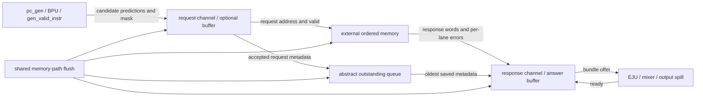

# fetch_mem_if black-box verification specification

Architecture review: 2026-10-15, branch `feat-verification`, source revision
`5fb6815`. Sections 1–22 preserve the architecture-phase specification and plans.
Section 23 records the subsequent native implementation and execution evidence;
[README.md](README.md) describes the installed commands. Production RTL,
configuration and existing pc_gen/EJU verification remain unchanged.

The 2026-10-19 transport update replaces the prediction-only FIFO with the
shared `completion_fifo` described in
[the memory integration notes](../../memory/tc_sram/MEMORY_BACKEND_INTEGRATION.md).
Request acceptance reserves metadata and result space; ordered memory responses
fill those entries independently of answer-spill readiness. The semantic model
and independent public-journal reconstruction now track pending, completed, and
answer-spill queues. Original architecture-phase findings below remain historical.

The pointer-only queue update adds FM-T41–FM-T44 to the existing directed
catalog: all completion slots occupied, full-credit recovery, mixed-state flush
with a returning response, reset of full/mixed queues, and repeated full-ring
reuse with distinguishable PCs, payloads, and faults. FV23 records these
interactions plus arriving-head bypass and concurrent older-result/response
handling. Expected values still come from semantic queues and public events,
without reading DUT pointers or storage.

## 1. Scope, evidence and verification policy

The future DUT is **production `fetch_mem_if` plus its actually instantiated request
spill, metadata FIFO/counters, and answer spill**. Observe only its public ports
and static elaboration constants. Do not instantiate pc_gen, BPU, gen_valid_instr,
EJU/RAS, memory emulator, mixer, issue, or the processor inside this standalone DUT.
Their contracts constrain independent environment stimulus; they are not oracles.

Use the existing evidence classifications:

| Class | Meaning in this document |
| --- | --- |
| A | Architectural requirement, such as preventing a canceled wrong-path fetch fault from becoming an architectural exception. |
| D | Explicit documentation or user-approved requirement. The task explicitly requires correct request-time metadata/error association; source comments explicitly require sufficient metadata capacity and ordered memory service. |
| I | Inferred producer/consumer contract or named proposed timing assumption; enabling it does not turn it into D. |
| O | Current RTL observation only; record as characterization unless independently justified. |
| Q | Missing specification decision, identified by FQxx. |

A requirement may have D functional intent but I timing prerequisites. Store both
in expected fields and diagnostics. An I-dependent mismatch is provisional until
its prerequisites are established. Do not call an O implementation detail golden,
classify an unknown value as passing, weaken exact checks after failure, or repair
expected queues using actual DUT outputs. Independently known checks remain active
after unrelated uncertainty. No new design policy is approved by this review.

Names `issue_*` on this DUT describe its **immediate output bundle**, before EJU,
mixer and the fetch output spill. They do not mean instruction issue/execution.
Similarly `instr_valid_i` is a **memory response**, whereas `instr_valid_o` is a
**memory request**. The two ready signals refer to opposite directions.

## 2. Active sources and inspected verification foundation

References are repository-relative, with inspected line locations. Sxx references
below refer to these active files, not unsupported `rtl-vm` variants or historical
configuration statements in older documentation.

| Ref | Source and relevant lines | Evidence supplied |
| --- | --- | --- |
| S01 | [fetch_mem_if.sv](../../../rtl/frontend/fetch_mem_if.sv), 12–45, 59–119, 125–165 | Actual ports, parameter, request record, ordered prediction FIFO, answer record and output wiring. |
| S02 | [fetch_stage.sv](../../../rtl/frontend/fetch_stage.sv), 15–19, 137–175, 180–205, 209–249, 259–282 | All immediate producers/consumers, shared memory flush, independent output-spill flush/readiness. |
| S03 | [gen_valid_instr.sv](../../../rtl/frontend/gen_valid_instr.sv), 11–64 | Starting-lane and first-hit-and-taken interval; N=1 special case. |
| S04 | [bpu.sv](../../../rtl/frontend/bpu.sv), 39–82; [btb.sv](../../../rtl/frontend/btb.sv), 39–106 | Per-lane PCs, independently produced hit/direction, targets; source-PC matching and resolution updates. |
| S05 | [spill_cell_flush.sv](../../../rtl/common/spill_cell_flush.sv), 18–47, 67–97; [spill_cell_flush_cu.sv](../../../rtl/common/spill_cell_flush_cu.sv), 59–109, 115–168 | Bypass behavior, two-record buffering, ready/valid timing, asynchronous reset and synchronous flush. |
| S06 | [fifo_nohs.sv](../../../rtl/common/fifo_nohs.sv), 15–21, 43–50, 63–93, 100–138; [modn_counter.sv](../../../rtl/common/modn_counter.sv), 15–42 | No full/empty handshake, overflow hazard, no empty-to-new-record fall-through, depth-specific widths. |
| S07 | [fetch_pkg.sv](../../../rtl/packages/fetch_pkg.sv), 49–73; [len5_pkg.sv](../../../rtl/packages/len5_pkg.sv), 21–37, 126–167; [len5_config_pkg.sv](../../../rtl/packages/len5_config_pkg.sv), 37, 49–57, 121–126 | Packed record widths, instruction union, exception codes, N and spill settings. |
| S08 | [memory_bare_emu.sv](../../memory/memory_bare_emu.sv), 17–38, 75–80, 147–208, 340–393, 426–429; [memory_class.svh](../../memory/memory_class.svh), 180–198, 226–251 | Real ordered memory, per-lane faults, buffering/latency, coordinated cancellation, sparse-memory behavior. |
| S09 | [tb_bare.sv](../../tb_bare.sv), 39–49, 266–281, 315–333; [datapath.sv](../../../rtl/datapath.sv), 1–21, 97–132, 191–197 | Request/grant aliases, actual memory configuration, external-memory flush wiring. |
| S10 | [pc_gen.sv](../../../rtl/frontend/pc_gen.sv), 82–110 | Ordinary fetch valid, memory-ready PC progression, redirect independence from memory readiness. |
| S11 | [early_jump_unit.sv](../../../rtl/frontend/early_jump_unit.sv), 155–197, 264–271; [instr_mixer.sv](../../../rtl/frontend/instr_mixer.sv), 18–61 | Early memory-flush completion, held offers, later mask shortening and lane compaction. |
| S12 | [issue_stage.sv](../../../rtl/expipe/issue-unit/issue_stage.sv), 206–225, 327–328, 548–559; [issue_queue.sv](../../../rtl/expipe/issue-unit/issue_queue.sv), 74–82, 118–123, 153 onward; [issue_cu.sv](../../../rtl/expipe/issue-unit/issue_cu.sv), 85–100, 161–173, 248–272 | Lane-mask qualification, fetch-fault priority, ROB exception metadata and frontend branch flush. |
| S13 | [backend.sv](../../../rtl/expipe/backend.sv), 233–246, 510–519, 590; [commit_decoder.sv](../../../rtl/expipe/commit-unit/commit_decoder.sv), 45–48; [commit_cu.sv](../../../rtl/expipe/commit-unit/commit_cu.sv), 225–255, 429–465; [commit_stage.sv](../../../rtl/expipe/commit-unit/commit_stage.sv), 373–410 | Exception recovery, delayed redirect, cause/PC/result-to-CSR paths. |
| S14 | [frontend.core](../../../rtl/frontend.core); [common.core](../../../rtl/common.core); [packages.core](../../../rtl/packages.core); [makefile](../../../makefile), 287–302, 377–420 | Active source organization and standalone build conventions. |
| S15 | [pc_gen README](../pc_gen/README.md), [pc_gen specification](../pc_gen/VERIFICATION.md), and its actual model/environment/driver/scoreboard/random/configuration/validator/regression/mutation/suite files | Existing reusable native framework, requirements and confidence policy. |
| S16 | [EJU README](../early_jump_unit/README.md), [EJU specification](../early_jump_unit/VERIFICATION.md), actual `early_jump_*.cpp/.hh`, wrapper/core/configuration and Python orchestration | Encoded words, per-lane prediction snapshots, saved-response stability, causal epochs, field checking and temporal checks. |
| S17 | [EJU architecture audit](../early_jump_unit/ARCHITECTURE_AUDIT.md), A3, C3, E2–E8; [recovery harness](../early_jump_unit/recovery/README.md) | Real recovery-window evidence; known coverage/reporting limitations to avoid inheriting. |
| S18 | [tb_macros.hh](../../verilator/tb_macros.hh), [tb_macros.cpp](../../verilator/tb_macros.cpp), [verilator-common.core](../../verilator/verilator-common.core) | Exact LEN5 logger/macros and verbosity. |

Actual local logs inspected include
`build/early-jump/validation/random-uao5qncn/all-full/console.log` and
`.../injected/console.log`: CONFIG, native startup, successful module summary,
injected mismatch with REQ/RSP/SCB history/replay, and failing module summary.
These are existing EJU evidence, **not fetch_mem_if test results**.

## 3. Purpose and transaction lifecycle

The block bridges independently produced fetch metadata and an ordered instruction
memory. It transports raw instructions; it does not decode jumps, execute branch
predictions, compute trap targets, inspect instruction legality, or detect memory
access permissions. Its essential responsibility is keeping one response's words,
exceptions, saved prediction records and saved lane mask together.



The external-memory flush connection is real integration wiring, **not an extra
fetch_mem_if output**. Within the future standalone environment it is a coordinated
environment action attached to the same generated flush event.

| Stage/event | What actually happened | What has not necessarily happened |
| --- | --- | --- |
| Fetch candidate offered | `fetch_valid_i=1`, predictions/mask available | No acceptance or memory obligation yet. |
| Fetch-side acceptance | `fetch_valid_i && fetch_ready_o` at an edge | With a buffered request path, memory may not yet have accepted it. |
| Memory request offered | `instr_valid_o=1`, `instr_addr_o` meaningful | No request obligation until memory ready/grant. |
| Memory request accepted | `instr_valid_o && instr_ready_i` at an edge | Response has not necessarily arrived; save this request's metadata now. |
| Response offered | `instr_valid_i=1`, words/error vector offered | Response may be held because answer capacity is unavailable. |
| Response accepted | `instr_valid_i && instr_ready_o` at an edge | Pop one outstanding association; buffer words+saved metadata+errors together. Downstream consumption may be later. |
| Bundle offered | `issue_valid_o=1`, complete saved record visible | Consumer may be stalled. |
| Bundle consumed | `issue_valid_o && issue_ready_i` at an edge, subject to flush-consumer window | One bundle leaves this DUT, not N independent transactions. |
| Logical cancellation | Reset/recovery invalidates pending records | A generic physical memory is not thereby proven canceled. This integration explicitly flushes its emulator too. |

With the selected request bypass, fetch acceptance and memory acceptance coincide
on ordinary non-flush edges. With the selected registered answer path, response
acceptance and presentation of that new bundle do **not** occur in the same
pre-edge sample. An older output can be consumed on the response-acceptance edge.

## 4. Configuration and narrow DUT boundary

| Item | Current source selection | Verification consequence |
| --- | --- | --- |
| `LEN5_MULTIPLE_ISSUES` | 4, `len5_config_pkg.sv:37` | N=4, B=16 bytes. Future source-aware support for 1/2/4/8; no sweep or alternate width selector. |
| ILEN / XLEN / ALEN | 32 / 64 / 64, S07 | Four-byte instruction words, full-width PC/target transport. |
| C / A extensions | Disabled, S07 | No compressed-lane model or translation/atomic protocol is implied. |
| `FETCH_REQ_SPILL_SKIP` | 1, config line125 | Combinational request bypass. |
| `FETCH_ANS_SPILL_SKIP` | 0, config line126 | Two-record registered answer capacity. The nearby “directly passed” comment is inconsistent with SKIP=0; use the cell's actual parameter semantics. |
| `MAX_MEM_OUTSTANDING_REQUESTS` | Module default 2, S01:13–14 | Metadata association capacity D=2; this is not request admission logic. |
| Active parent depth | Datapath defaults to `len5_config_pkg::FETCH_MEMIF_FIFO_DEPTH` (8); standalone `fetch_stage` defaults to 2. | Bare testbench uses the CPU configuration; standalone verification explicitly selects depth 2. |
| Memory emulator | PIPE_NUM=0; instruction answer spill enabled | At least a registered response, capacity2; source order preserved. |

Do not hardcode N=4, masks=0xf, or a two-bit lane index in C++. N=1 has no partial
instruction-aligned bundle or two-lane prediction cross; use mathematical indices
and ordinary C++ integers. `fetch_mem_if` itself has no N-dependent zero-width lane
index, unlike some surrounding logic. This is source inspection, not evidence that
all configurations compiled. Only the currently selected N is to be built later.

The future adapter must expose static N, ILEN/XLEN, exception-code width, both SKIP
settings and actual metadata depth. Parse production constants/defaults and parent
bindings, verify them against elaboration, and fingerprint every compiled dependency.
No BOOT_PC parameter exists on this DUT. Bundle/request PCs are input metadata.

Other metadata depths are a separate parameter question FQ08: depth1 uses
`[$clog2(DEPTH)-1:0]` ranges in S06; depth0 bypasses metadata storage entirely.
Neither is automatically a supported delayed-memory configuration. Positive
depths above2 must be matched by a justified memory-capacity contract, not guessed
from “maximum” in the parameter name. Do not modify source configuration to explore
them in this phase.

## 5. Complete public-port inventory and connectivity

N=`LEN5_MULTIPLE_ISSUES`; W=XLEN=64; E=`EXCEPT_TYPE_LEN`=5;
P=`prediction_t`=2W+2=130 bits. Packed order is `.pc`, `.hit`, `.target`, `.taken`
(S07). `instr_t` is a 32-bit packed union; transport/check `.raw`.

| Port | Direction / width | Actual immediate producer/consumer | Meaning and validity |
| --- | --- | --- | --- |
| `clk_i` | input1 | System/fetch clock | Rising-edge consumption; no clock enable. |
| `rst_ni` | input1 | System reset | Active-low asynchronous storage reset; see reset qualifications below. |
| `flush_i` | input1 | `fetch_stage.flush_i OR early_jump_mem_flush_o` | Synchronous cancellation of this memory path; no reason, age or ID. |
| `fetch_valid_i` | input1 | `pc_gen.valid_o` | Fetch candidate offered. |
| `fetch_ready_o` | output1 | `pc_gen.mem_ready_i` | Request-side admission; current bypass equals memory request readiness. |
| `fetch_pred_i[N]` | input N×P | `bpu.pred_o` (`curr_pred`) | Full per-lane records; `.pc` is meaningful even on a miss. Lane0 PC supplies memory address. |
| `valid_instr_i[N]` | input N bits | `gen_valid_instr.valid_o` | Request-time eligible physical lanes; not bundle valid and not prediction hit. |
| `valid_instr_o[N]` | output N bits | EJU `valid_instr_i` | Saved mask for currently offered answer. No new mask calculation here. |
| `issue_valid_o` | output1 | EJU `instr_valid_i` and fetch output spill `valid_i` | Complete answer bundle offered; not instruction execution. |
| `issue_ready_i` | input1 | Fetch output spill `ready_o` (`spill_ready`) | Can consume this bundle after EJU/mixer. Not directly backend ready. |
| `issue_instr_o[N]` | output N×32 | EJU and mixer | Returned words in physical-lane order before compaction. |
| `issue_pred_o[N]` | output N×P | EJU `mem_if_pred_i` | This answer's saved request metadata, not current BPU state. |
| `issue_except_raised_o[N]` | output N bits | Mixer `except_raised_i` | Per-lane response error flags; meaningful for a live offered answer. |
| `issue_except_code_o[N]` | output N×E | Mixer `except_code_i` | Per-lane causes, meaningful architecturally when that lane is live and its flag is1. |
| `instr_valid_o` | output1 | Datapath `instr_req_o`, memory `instr_valid_i` | Memory read request offered. |
| `instr_ready_i` | input1 | Datapath `instr_gnt_i`, memory `instr_ready_o` | Request readiness/grant. Not response readiness. |
| `instr_addr_o` | output W | Memory `instr_addr_i` | Request address from accepted/offered request's lane0 PC. No independent PC input. |
| `instr_we_o` | output1 | Datapath `instr_we_o`; unconnected in tb_bare | Always0: instruction requests are reads. |
| `instr_valid_i` | input1 | Datapath `instr_rvalid_i`, memory `instr_valid_o` | Response bundle offered. |
| `instr_ready_o` | output1 | Datapath `instr_rready_o`, memory `instr_ready_i` | Capacity to accept one response, independent of whether a request exists. |
| `instr_rdata_i[N]` | input N×32 | Memory `instr_rdata_o` | Response words for the oldest outstanding physical request. |
| `instr_except_raised_i[N]` | input N bits | Memory `instr_except_raised_o` | Error flags accompanying those response words. |
| `instr_except_code_i[N]` | input N×E | Memory `instr_except_code_o` | Matching per-lane causes. There is no separate bus-error qualifier. |

All synchronous controls/payloads must be settled around the consuming edge.
Required held-response payload stability covers words, saved PCs/predictions/mask,
and meaningful exception fields. It lasts until acceptance or cancellation.
Inactive/unqualified buses are not required to read zero (FQ07).

Special request-side stability rule: while an **unaccepted** bypassed request is
stalled, current BPU hit/taken/target and hence the mask may change (pc_gen Q8).
Capture the metadata at the accepting edge. Do not import EJU's held-*response*
stability requirement onto these current BPU outputs. Ordinary held memory
addresses stay fixed; redirect-driven withdrawal/address changes require FQ01's
explicit cancellation contract. Once accepted, all saved metadata is immutable
even while current BPU inputs change.

Reset empties registered request/answer storage and associations asynchronously
(S05/S06). A bypassed path ignores reset/flush combinationally: do not assert that
`instr_valid_o` or `fetch_ready_o` must become0 regardless of their inputs. In the
integrated reset pc_gen supplies fetch_valid=0 and the memory's spill readiness
is0. Registered answer valid resets0. Exact release readiness is I/FQ05.

Flush clears registered queues at its edge; it need not zero data buses or
combinationally suppress an already offered answer. Output meanings on that edge
depend on the consumer window in §10, not a fictitious universal valid-low rule.

## 6. Memory protocol and outstanding-request contract

### 6.1 Independent channels

For an ordinary live edge, define:

```text
F = fetch_valid_i && expected_fetch_ready
K = expected_instr_valid && instr_ready_i           # memory accepts request
R = instr_valid_i && expected_instr_ready           # DUT accepts response
D = expected_issue_valid && issue_ready_i           # immediate consumer accepts
```

These are oracle events using independently expected output qualifiers. Also
record **actual** public handshakes separately; they never repair the oracle.
`instr_gnt` at datapath is simply the request-channel alias in S09, not a third
acknowledgment phase. There is no address request ID, response ID, response address,
retry, response error acknowledgment, per-lane ready, cache line tag or burst-last.
One response completes one accepted bundle request, whether clean or faulting.

Memory may assert request-ready without a request and response-ready may be high
without any outstanding request. Neither counts as a transaction. Response valid
without a prior accepted request is a producer violation, not an idle event.

### 6.2 Ordering, latency and capacity

Maintain an independent FIFO of accepted memory requests awaiting response
**acceptance**, not awaiting eventual issue. Associate R with the oldest prior
entry. K appends after old-head association when K and R coincide. A response to
an earlier request is legal without any concurrent K. Simultaneous K/R for
different requests is ordinary pipelining.

S01:79–85 explicitly documents in-order service and enough metadata slots for all
pending requests (D). The actual emulator preserves order by its shared pipeline
advance and answer spill (I, S08). Out-of-order response data cannot be associated
at this boundary; no ID can repair it. Distinguishable instruction payloads are
necessary to detect swaps, since two equal responses can hide misassociation.

For q outstanding metadata records, require on normal edges:

```text
R implies q > 0                       # positive-latency profile
q_next = q + K - R
0 <= q_next <= D_metadata
```

A capacity-preserving full-queue K+R can be tested under an explicitly capable
memory schedule; it is not an overflow merely because q was full before the edge.
The current emulator, when physically full, deasserts grant until a slot is freed;
do not manufacture that full-state grant in its exact architectural profile.

Crucially, fetch_mem_if does **not** inspect FIFO-full/empty to throttle either
channel. `fifo_nohs` deliberately lacks such ports, can overwrite on overflow,
and its only full assertion is disabled under Verilator (S06:131–138).
The environment must enforce the advertised physical-memory capacity. A generous
memory accepting unlimited requests is an invalid environment here, not proof of
a missing internal grant gate. Answer-buffered records no longer occupy metadata
slots; downstream stalls can accumulate answer records plus outstanding requests.

Zero-latency empty-queue K+R is **not established**. With depth>0 S06 has no bypass
from a newly accepted request to the current empty FIFO output. The package comment
about zero-latency memory requires a fetch spill but does not settle metadata
association. Default architectural latency is at least one edge; empty-queue
same-edge completion is characterization/FQ03, never silently given a golden
“use current predictions” rule. A combinational response offered before a request
accepting edge is also outside the default protocol.

## 7. Request-time prediction, mask and lane association

For an instruction-aligned logical start address p, independently construct:

```text
B = 4*N
base = floor(p/B)*B
start = (p-base)/4
lane_pc(k) = base + 4*k modulo 2^XLEN
cutoff = first k >= start for which hit[k] && taken[k], otherwise N-1
mask[k] = (start <= k <= cutoff)
```

For N>1, **memory request address is lane_pc(0)=base**, even when the start lane
is nonzero. The start is represented by the valid mask, not by sending p directly
on `instr_addr_o`. For N=1 the BPU provides p itself. This follows S03/S04/S01:155;
it must be tested explicitly to avoid copying a misleading request-PC assumption
from a different module's environment. Physical memory returns the whole aligned
bundle; leading and trailing unused words remain electrically present.

| Request-time situation | Producer mask consequence (I) | fetch_mem_if obligation (D transport) |
| --- | --- | --- |
| All hits0, directions arbitrary | All lanes from start through N-1 | Save exact miss/direction distinction and PCs. |
| hit1/taken0 at an eligible lane | Does not shorten interval | Preserve valid not-taken record; do not turn it into a miss. |
| hit0/taken1 | Does not shorten interval | Preserve the raw direction; do not qualify it as taken here. |
| First eligible hit1/taken1 at j | Include j; exclude all younger lanes | Preserve mask and all per-lane records; do not choose another prediction. |
| Several NT before a T | Earlier NT lanes and T are included | Preserve their individual targets and directions. |
| Multiple raw T predictions | Earliest eligible T limits the mask | Later records may still exist; only mask determines eligibility. |
| T before start | Ignored by producer cutoff | Transport its raw record too; never restore it as a valid lane. |
| BPU changes while request waits for grant | New metadata can be sampled at grant | Snapshot the accepting edge, not initial offer. |
| BPU changes after K or while older response stalls | No change to saved record | Returned A must not inherit B/current metadata. |
| Several accepted requests, different masks/targets | Each has its own snapshot | Order A/B/C associations through delay and backpressure. |
| Holes/zero mask/incoherent PCs | Not normal gen_valid_instr history | Stress raw transport where defined; no invented mask repair. |

The DUT does not call gen_valid_instr, rebase lane PCs, compact words, check that
predictions describe real branches, or recompute masks when instructions return.
Prediction correctness and EJU selection are outside this oracle. Ordinary/JAL/
JALR/branch/raw words are payload patterns that **must all transport identically**.
The approved x1-only RAS policy has no effect on this module's correctness.

## 8. Buffering, stalls and externally visible timing

For current settings, request transport is combinational; answers are a two-entry
elastic queue with no combinational empty-to-output forwarding (S05/I).
Use abstract queues, not spill states, A/B selection or FIFO pointer algorithms.

| Abstract answer state before edge | Expected output / response admission under current cell contract (I) |
| --- | --- |
| Empty, released | issue_valid=0; instr_ready=1 absent flush. An R becomes an offered bundle after the edge. |
| One record | issue_valid=1 with old head; instr_ready=1 absent flush. R and/or D can occur independently. |
| Two records | issue_valid=1 with oldest head; instr_ready=0 even if issue_ready=1 this cycle. D frees capacity; response-ready rises next cycle. |
| Reset/release interval | Registered output invalid. Initial ready-low interval is observed, not newly approved (FQ05). |
| Flush interval | Response-ready=0 in the registered answer path; old issue_valid may remain1 until edge. See §10 for consumption. |

That conservative full-state ready is an I cell timing contract, not a universal
ready/valid requirement. Do not build lookahead acceptance into the model simply
because it would improve throughput. Neither should exact cell timing become D
merely because the present controller implements it.

When downstream stalls, one additional response can enter an available answer
slot. Once full, memory must hold its response; later the memory's own capacity
fills and request grant falls, propagating backpressure to pc_gen. With the active
memory capacity2, at most two unreturned requests plus two returned answer records
can be retained (plus no request-buffer records in bypass mode). Do not call all
four “metadata FIFO occupancy.” Queued frontend request offers are not outstanding
memory requests until memory K.

An offered downstream record's words, saved prediction fields, mask and meaningful
exception metadata remain stable through a noncanceling stall. Response data can
change on the same edge that D consumes the old head. Check independent pre-edge
and post-edge snapshots; do not compare a just-consumed record against the new head.

If source configuration later enables request buffering or answer bypass, the
same transaction records remain valid but timing/admission contracts change.
Request buffering decouples F from K; answer bypass may allow R and D for the
same record. Parse the active switches, reject an unsupported profile clearly,
and document support limitations instead of assuming current timing universally.

## 9. Memory exceptions: detection, transport and downstream meaning

### 9.1 Actual error representation

There is **one flag and one 5-bit cause per instruction lane**, not a scalar bus
error for the entire response. S08 loops over physical bundle lanes, calls ReadW,
then records per-lane results with the returned words. A bundle may contain a
mixture of successful and faulting lanes. A bundle-wide failure can be represented
by flags on every affected lane; do not invent broadcasting inside fetch_mem_if.

| Category | Real source / code | Scope of the future check |
| --- | --- | --- |
| Instruction address misalignment | ReadW returns1; memory emits `E_I_ADDR_MISALIGNED`=0 | Transport a supplied lane flag+cause exactly. The DUT does not generate the fault. N>1 emulator lane reconstruction aligns addresses; actual misaligned-target diagnosis has separate producer limits FQ09. |
| Instruction access fault | ReadW returns2 for sparse/uninitialized memory status; `E_I_ACCESS_FAULT`=1 | Associate this lane error with the correct saved request PC and response; no permission checker is instantiated. |
| Unknown memory status | Emulator default maps to `E_UNKNOWN`=31 | Stress/characterization unless a producer history establishes it. Still verify defined transport. |
| Instruction page fault | Code12 exists in common enum | No active bare-metal translation/page-fault producer found. Not an architectural fault-generation goal. Optional encoded-code transport stress only. |
| Separate bus error, timeout/retry, response poison | No dedicated pins | No invented event/encoding; decision required if a future memory maps these to an existing cause. |
| Load/store faults or illegal instructions | Other common codes/other modules | Do not generate these as normal instruction-memory faults or require decoding here. Raw cause transport can be labeled stress. |

Sparse-memory emulation is not a golden fault detector: ReadW's loop returns its
last byte-read status (S08 memory_class:238–251). Partially initialized words may
therefore have surprising emulator status. The independent memory environment
must define its own initialized-address/fault map and supply explicit response
flags; do not reproduce this unrelated implementation detail.

### 9.2 Association, buffering and qualification

On R, capture the response's N words and N flag/cause pairs with the oldest saved
prediction/mask record. A fault completes/dequeues **one whole request**, exactly
as a clean response does; it is not an additional response or a separate FIFO pop.
The fault vector must remain attached while buffered and stalled. A clean B after
faulting A must not retain A's flag, cause qualification, PC or lane position.
Likewise later current BPU metadata cannot change the faulting PC saved for A.

The port has **no response address, mtval, fault address payload or exception ID**.
The only PC identity available downstream is saved `issue_pred_o[k].pc`. Require
that saved PC/error/data association exactly; do not invent a separate fault-address
output. The independent memory ledger retains request identity and lane addresses
for diagnostics. Different requests to the same address remain different IDs.

For a live answer, compare the full mask and saved record identity. For an eligible
lane compare flag exactly, and compare cause when flag=1. Faulting instruction
bits are architecturally unusable; supplied bits can still be checked under the
separate I raw-transport contract. A clear flag makes cause architecturally
don't-care, not “must equal zero.” Inactive-lane payload/causes similarly have no
architectural consumption requirement, but full-record bit preservation is a useful
explicit transport-profile check (FQ07). Do not let that distinction hide an error
flag leaking into a later eligible lane.

### 9.3 Path to architectural exception, outside the DUT

S02 routes memory exception outputs **past EJU**, whose public interface has no
exception input, into instr_mixer. Mixer shifts words, prediction PCs and exception
fields together (S11). Fetch output spill then holds the combined record. Issue
queue allocates qualified lanes; issue prioritizes an already-raised fetch exception
over decoder exception code, produces a ready exceptional ROB record and stalls
normal younger issue (S12). Commit's decoder prioritizes its exception flag; commit
saves instruction PC to mepc and cause to mcause before redirection (S13).

Commit's mtval path selects `res_value` for access/misalignment errors, whereas
fetch_mem_if supplies no dedicated fault-address value. Issue constructs exception
results from its ordinary operand/immediate path (S12:548–558). This review does
**not** establish correct fetch-fault mtval generation. FQ10 assigns that to
issue/commit producer verification. A standalone transport pass proves neither
CSR values nor precise retirement, and must not fix those modules.

### 9.4 Canceled faults

A canceled wrong-path response must not become a live architectural exception
(A and explicit task requirement). In the current integrated memory protocol,
flush clears the memory's outstanding valid entries too; no old fault response
may be delivered as a new-epoch response after that flush edge (I).

fetch_mem_if alone has no stale-response ID/filter. Under a generic noncancelable
memory, late clean **and** faulting responses can be paired with missing or new
metadata. Such a memory is outside the current cancellation contract (FQ04).
Characterize the risk explicitly; never claim stale rejection from a successful
run whose environment simply removed all old responses. A canceled fault offered
on the flush edge is not accepted into the registered answer path because its
response-ready is0; its later physical disappearance depends on memory cancellation.

## 10. Flush, recovery and reset semantics

### 10.1 Sources and consumer windows

| Environment reason | Actual routing | What survives / what is canceled at this boundary |
| --- | --- | --- |
| Early correction completion | EJU `mem_flush_o` → fetch_mem_if F and datapath memory flush; **not** fetch output-spill flush | Current oldest answer may be consumed into output spill on this same edge. Remaining answers, pending metadata, request-buffer contents and external memory work are canceled. |
| Branch misprediction recovery | Issue CU frontend misprediction flush → datapath/fetch F → this F, EJU and output-spill F; also external memory flush | Output spill withdraws ready; old answer is not consumed normally. All pending memory-path records canceled. pc_gen recovery is separate. |
| Commit exception recovery | Backend exception flush → same fetch/memory paths, plus BPU flush | Same memory-path cancellation; trap redirect occurs later. No exception reason enters this DUT. |
| Reset | Shared rst_ni | Async storage/association invalidation; environment also resets memory obligations. Bypass qualifiers retain their input-defined behavior. |

No fetch_mem_if pin distinguishes these reasons. Classify them in environment
metadata using the **generated history**, never by inferring reason from DUT
outputs. Branch/exception port episodes with identical inputs are indistinguishable
to this DUT. Do not demand age-selective retention: the only command is global F.

An early flush **must not discard the current consumed correction instruction**
from the oracle's completed ledger. S02/S11 intentionally let the old head be
transferred while this DUT is being flushed. Branch/exception flush instead makes
issue_ready_i=0 through the separate output spill. Generic raw F+issue_ready=1 is
stress unless an early-completion history justifies it (FQ06).

### 10.2 Edge priority and physical cancellation

Reset dominates registered state. At a flush edge all still-pending internal
request/association/answer records are canceled; no response or new request
metadata is retained through it. A meaningful already-offered old head can be
compared and counted as consumed in the early-completion window **before** pending
records are canceled. Do not require all output-valids to go low before the edge.
The registered answer channel drives response-ready low during flush; the bypass
request channel does not itself suppress request-valid or fetch-ready.

The actual memory's registered request-ready is low on its flush interval (S05,
S08), preventing K even when pc_gen's request valid remains high. Its pending
response-valid can remain high before the flush edge but is cleared at that edge.
Afterward it can accept new work; there is no cancel acknowledgment. With shared
reset/flush and registered memory, this is a coherent atomic-cancellation contract.

Raw F+request-ready=1 can produce an electrical K while metadata is cleared.
Do not silently regard that new request as tracked or live. It requires an agreed
same-edge external cancellation/admission rule (FQ02). Raw F+R with the current
registered answer profile is a DUT-ready failure if observed; a response *offer*
on F is allowed and is different from R.

### 10.3 Recovery window identified by the EJU audit

S17 E5 observed qualified commits of unexpected stream NOPs after exception flush
and before/around handler execution. Source inspection explains why this memory
path can contribute: F clears old work once, but it does not latch a “wait for trap
PC” condition. Request bypass resumes with whatever new fetch metadata is offered;
pc_gen has no frontend-flush input and suppresses ordinary requests only during
its later commit/branch redirect-valid interval (S10). COMMIT_EXCEPT and
EXCEPT_LOAD_PC are separated by CSR handling (S13).

The standalone requirement is cancellation of **pre-flush** work, not guessing
that every post-flush request is the correct trap epoch. The environment can tag
generated post-flush candidates for integration diagnostics, but cannot invent a
DUT recovery-done pin or stall them solely to make the full-core concern disappear.
FQ12 remains integration work. This phase neither proves its cause is fetch_mem_if
nor reproduces/fixes the full-core problem.

## 11. Complete discovered external event catalog

Event notation below is semantic, not a request for extra DUT pins. K/R/D/F are
defined in §6; use Z for reset and X for flush to avoid confusing fetch-side F
acceptance with the flush input. Unless noted, events consume on a rising edge,
can overlap independent channels, are subordinate to reset/cancellation, and
meaningful offered payload is held until accepted/canceled. Synchronous input
timing is stable around the edge; simulation cannot prove physical setup/hold.

| Event | Source / public representation | Preconditions, acceptance and stability | Abstract effect / externally visible consequence |
| --- | --- | --- | --- |
| Z: reset assert/hold | System, rst_ni=0 | Async at any clock phase; may interrupt stalls/traffic | Cancel all pending model obligations under coordinated memory reset; registered answer invalid; bypass fields remain input-defined. |
| U: reset release | System, rst_ni rises | No old response/offer resumes as live; FQ05 release timing | Start new epoch; eventually admit first request/response under declared release profile. |
| I: idle | fetch_valid=0, response_valid=0, no buffered head | Readiness may be either value; inactive payload may vary | No transaction; no invented queue change. |
| OQ: fetch offer | pc_gen/BPU/mask, fetch_valid=1 | Valid coherent candidate; accepted only on F | Candidate can wait for memory; request-time BPU metadata can refresh before acceptance. |
| AQ: fetch-side acceptance | OQ with fetch_ready=1 | Once per accepted candidate; bypass F=K | Append optional request-stage obligation; current bypass immediately supplies K. |
| SQ/LQ: request stall/release | Memory grant0/1 with request offered | Address stable for ordinary wait; BPU fields may update; redirect exception FQ01 | No outstanding entry before K; on release snapshot final accepted metadata. |
| K: memory grant/acceptance | instr_ready_i && instr_valid_o | Offered request, independent capacity available; no flush unless explicitly characterized | Append one immutable prediction/mask/address record; creates one ordered response obligation. |
| MD: current metadata update | BPU/gen_valid inputs change | Before K or for later requests; not mutation of accepted record | No change to any older queued metadata; current bypass outputs reflect current request. |
| PM/PN/PT: prediction states | Per-lane hit/taken 00/01,10,11 | Mask qualification uses hit&&taken, not taken alone; all four raw pairs retained | Payload classes; multiple records transported together, no independent lane handshake. |
| MP: multiple raw predictions | BPU per-lane vector | Coherent start/first-T mask architecturally | Save all records; coverage separates eligible and masked predictions. |
| W: response latency gap | Memory response_valid=0 with outstanding work | Oldest request retained; randomized finite delay | q unchanged absent new K; no spontaneous answer. |
| OR: response offer | Memory instr_valid_i=1 | Oldest prior physical request; words/flags/meaningful causes stable through stall | Presented response is not completed until R. |
| R0: clean response acceptance | OR && instr_ready_o, all relevant error flags0 | Existing oldest association; capacity in answer stage | Remove one outstanding entry; append one clean combined answer; no inherited prior error. |
| RE: fault response acceptance | OR && instr_ready_o, one/more flags1 | Same request qualification as R0; per-lane codes supplied with words | Same one-request completion; append errors with their original PCs/mask. |
| SR/LR: response stall/release | OR with instr_ready_o=0/1 | Memory holds the same response; requests may independently proceed until memory capacity fills | No pop during SR; exactly one pop at LR/R. Faults hold just like clean data. |
| OA: downstream bundle offer | issue_valid_o=1 | Model has a combined answer (or enabled bypass profile) | All known live fields compare before edge; no consumption if issue_ready=0. |
| D: downstream acceptance | OA && issue_ready_i | Once per answer; early-flush old-head exception in §10 | Complete transport obligation; record full request-to-consumer witness. |
| SD/LD: downstream stall/release | issue_ready_i=0/1 with OA | Output spill controls ready; memory responses may still use spare answer slot | Hold offered answer exactly; release consumes old head before changing observed head. |
| QE/QM/QF: queue boundaries | No dedicated pins; derived from independent accepted histories | q=0, intermediate, D_metadata; answer size0/1/2 | Exercise admission constraints and next visible transitions; never read internal occupancy. |
| XE: early memory flush | EJU completion projected onto flush_i | Old answer consumed and issue_ready=1 in coherent episode; external memory canceled too | Preserve completed old head; cancel remaining request/response obligations and advance epoch. |
| XB: branch recovery flush | Issue CU frontend recovery projected onto flush_i | Output-spill ready0; physical memory cancellation | Cancel all pending memory-path records; no automatic address redirect inside DUT. |
| XX: exception recovery flush | Commit/backend projected onto same flush_i | Same memory cancellation; actual trap PC command is separate | Same local cancellation; new fetch offers after X are not held off internally. |
| XP: flush pulse/hold/repeat | Same flush_i held or consecutive | Reason/memory cancellation tracked separately; no new live work during supported X | Repeated clearing; no later reappearance of old metadata/data/faults. |
| ER: epoch restart | New OQ/K after reset/flush | External memory has discarded old obligations; no stale physical completion | New identity even at repeated address; new responses use only new metadata. |
| LS: late stale response | Generic/noncancelable memory instr_valid_i after X | Violates current atomic-cancel memory profile; no identification bits | Characterize association risk; do not silently accept as new response or claim correct stale filtering. |
| UR: unsolicited/duplicate response | Memory instr_valid_i with no pending obligation or already completed ID | Invalid architectural history; phase/zero-latency alternatives explicit | Environment-negative rejection; raw characterization may make association unknown. |
| NQ/NR: inactive input noise | fetch_valid=0 or instr_valid_i=0 | May vary all irrelevant payloads; active held response cannot mutate | No new request/response/exception effect. Always-readonly invariant still applies. |
| CP: stopped-clock/probe | Test driver changes inputs without rising edge | Async reset can act; other accepted histories cannot advance | Check combinational bypass/control and registered stability; falling-edge checks separate. |

Every cancellation event invalidates pending fault obligations with its data and
metadata. Every accepted clean/fault response creates one buffered record, never
one record per raised flag. Outstanding and buffered records require prior state;
SQ, idle-ready, metadata changes and reset do not. Response/answer valid is not
just another free randomized bit in architectural traffic.

## 12. Interaction matrix and reachability

### 12.1 Normal consuming-edge matrix

For Z=0, X=0, current bypass request/registered answer profile, let q be outstanding
count and a be pre-edge buffered answer count. D consumes an **old** answer; R
cannot consume the newly pushed request when q=0. R needs a<2; D needs a>0.
K requires memory-grant capacity and q+K-R<=D_metadata. These constraints define
the legal denominator, rather than raw combinations of unrelated pin bits.

| Row | K R D | Required prior state | Expected independent transaction effect | Classification |
| --- | --- | --- | --- | --- |
| M0 | 0 0 0 | Any valid occupancy | Hold all records; held offers stay stable | Architectural, including idle and long stalls. |
| M1 | 0 0 1 | a>0 | Consume old answer only | Architectural. |
| M2 | 0 1 0 | q>0, a<2 | Move oldest outstanding record plus response into answer queue | Architectural, clean or faulting. |
| M3 | 0 1 1 | q>0, a=1 | Consume old answer, replace with separately associated response | Architectural; do not compare R's payload against D's old head. |
| M4 | 1 0 0 | Memory capacity, q<D_metadata | Append accepted request snapshot | Architectural. |
| M5 | 1 0 1 | a>0, memory capacity, q<D_metadata | Append request; consume old answer | Architectural. |
| M6 | 1 1 0 | q>0, a<2, grant capacity | Associate old head; append new request; buffer old response | Architectural, with nonfull exact-emulator grant; full q simultaneous turnover is interface stress unless separately justified. |
| M7 | 1 1 1 | q>0, a=1, grant capacity | Three distinct lifecycle actions, potentially three IDs | Architectural; distinct IDs/data/metadata mandatory for diagnostic case. |

Cross M0–M7 with clean/error offers, request/response valid held while unready,
prediction states and masks. “Error offer without R” never pops metadata; “response
valid without K this cycle” is normal whenever q>0. a=2 with downstream D has R=0
under current I no-lookahead timing; next-cycle release is a required temporal bin.

### 12.2 Reset/flush priority and offer overlaps

| Overlap | Expected state/output contract | Integrated classification |
| --- | --- | --- |
| Z + any request/response/consumer/flush | Reset invalidates registered histories; no carry-over. Do not demand bypass-valid0 for raw asserted fetch_valid. | Reset interrupting real work architectural; incoherent active producers during shared reset stress/characterization. |
| U + new request | First admission per release profile; no previous epoch response | Architectural once memory ready; immediate raw release overlap FQ05 characterization. |
| X + response offered, ready_o=0 | No R; memory drops old offered response at flush edge, including faults | Architectural. |
| X + outstanding/answer records, issue_ready=0 | Cancel pending queues; output-valid/payload may still describe old head before edge | Branch/exception architectural; exact unconsumed payload is not an architectural requirement. |
| X + old answer + issue_ready=1 | Compare/consume permitted old head, then clear remaining work | Architectural for causal XE; otherwise interface stress/FQ06. |
| X + fetch offer + memory ready0 | No K even if instr_valid_o=1; pending records canceled | Architectural current memory. |
| X + request-ready1 + request-valid1 | Electrical K possible through bypass, metadata reset; retained physical obligation unspecified | Characterization FQ02 unless an explicit memory “cancel at this edge” protocol is selected. Not required architecture coverage. |
| X + actual R=1 | Inconsistent with current registered answer-ready0 | Detect wrong ready under I timing; bypass variants need a separate contract. |
| X + faulting output held | Cancel if unconsumed; permitted consumed head retains its original error, not arbitrary suppression | Architectural using reason/consumer window; no global “erase all error flags combinationally” rule. |
| XE + XB/XX | Only one electrical X; branch/exception output spill withdraws ready | Architectural with simultaneous causal controls if justified; cause-priority is upstream, not a new fetch_mem_if arbiter. |
| Consecutive X / X then Z | Empty pending history stays canceled; no resurrection | Architectural for justified recovery/reset, otherwise interface stress. |
| First request after X + old physical response | No way to identify old response at DUT ports | Invalid current memory contract; explicit stale-response characterization FQ04. |

### 12.3 Protocol-invalid and artificial refinements

| History/overlap | Classification and reason | What remains checkable |
| --- | --- | --- |
| q=0, K=0, response-valid1 | Malformed: no response obligation | Read-only invariant, known ready timing; association unknown, environment error reported. |
| q=0, K=R=1 | Zero-latency alternate protocol, FQ03 | Characterization; do not use present request metadata as a fabricated golden head. |
| q=D_metadata, K=1, R=0 | Capacity violation by memory grant schedule | Reject architectural environment; characterize overwrite risk, never “expected overwrite” golden behavior. |
| Memory responds B before A | Violates documented ordered service/no IDs | Environment-negative error; ordering/data mismatch remains visible in explicit stress. |
| Same response ID completes twice / disappears without cancellation | Invalid reliability history | Conservation/liveness obligation failure; do not make queues agree by removing records. |
| Memory changes held meaningful response fields | Producer protocol violation | Environment rejection; characterize; no invented DUT requirement to preserve a transaction that changed before acceptance. |
| Current BPU changes while unaccepted fetch stalled | Supported pc_gen/BPU interaction | Accepted-edge metadata snapshot and old-record independence are exact. |
| Saved response metadata changes while downstream stalled | DUT output stability violation, absent cancellation | Exact known-field mismatch; cannot excuse it as current BPU update. |
| Holey/zero validity mask, arbitrary predictions on ordinary words | Public transport stress; not coherent gen_valid_instr architectural mask | Exact saved-bit transport under I raw-record contract; no decoding or repair. |
| All lanes/one lane/masked lane has error | Supported per-lane representation; masked-lane errors can arise from whole-bundle reads | Preserve mask/flags; only retained lanes can become architectural faults downstream. |
| Any enum code with raised0 | Cause unqualified | Don't-care architecturally; optional I raw-bit checks, not fake error-type coverage. |
| Unsupported/page/LD/ST cause with raised1 | Cause transport stress/characterization; no active corresponding instruction-memory producer | Defined lane association remains exact; don't claim fault detection. |

For a complete executable matrix later, enumerate offered fetch valid, memory grant,
response valid and downstream ready over abstract q/a/request-buffer states, then
derive feasible K/R/D rows with the declared timing/flush profile. This covers all
meaningful simultaneous handshakes without claiming every raw combination is
architecturally reachable. Publish excluded rows with the predicate that excludes
them; do not hardcode pc_gen's 20/48-row or EJU's 12/18-row denominators.

## 13. Independent black-box reference-model design

### 13.1 State and records

The model receives public **Inputs + Config + named contract policies**, never
an Outputs object or Verilator handle. Maintain these logical structures:

1. Optional accepted-but-not-yet-granted fetch records when request buffering is
   enabled. Empty/absent in current bypass profile.
2. Ordered outstanding-memory request queue Q.
3. Ordered completed-response/answer queue A.
4. Epoch, independent transaction counter, initialization/release status and
   independent knowledge/confidence for each queue/field.
5. A temporal obligation ledger recording each accepted request through response,
   output delivery or justified cancellation, with acceptance/availability cycles.

Request record: independent ID, epoch, generated logical start p, expected wire
address, all N saved predictions, exact saved mask, fetch/memory acceptance cycles,
memory latency policy, live/canceled state, provenance and known status.
Response record: original request ID, N supplied words/flags/causes, response offer
and acceptance cycles, saved request metadata, delivery/cancellation status.
The logical p/ID/epoch exist only in the environment/journal; they are not pins.
No internal FIFO head/tail, spill state, A/B selection or data-valid array appears
in this model.

### 13.2 Independent outputs and transitions

Compute request-valid/address and fetch-ready from the configured abstract request
path; current bypass means offered fetch-valid, supplied lane0 PC and memory-ready.
Readonly always0 is independently checkable. Compute answer-valid/head and
response-ready from abstract capacity/timing, not the DUT's signals. At an ordinary
edge, use **old** Q head for R and **old** A head for D, then apply removals and
append the independently assembled records. K appends a new snapshot. A response
fault changes payload, never ordering/admission by itself.

Expected public outputs are separate Field values (known/value/requirement/evidence/
assumption/question), including every lane's raw word, PC, hit, taken, target,
mask bit, exception flag and qualified cause. Make output validity itself a checked
field, not only a gate for data checks. A wrong DUT valid-low must not suppress an
expected live record comparison; wrong valid-high on an empty model is a failure.
For valid-low outputs, compare only separately specified invariants.

Plan reset/flush as §10 semantic cancellation, not a translation of spill/FIFO RTL.
If the consumer is permitted to take an old head on X, compare its original fields
and close that obligation before canceling remaining pending records. A new response
must never be substituted for that old head on the same edge.

The physical memory environment owns a separate response schedule and fault/data
source keyed by generated transaction identity. Its response words must not come
from DUT outputs or from the oracle's assembled answer. Use fixed independent
payload fixtures and per-request/lane distinguishable generated values to catch
shared ordering/packing mistakes.

### 13.3 Actual handshakes versus independent expectations

Keep two records of acceptance: (a) the oracle's predicted handshakes, which drive
expected state, and (b) public observed handshakes, which establish exercised
coverage and expose mismatch. Never push an expected record merely because actual
instr_valid_o happened to assert. Never read instr_addr_o and use it as the golden
saved address. Preserve the originally driven request metadata independently.

In passing traffic, the two agree. If request-valid/address/ready diverges, record
the first error; stop or quarantine the dependent physical response sequence rather
than fabricate memory responses for requests memory did not receive. If continued
simulation uses an actual-acceptance physical ledger, keep it separate and tag
association confidence loss. It cannot resynchronize Q/A. Exact independent
constant, reset, stable-field and unaffected-record checks remain active.

This design reconciles real memory causality with oracle independence: it does not
pretend the environment accepted an unobserved physical request, nor let a faulty
DUT transaction redefine its expected counterpart.

### 13.4 Requirements and initial contract profiles

| ID | Functional requirement | Evidence / remaining assumptions |
| --- | --- | --- |
| FM01 | Instruction requests are read-only; instr_we_o=0. | D read-only interface S01:151–152. |
| FM02 | Current bypass offers supplied fetch-valid and lane0 PC, and returns memory grant as fetch-ready. | I S01/S05; reset/flush bypass behavior O constrained by FQ01/02/05. |
| FM03 | One accepted memory request creates one immutable metadata association; no entry from an unaccepted offer. | D task metadata requirement; I accepting-edge convention. |
| FM04 | Responses associate with oldest outstanding request, in order; simultaneous K/R uses prior head. | D ordered FIFO documentation; I positive-latency protocol. |
| FM05 | Preserve each request's complete prediction records and mask through delay/backpressure. | D explicit task requirement; inactive-bit relevance FQ07. |
| FM06 | Preserve per-lane raw words/order without decoding, compaction, instruction-dependent stalls or prediction repair. | I transparent transport role S01:125–165; D association intent. |
| FM07 | Deliver each live response at most once, lose none under reliable finite-latency/readiness assumptions; explicitly account for cancellation. | D requested transport correctness; I liveness/fairness and flush contract. |
| FM08 | Bundle-level ready/valid acceptance; no speculative pop on response offer/stall and no repeated D for one held record. | I S01:107–108/S05. |
| FM09 | Honor selected response latency, two-entry capacity and registered ready/full timing. | I documented spill role S05; FQ05 exact startup. |
| FM10 | Stable meaningful output fields during noncanceling downstream stalls. | I consumer handshake S02/S05. |
| FM11 | Per-lane error flag/cause belongs to the same request, PC and word as that response; error still completes one request. | D explicit task requirement, I response-handshake timing. |
| FM12 | No stale error on later clean eligible lanes; no error migration/permutation between lanes/requests. | D explicit task requirement. |
| FM13 | Preserve masked/inactive status; do not create a live fault from an inactive lane. | D mask association; A architectural nonconsumption depends on downstream masks, not proven here. |
| FM14 | Flush cancels pending request/association/answer history under coordinated external cancellation; no resurrection afterward. | I S01/S08/S09; A canceled fault must not become architectural exception. |
| FM15 | Permitted current-head delivery at early completion remains valid even though younger memory path is flushed. | I S02/S11, FQ06. |
| FM16 | Registered state resets asynchronously; old transactions cannot resume after coordinated reset. | I S05/S06/S08; FQ05 release/bypass qualifications. |
| FM17 | Registered state changes only on rising edges or async reset; combinational path changes do not consume transactions. | I module/cell contract; synchronous flush. |
| FM18 | Metadata capacity never exceeded by legal environment; memory service ordered, no unsolicited/duplicate response. | D S01:13–14,79–85; tested as environment constraints, not extra DUT enforcement. |
| FM19 | Active source N/widths/depth/SKIP match elaboration and replay; no stale binary. | D task configuration/reproducibility requirement. |
| FM20 | Unknown/provisional behavior is reported separately and cannot erase independent comparisons or pass an empty run. | D existing verification methodology/task. |

Proposed implementation profiles (names not installed): `integrated` enables I
positive-latency, capacity-limited, atomically canceled memory and selected spill
timing; `established` retains D/A checks wherever independent associations are
known and marks unresolved timing/consumer windows unknown. Both retain exact
metadata/error/data-association checks once a record is established. Neither may
guess stale-response identity or automatically use current BPU metadata on q=0.

Name assumptions separately, e.g. `ordered-positive-latency`, `memory-capacity=D`,
`atomic-cancel-at-flush`, `registered-answer-no-lookahead`,
`release-one-empty-edge`, `early-head-consumed`, and `raw-record-preservation`.
The release policy is I/FQ05, not a compulsory new reset delay. Report which
requirements are conditional on each. Alternative hypotheses run separately as
characterization/provisional evidence, never silently replace the default.

### 13.5 Uncertainty and scoreboard confidence

An unsolicited/stale response, unknown same-edge flush acceptance, ambiguous
zero-latency association or violated capacity can make Q alignment unknown.
Unknown association propagates to saved-PC/mask/metadata/error-address comparisons
for affected records. It need not make instr_we, independent ready timing, supplied
response words under a separately known transport history, or other independent
fields unknown. If exact timing is unapproved, retain a bounded set of possible
independent queue states or declare it unresolved; never choose the variant whose
output happened to match.

Reestablish known queues only through a specified coordinated reset or atomic
flush with **independently guaranteed** physical cancellation and known startup.
A flush alone cannot regain confidence with a noncancelable memory still returning
old work. Seeing issue_valid=0 or matching a later output does not prove an empty
unknown queue. Do not read internal occupancy or pop mismatching records to heal.

As in pc_gen/EJU, a definitive secondary priority/misassociation diagnosis requires
a previously verified relevant context. Exact known field comparisons stay active
after divergence; suppress only unsupported causal blame. Report confirmed DUT
mismatch, provisional contract mismatch, environment violation, model/driver error,
characterization observation and incomplete evidence separately.

## 14. Stateful environment and legal transaction histories

Use a memory/front-consumer **behavioral environment**, not the production emulator
as the only stimulus source. It must generate controllable grants, ordered response
latencies, held responses, errors and cancellation, with enough capacity state to
enforce FM18. Memory latency and backpressure cannot be modeled by random response
bits unrelated to prior requests.

- Candidate builder generates logical p, mathematical lane PCs/mask and per-lane
  predictions. N=1 and partial bundles are explicit cases. Once K occurs, save an
  independent immutable copy; changes to later BPU inputs do not mutate it.
- Memory scheduler holds a FIFO of accepted physical request identities, scheduled
  data/faults and earliest response cycle. It can delay the oldest response and
  accept later requests up to capacity, but cannot return them first. Request and
  response progress are separately controlled.
- An offered memory response remains stable until R or a supported cancellation.
  Response-ready0 cannot make the scheduler remove it. Several clocks with valid1
  are one offer, not several response IDs.
- Consumer controls issue_ready in independently timed bursts. Ready0 models the
  output spill filling, not arbitrary changes to the DUT's stored record. Normal
  recovery lowers ready; a causal early-completion episode permits ready1/head D.
- Shared reset/flush invalidates both model and physical memory obligations under
  the chosen atomic protocol. Canceled IDs cannot later reenter architectural
  traffic, even if their addresses repeat. Keep canceled physical records in
  characterization when deliberately testing a noncancelable memory hypothesis.
- Errors attach to a scheduled response ID and lane address, not the current
  candidate PC. For realistic memory-map cases, generate initialized/uninitialized
  words independently. Raw instruction bits are transport payload; decoder use is
  optional environment annotation, never part of response association.
- Early/branch/exception reason labels are generated from an abstract causal
  control episode, not observed EJU/pc_gen outputs. Exception trap timing and full
  ROB/retirement modeling stay outside this standalone environment.

Validate each architectural step before clocking: capacity, oldest response ID,
minimum latency, no duplicate delivery, stable held response, coherent lane PCs/
mask, no canceled completion, valid flush consumer window. Negative environment
unit tests must reject all violations. Keep expected-model and physical-scheduler
checks independent enough that a shared ordering bug cannot make the suite pass.

## 15. Directed scenario catalog

These FM-Txx are planned tests, not executed results. Each uses distinguishable
addresses, per-lane words and prediction targets except explicit equal-value cases.
Directed tests build causal history before requesting R/D/cancellation.

| Scenario | Required episode and meaningful checks | Requirements / questions |
| --- | --- | --- |
| FM-T01 | Stopped-clock reset assertion; hold with nonempty histories; release and first accepted fetch/response | FM01/16/17, FQ05. |
| FM-T02 | Idle ready high/low, fetch-valid0 and response-valid0 payload noise; no spontaneous output | FM01/03/07/08. |
| FM-T03 | One clean request → delayed response → output; verify all physical lanes, PCs, predictions and mask | FM02–08. |
| FM-T04 | Ordinary request held across long grant stalls; change current prediction/mask before final grant | FM03/05, FQ01. |
| FM-T05 | For every start lane: partial bundle, aligned lane0 memory address, physical response words, saved start mask | FM02/05/06/19. |
| FM-T06 | No hit, hit/NT, hit/T, miss/T in every lane; metadata retains all four pairs | FM05. |
| FM-T07 | Multiple NT/T predictions, pre-start T, first-T cutoff, equal/conflicting targets | FM05/13; producer-mask context, no EJU decoding requirement. |
| FM-T08 | Fill outstanding capacity with A/B; distinct masks/predictions; delay A while B accepted, then return in order | FM03–05/18. |
| FM-T09 | K+R steady stream with prior q>0; old head versus newly accepted metadata | FM04/08/09. |
| FM-T10 | Simultaneous K/R/D with three distinct lifecycle identities; repeated FIFO wraparound | FM03–09. |
| FM-T11 | Downstream ready0, fill both answer slots, hold memory response, fill memory capacity and stall new requests | FM08–10/18. |
| FM-T12 | Release full answer queue; old head consumes, ready rises following edge; drain in order | FM07–10, named no-lookahead I. |
| FM-T13 | Independent request stall/response progress and response stall/request progress; no channel conflation | FM02–09. |
| FM-T14 | Changing newer BPU metadata while A outstanding and while A output held; A stays immutable | FM03/05/10. |
| FM-T15 | Every valid lane individually reports instruction access fault with identifiable PC/data | FM11/12. |
| FM-T16 | Supplied misalignment flag/cause, including code0 with raised1; transport without detecting/rounding targets | FM11, FQ09. |
| FM-T17 | Mixed flags/causes across lanes, all-lane fault, error only before start/after cutoff | FM05/11–13. |
| FM-T18 | Error A → clean B → error C; back-to-back errors with different PCs/lanes/causes | FM04/11/12. |
| FM-T19 | Error response held at memory, then accepted and held downstream for long stall | FM08/10/11. |
| FM-T20 | Error R simultaneous with clean/new K and old D; no flag/PC migration | FM04/11/12. |
| FM-T21 | Raised0 with poisoned cause, valid0 with poisoned flag/data, inactive lanes with faults | FM11–13; optional raw-record I versus architecturally don't-care FQ07. |
| FM-T22 | Branch recovery with q/a empty, one, full; discard old work, new distinct request after cancellation | FM07/14/18. |
| FM-T23 | Early flush consumes current head while younger outstanding/buffered responses are canceled | FM05/14/15, FQ06. |
| FM-T24 | Exception-shaped flush then new offers before a delayed redirect-shaped address change | FM14, FQ12: check transport/cancel only, no processor recovery verdict. |
| FM-T25 | Flush coincident with offered clean/fault response stalled upstream; no response acceptance/new-epoch fault leak | FM11/12/14. |
| FM-T26 | Flush with held fault output and consumer-ready0; all canceled; later clean response stays clean | FM10–14. |
| FM-T27 | Flush and request offer with grant0, consecutive flush, reset during flush | FM14/16/17. |
| FM-T28 | Reset at every outstanding/answer occupancy, including held memory fault | FM07/11/16. |
| FM-T29 | Same wire address in successive epochs, different data/predictions/faults; no identity conflation | FM03–05/11/14. |
| FM-T30 | Long clean/fault bursts with repeated fill/drain/metadata reuse, then bounded completion check | FM07–12. |
| FM-T31 | Payload families ordinary/JAL/JALR/branch/load/store/system/FP/raw; all transport identically | FM06; no instruction execution oracle. |
| FM-T32 | Address0, high bit, near XLEN wrap, every bundle lane; raw misaligned metadata in stress | FM02/05/06/19, FQ09. |
| FM-T33 | Clock-stopped valid/ready/data/flush probes, falling-edge stability, async reset | FM17 and combinational FM02; no physical timing claim. |
| FM-T34 | Empty-queue zero-latency response alternative and response-before-request | FQ03 characterization; FM20. |
| FM-T35 | Noncancelable late clean/fault response, including collision with new K and repeated address | FQ04 characterization, FM20; expose unsupported stale association. |
| FM-T36 | Raw flush+grant1+request and bypass/registered variants when selected | FQ02/06 characterization; never assume tracking survives flush. |
| FM-T37 | Overcapacity grant, unsolicited/duplicate/out-of-order response, changing held payload | FM18 environment-negative units; raw characterization separate. |
| FM-T38 | Holey/zero mask and incoherent PCs, miss-target poison, unused cause codes | FM05/06 I raw transport, FQ07; don't invent gen_valid_instr behavior. |
| FM-T39 | Independently justified reset/atomic flush regains known state after a malformed episode | FM14/16/20; no observed-state repair. |
| FM-T40 | Deliberate driver/scoreboard/coverage/configuration faults, empty run and timeout | FM19/20; meaningful checks/nonzero statuses and confidence fixtures. |

Required long association witness: accept A/B with different start masks, delay
responses, change current predictions, accept A into answer queue and stall it,
return faulting B, accept C when memory capacity permits, consume A, then flush
while B/C are still pending. Under atomic cancellation B/C must not leak; issue a
fresh clean D with distinct metadata and verify full delivery. The stale-physical
B/C completion variant belongs in FM-T35, not the architectural denominator.

An illustrative **planned stimulus schedule**, not an execution trace, makes the
edge accounting concrete. Start after release with q=a=0; A/B/C/D name independent
transactions, not physical slots. A is an eligible correction-bearing bundle for
the XE environment episode; B has a live-lane access fault. Response latency here
is the minimum one-edge abstract memory latency, with optional additional stalls.

| Edge | Pre-edge event / readiness | Resulting expected q / a | Required observation |
| --- | --- | --- | --- |
| t0 | K(A), no response/output | 1 / 0 | Snapshot A predictions/mask. |
| t1 | K(B)+R(A), issue_ready=0 | 1 / 1 | A first becomes offered after the edge; B cannot supply A's metadata. |
| t2 | K(C)+RE(B), issue_ready=0 | 1 / 2 | Output still A; B's error is buffered behind A. |
| t3 | C response offered; answer full, issue_ready=0 | 1 / 2 | instr_ready_o=0; no metadata pop; A stable and error-free. |
| t4 | XE, issue_ready=1, memory grant0; C still offered | 0 / 0 | Consume old A; cancel faulting B and outstanding C; do not accept C's response. |
| t5 | K(D), fresh clean epoch | 1 / 0 | D saved independently of canceled B/C. |
| t6 | R0(D) | 0 / 1 | D's own words/PC/mask/predictions; no inherited error. |
| t7 | D(D) downstream consumption | 0 / 0 | A/D delivered once; B/C canceled once; all obligations accounted for. |

The analogous branch/exception episode uses issue_ready=0 at t4 and cancels A too.
Returning physical C after t4 changes the memory contract and moves the episode
to FM-T35 characterization. These two distinctions must survive randomization.

## 16. Constrained-random campaigns and bounded guidance

Reuse the three-stream split-seed/mt19937_64 and integer-weight approach from
pc_gen/EJU, with a new explicit `fetch-mem-if-v1` policy. Events, payloads and
latencies have independent streams. Same seed/configuration/profile/policy/weights
must replay identically regardless of process count, verbosity or FST. Record
all normalized settings and source fingerprint; width guards are assertions,
never configuration selectors.

### Architectural campaign

Generate coherent logical starts and prediction masks, accepted memory records,
ordered finite-latency responses, per-lane access-fault/misalignment-supplied error
records where a producer contract supports them, held responses and consumer
stalls. Use memory capacity D and the selected buffered response timing. A memory
grant does not imply a response on that edge; a response does not require a new
request on that edge. Mixed simultaneous K/R/D occurs naturally from older work.

Episodes include long sequential-address runs; same-address repeats with new IDs;
isolated requests; bursts to capacity; long response gaps; independent request,
response and consumer stalls; error/clean/error alternation; partial bundles at
every lane; NT/T/miss prediction mixtures; early completion with a consumed head;
branch/exception-shaped epoch cancellation; and immediate new requests after the
supported recovery boundary. No architectural generator should produce stale
responses after atomic cancellation merely to close a late-response bin.

### Interface-stress campaign

Keep legal causal request/response ordering while exploring rare public-port
overlaps and payloads: capacity-preserving simultaneous full-q K/R when the chosen
memory protocol permits it; unusual masks; arbitrary per-lane PCs/targets; many
raw BPU hits; all-lane/masked faults; raw code transport; equal/conflicting data or
targets; prolonged independent stalls; consecutive cancellations and resets.
Explicitly distinguish these from the current emulator's exact grant schedule.
Error and clean data association remains exact; “stress” is not a blanket waiver.

### Characterization campaign

Separate raw experiments for unexpected/duplicate/out-of-order responses,
unstable held response fields, overcapacity, unsupported error categories,
zero-latency empty association, flush+grant acceptance and noncancelable memory.
First validate/reject these through independent negative environment tests.
If actually driven for observation, mark malformed histories and preserve
per-field unknown/provisional status. Check independently established invariants;
do not make an undefined queue ordering match observed output. Use a justified
coordinated reset between episodes when needed to restore knowledge.

### Payload and timing parameters

Randomize addresses and starting lanes; every lane's encoded word and operand/
immediate bits; hit/taken/target combinations; coherent/raw mask classes; request
spacing; offered/accepted response latency; memory-capacity use; grant suppression;
consumer and response-stall lengths; flush/reset position and duration; fault
lane masks; supported cause values and generated fault addresses. Favor zero,
adjacent bundles, sign/high-bit boundaries, near-wrap and every active lane.
Raw instruction encodings are legal transport payload even when they would be
illegal instructions; do not let the transport oracle decode them into behavior.

Reuse EJU's independent encoded-word generators directly for realistic words and
near misses. Add distinguishable request/lane patterns or an independent memory
map so swapping two JALs/NOPs cannot hide association errors. Generation must not
overwrite an outstanding request's immutable payload when a random current
prediction or repeated address is chosen.

Configurable weights should cover request/burst start, grant delay, response delay,
downstream stall, supported error, early flush, recovery flush, reset and metadata
refresh. Probability knobs cannot override causality/capacity. Duration knobs
must produce multi-cycle episodes and adjacent event sequences, not independent
per-cycle random bits. Longer runs should require only cycle/seed options.

### Coverage guidance and termination

At bounded episode boundaries boost deficient **feasible** goals: first create
outstanding requests for R combinations, fill answer/memory capacity for stall
goals, retain distinguishable metadata for reorder goals, schedule a specific
fault lane, or prepare an old output head before XE. Deficit feedback may inspect
observed/matched coverage counters but never actual output addresses for expected
state. Log temporarily blocked and impossible goals with reasons.

Unlike resetting every short campaign window, permit long histories and drain
windows. If campaigns rotate, finish/drain or explicitly cancel pending records,
and stop adjacent-event/stall histories at the boundary. Don't count an interrupted
obligation as completed. End a normal finite campaign with bounded fair grant/
response/consumer drain or justified cancellation. Still-pending obligations at
timeout are incomplete evidence; a permanently stalled external consumer cannot
justify accusing the DUT of response loss. Compare guided/unguided coverage under
the same policy/configuration, without claiming exhaustive correctness.

## 17. Functional coverage and temporal obligations

Separate architectural, interface-stress and characterization statistics, and
keep random-only closure distinct from directed contributions. Four evidence
levels must be explicit: generated intention, sampled public offer, actual accepted
transaction, and checked/matched outcome. A generator attempt earns no acceptance
or correctness coverage. Model occupancy describes expected state; it is not an
internal DUT occupancy measurement.

| Coverage ID | Required observed categories / bounded crosses | Qualification and exclusions |
| --- | --- | --- |
| FV01 | Every §11 event; fetch/request/response/consumer offer versus acceptance/stall | Offers count once per cycle; completed identity counts once. Reset/recovery windows separate. |
| FV02 | M0–M7 normal K/R/D rows × clean/fault response × q/a boundary class | Derive feasibility from capacity/timing. No R at q=0, no D at a=0; current full-answer R excluded. |
| FV03 | Outstanding q=0/1/interior/full and empty→nonempty/full→nonfull/wraparound episodes | D-dependent denominator, interior excluded when empty range. Counts from accepted history, checked through later delivery. |
| FV04 | Answer occupancy0/1/2, stall-fill, full-release bubble and simultaneous replacement | Current registered profile; bypass profile has different goals, never two-entry bins. |
| FV05 | Request-to-response offered/accepted latency, response-to-output/delivery latency | Zero only in separate FQ03 characterization. Distinguish memory latency from consumer stall. |
| FV06 | Request/memory-response/downstream stall lengths1/2/3..N/>N/long; onset/release/interruption | Empty ranges excluded; incomplete stalls labeled; no sequences across campaign/reset boundaries. |
| FV07 | Start lane0..N-1; interval length; pre-start/post-cutoff inactive lanes; partial bundle address | N=1 partial-start bins excluded. All per-lane comparisons record their actual sampled position. |
| FV08 | Four hit/taken pairs × lane; count0/1/2/many predictions; NT-before-T; pre-start T; multiple T masks | Higher cardinality only when N permits; raw and eligible prediction counts separate. |
| FV09 | Request identity × delayed newer metadata changes × matched data/PC/mask/prediction witness | Use bounded identity/age categories, not unbounded IDs as denominator. Outstanding A changing current BPU must later match its own snapshot. |
| FV10 | Every lane's error flag; cause0/1 and stress31/other; clean/mixed/all-fault vectors | Cause bins require raised1 and relevant response. Page faults not architectural producer goals. |
| FV11 | Error lane × valid/inactive × start/cutoff class × matched saved PC | No invented fault-address port. Masked faults don't count as checked architectural exceptions. |
| FV12 | Fault held at memory/downstream, RE+K, RE+D, RE+K+D | Must have real source request, sampled error acceptance and known checked output. |
| FV13 | Error→clean, clean→error, back-to-back errors on same/different lane/request address | Later matched flag/PC association closes witness; generating pair alone insufficient. |
| FV14 | X reason × q/a state × response clean/error offer × consumer window | Reasons are environment labels; FQ02 and unsupported raw overlaps excluded architecturally. |
| FV15 | Cancel fault before R / buffered before D; first new-epoch clean output; repeated address | Record canceled obligations and later new delivery; no canceled output/error leak is an invariant, not a positive stale-acceptance bin. |
| FV16 | Late clean/fault response after X, with/without new request | Required characterization observation goals; excluded from atomic-cancel architectural denominator. No correctness credit for unspecified association. |
| FV17 | Reset assertion/release × q/a nonempty × active controls/faults; stopped-clock phases | Raw reset rows separate from shared-reset producer-legal ones. |
| FV18 | Instruction payload family × lane × matched raw transport, unique/equal payloads | Encoding classification helps payload diversity only; no required instruction interpretation. |
| FV19 | Address/target classes: bundle boundary, high bit, wrap, repeated/adjacent; mask/target differences across requests | Inactive targets can be raw-bit transport I; no target-alignment correction expected. |
| FV20 | Expected known→unknown and justified unknown→known; compared/don't-care/unknown fields, A/D/I/O/Q checks | Unknown observations never earn matched-field goals; no requirement disappears silently. |
| FV21 | Request→response→delivery/cancel obligations, ordering, no duplicates and no residual unaccounted records | Explicit ledger with accepted/responded/buffered/delivered/canceled/pending counts. Individual state visits alone are not completed obligations. |
| FV22 | Configuration source/elaboration/replay guards; all meaningful output lanes compared | Only selected N executes. Pure N=1/2/4/8 coverage fixtures are mathematical checks, not RTL width execution. |

Useful limited crosses are event row×fault, queue-boundary×stall/release,
start-lane×prediction-cutoff, error-lane×validity, and
flush×pending-error×first-new-output. Do not declare a Cartesian product of all
32-bit words, all masks, all targets, all occupancies and all latencies.

Obligation conservation at a drained epoch must hold:

```text
memory-accepted requests = live delivered bundles + canceled requests
                          + live outstanding + live buffered answers
```

Track responded-then-canceled separately so the same ID is not counted twice.
Also account for fetch-accepted/request-buffered records when request buffering
is active; they have not yet created physical response obligations. Validate
these equations independently from journals. An old head consumed on XE is
delivered, not also canceled. A canceled physical completion in characterization
is not a live delivered bundle.

Learn from S17 C3: implement the explicit pending/fulfilled/canceled obligation
ledger from the start, populate regression reset maps from actual counters, merge
the native `assumption_checks` key, and make REQUIRE_MATRIX's precise scope explicit.
Report feature gaps and pending temporal goals even when the required event rows
are complete. No declared coverage percentage proves full frontend recovery.

## 18. Model confidence, validation and mutation plan

Do not run a new implementation or RTL regression during this analysis phase.
For the later implementation, validate incrementally before expensive regression:

1. Compile the narrow real DUT/real common-cell adapter for source-selected N.
   Check static configuration agreement and port packing/readback first.
2. Pure C++ fixtures: independent fixed request/response words and metadata,
   mathematical masks for supported N, queue conservation, held payloads,
   distinct simultaneous K/R/D IDs, errors and cancellation. Avoid tests that
   merely call the same encoder/model routine for both expected and actual.
3. Negative environment fixtures: orphan/duplicate/out-of-order response,
   overcapacity, zero-latency under positive-latency profile, changed held response,
   resumed canceled fault, illegal flush/grant schedule.
4. FM-T01–T33 focused transport cases, then characterization/negative cases.
   Check meaningful comparisons at pre/post/falling/probe/async phases.
5. Small seeded campaigns; reconstruct accepted transactions, coverage and
   complete obligations from public journals using an independent parser.
6. Confidence fixtures: exact unrelated known fields remain checked after a prior
   association mismatch; secondary definitive blame needs verified context;
   no known-state repair from actual valid/address; zero checks cannot pass.
7. Byte-identical successful replay with/without FST/log changes, and same first
   injected failure with replay. Verify nonzero exits for failure, invalid
   environment/configuration, timeout and incomplete coverage/obligations.
8. Once stable, target 100 seeds×10000 cycles with native parallel processes,
   selected configuration only. Report actual seed/cycle/comparison counts, fault
   deliveries, cancellations and coverage gaps. Longer runs need no source edits.
9. Controlled disposable-copy mutations below, original before/after, hash
   integrity. Full regression only after substantive changes justify it.

| Mutation target, where applicable to actual RTL | Planned detection / requirement |
| --- | --- |
| Pop metadata on response offer instead of acceptance | FM-T11/T19, FM04/08/11. |
| Save metadata on fetch offer or every cycle instead of accepted memory request | FM-T04/T08/T14, FM03/05. |
| Use current fetch prediction/mask for a delayed answer | FM-T08/T14/T20, FM05/11. |
| Wrong FIFO entry/order or missing push/pop | FM-T08–T10/T30, FM04/07; independent obligation drain catches loss. |
| Use current candidate address or wrong lane PC for memory request | FM-T05/T32, FM02/05. |
| Swap response words or prediction/error lanes | FM-T03/T05/T17, FM05/06/11. |
| Lose one error flag, force clean, or delay error one response | FM-T15/T18/T20, FM11/12. |
| Corrupt cause bits, especially code0, or wrong saved faulting PC | FM-T15–T20, FM05/11. No nonexistent fault-address signal mutation. |
| Duplicate answer or drop answer at capacity/release | FM-T10–T12/T30, FM07–09/FV21 obligations. |
| Incorrect response-ready/full behavior | FM-T11/T12, FM08/09, with I timing classification. |
| Missing FIFO/request/answer flush or wrong reset/flush priority | FM-T22–T29, FM14/16; later distinguishable new-epoch output. |
| Accept new tracked metadata through flush despite selected cancellation contract | FM-T25/T27, FM14/FQ02 classification retained. |
| Incorrect registered-versus-bypass forwarding/timing | FM-T03/T09/T33, FM02/09/17. |
| Return instruction write-enable1 | All scenarios, FM01. |

Never credit a compile failure, invalid environment, zero comparisons or timeout
as a killed mutant. Classify provisional-only detections honestly. N=1 lane-swap
mutations can be equivalent and must be excluded with a reason, not counted as
killed. There is no existing stale-response filter to “remove”: mutate existing
flush preservation paths rather than inventing a filter and claiming its coverage.
Survivors require investigation and explicit reporting. No production source is
ever edited in place, even temporarily.

## 19. Concrete framework reuse and build plan

The existing frameworks are the required foundation. Preserve their behavior and
avoid a generic framework rewrite. The code inspection included actual phase
scheduling/readback in both drivers, pc_gen Field/provenance helpers, EJU model/
environment/selection and random streams, scoreboard/coverage/report paths,
configuration parser/source snapshots, suite/regression process isolation,
validator confidence/replay and mutation build/detection. Those implementations
contain module-specific assumptions; reuse does not mean renaming every file.

| Existing files/components | Reuse decision |
| --- | --- |
| `tb/verilator/tb_macros.hh/.cpp`, `polito:len5:verilator-common` | Compile unchanged directly. Preserve macros, prefixes, colors and gates. |
| `pc_gen_model.hh/.cpp`: Field, Campaign, hex/JSON serialization | Reuse unchanged helpers as EJU already does. Linking helpers does not instantiate the pc_gen transition model. A small later helper extraction is optional only if justified; no refactor in this phase. |
| `pc_gen/configuration.py`: literal/configuration parser | Import production literal parsing/width checks; add both spill flags, exception width, module depth and all common-cell sources. Do not use EJU's RAS-depth restriction for this DUT. |
| `early_jump_driver.cpp/.hh`, `pc_gen_driver.cpp/.hh` | Adapt clock-low setup, input readback, independent pre/post/falling snapshots, stopped-clock reset, context/FST lifecycle and static source/elaboration audit. New memory ports and queue scheduling are module-specific. |
| `early_jump_model.hh`: prediction value shape and per-lane fields | Reuse representation/packing concepts; do not link in its RAS model just to obtain a trivial prediction record. A small local record using the same fields is sufficient unless a shared utility already exists. |
| `early_jump_instructions.cpp/.hh` | Reuse unchanged standalone encoders/ordinary/near-miss word generation where practical; no EJU selection, RAS or execution outcome controls the memory oracle. |
| Both environment implementations | Reuse ID/epoch/cancellation, saved metadata and held-transaction concepts. New physical-memory and answer queues, response identity/error records and explicit obligations are required. |
| `early_jump_scoreboard.cpp/.hh`, pc_gen counterpart | Adapt per-field comparison, provenance, bounded eight-sample journal, injected failures, confidence gating and JSON. Replace RAS/PC coverage with FVxx and request/response histories. |
| `early_jump_directed.*`, `early_jump_random.*` | Reuse scenario dispatch, seed splitting, weighted semantic episodes, bounded guidance and configuration guards. Implement FM-Txx and capacity-aware multi-request scheduling; don't retain its single pending-response limitation. |
| `validate.py`, `validate_random.py`, C++ unit/confidence fixtures | Adapt expected-negative exits, input/journal reconstruction, packing, coverage/replay/FST/configuration checks. Add independent conservation/completion checks; retain sampled versus matched distinctions. |
| `regress.py`, `suite.py`, `suite_unit.py` | Reuse native-process parallelism, private seed directories, build-once group orchestration, output isolation, aggregated status. Adapt schema keys/counters/requirements; don't inherit EJU reset-map/assumption-summary gaps. |
| `mutate.py` | Adapt disposable source mutation, exact compile/run detection, baseline hashes and original-before/after checks. Keep dependency export used after the EJU audit's demonstrated relative-path alias bug; never silently compile another source tree. |
| Shell build helpers and `.core` patterns | Adapt build locks, source fingerprints/snapshots, isolated evidence, failure propagation and named options. No changes to existing targets or their verification semantics. |

### Planned files, dependencies and adapter

Keep `.cpp/.hh` pairs under `tb/frontend/fetch_mem_if/` for module model,
environment, driver, scoreboard/coverage, directed scenarios and random episodes;
module-local validator/regression/mutation/configuration scripts follow the existing
layout. None is created in this phase.

Future `fetch_mem_if_tb.sv` flattens **every public port** into N raw words,
per-lane PC/hit/target/taken arrays, masks and 5-bit causes, preserving lane0
ordering with independently tested packing. It exposes only static constants in
addition. Do not add transaction IDs to the DUT, hierarchical FIFO peeks, full/
empty outputs, a fault-address output, synthetic memory cancel acknowledgment,
or extra flush reasons. Environment journal metadata carries those concepts.

Proposed FuseSoC core `polito:len5:fetch-mem-if-tb` depends on existing packages
and verilator-common. Explicit production files are `frontend/fetch_mem_if.sv`,
`common/spill_cell_flush.sv`, `common/spill_cell_flush_cu.sv`,
`common/fifo_nohs.sv`, and `common/modn_counter.sv`, plus the test-only adapter.
The production package filesets provide imported memory/expipe types. Do not
depend on full frontend/datapath/memory/firmware cores. Reuse C++17, Verilator,
FuseSoC/Edalize, Python3 and FST; no Cocotb or new dependency.

Future Make commands, **proposed and not installed**:

```text
fetch-mem-if-build
check-fetch-mem-if                 # build once; parallel independent groups
check-fetch-mem-if-run             # directed all / SCENARIO=FM-Txx
check-fetch-mem-if-framework
check-fetch-mem-if-random
check-fetch-mem-if-random-framework
check-fetch-mem-if-regression
check-fetch-mem-if-mutations
```

Retain SEED/SEEDS/CYCLES/JOBS/TEST_JOBS/SCENARIO/MAX_CYCLES/LOG_LEVEL/DUMP_WAVES/
GUIDED/WEIGHTS/JOURNAL/REQUIRE_MATRIX/BUILD_DIR conventions and named contract
policies. No runtime or Make issue-width selector. Build only the active RTL N;
pure supported-N fixtures may verify the model/coverage arithmetic without RTL
configuration changes or sweeping elaborations.

Build fingerprint must include actual production packages, module, cells/counter,
logger, test wrapper, every compiled C++/header, `.core`/waiver, parser/helper,
effective depth and spill settings. Verify source unchanged after compilation and
source snapshots/elaborated constants at startup. Source changes select a new
model directory, including changed depth/spill flags; no stale binary reuse.
Use FuseSoC dependency export for private copies; ensure exported sources are the
fingerprinted ones. Address the known source-path alias before trusting a build.

Proposed roots:

```text
build/fetch-mem-if/model/issues-N-depth-D-req-R-ans-A-FINGERPRINT/
build/fetch-mem-if/run/<scenario>-<seed>-<unique>/
build/fetch-mem-if/{validation,regression,mutation,suite}/<unique>/
```

R/A identify the actual SKIP values, not new independent source settings.
Keep build.log and configuration snapshots with the executable; private run
directories hold console.log, logs/report.json, coverage.json, samples.jsonl,
characterization.jsonl and optional public-boundary waves.fst. Regression workers
reuse one already-built binary; no simultaneous FuseSoC setup on a shared root.
Do not run repository `make check`, which formats production RTL in place.

## 20. Logging, reports and failure diagnostics

Use unchanged TbLogger/TB_* (S18), as confirmed by the existing logs in §2:

| Macro | Preserved format / behavior |
| --- | --- |
| TB_LOG | `[LOG   ] basename:line >`, uncolored stdout, level-gated, context timestamp `[%5lu]`; prefix width35. |
| TB_SUCCESS | `[OK!   ]`, bold green stdout, same gate/timestamp; colored prefix width46. |
| TB_CONFIG | `[CONFIG]`, bold stdout, always printed, no timestamp; colored prefix width44. |
| TB_WARN / TB_ERR | `[WARN  ]` yellow / `[ERR!  ]` red stderr, always printed, context timestamp; colored prefix width46. |

Levels LOG_NONE/LOW/MEDIUM/HIGH/FULL/DEBUG=0..5; retain canonical names and ANSI
sequences in captured files. LOW startup/scenario/final summaries, HIGH requests,
FULL snapshots and DEBUG internal model/environment detail. Ordinary random
successes must not format/print every cycle. Configuration/errors still appear at
LOG_NONE; success summaries obey the existing logger gate.

Retain `REQ >`, `RSP >`, `SCB >`, `-->`, `(expected: ...)`; 64-bit PCs/targets
use zero-padded sixteen-digit hex, words eight-digit hex, masks sized for N.
Print zero-based consuming cycle and phase explicitly; logger time is a context
tick, **not CPU cycles**. Reuse two ticks per full native clock cycle, with distinct
pre/post/falling and clock-stopped/async snapshots.

```text
TEST SUCCEEDED > errors: <failed checked records>/<checked records>
TEST FAILED > errors: <failed checked records>/<checked records>
Test successfully passed > <scenario/run>
Test failed > <scenario/run>
All tests passed
```

The aggregate prints its final success only if every required group succeeds.
Differentiate cycles, sampled phase records, checked records, field comparisons,
accepted requests/responses, delivered bundles, canceled IDs and unresolved
obligations. A no-op/zero-comparison run is incomplete, never success. Retain native
exit0 success,1 confirmed/provisional/injected mismatch,2 environment/configuration/
framework error,3 empty/incomplete/timeout; distinguish regression coverage failure
from DUT mismatch. Expected-negative validators pass only on the specified detected
failure; real original-DUT failures remain failures.

Failure records must include test/scenario, FM/FQ ID, evidence and assumptions,
seed/policy/weights/N/depth/SKIP/fingerprint, cycle/time/phase, active offers and
K/R/D/X events, transaction ID/epoch/age, expected queue heads/occupancies,
request address and every relevant lane's prediction/mask/word/error/code, expected
versus actual output, first causal divergence, bounded recent history and exact
replay command. A later error showing up at the wrong PC must identify both source
and wrongly observed request, without repairing either expected record.

Reports retain existing status/reason/config/specification_status/requirement_checks/
campaign_requirement_checks/assumption_checks/unknown_output_samples/
dont_care_output_samples/discrepancies/replay/stimulus-digest fields as applicable.
Add explicit lifecycle/physical-cancellation/temporal-obligation counts. Merge
actual native schema keys, not a guessed `assumptions` alias. Replay must enforce
configuration compatibility, include all protocol policies and reproduce the
same first failing comparison; FST/log verbosity cannot alter stimulus.

## 21. Open specification questions and architectural risks

These are decisions/questions, not automatically confirmed RTL defects. None was
closed merely by observing the current implementation. Tests above name the
required focused experiments; an approved answer should update requirement
provenance explicitly.

| ID | Missing decision / evidence | Initial policy and required verification |
| --- | --- | --- |
| FQ01 | Exact unaccepted memory-request stability/cancellation contract, especially pc_gen early redirect during memory stall. S10 can update PC independently of ready; bypass S05 does not hold address. Current BPU can legitimately refresh stalled request metadata. | Ordinary address holds; accepting-edge metadata snapshot is required. Redirect-driven held-address change/withdrawal needs producer protocol review; FM-T04/T13/T14 and future integration timing. Do not require saved-response metadata to track these changes. |
| FQ02 | Does a request granted on a flush edge belong to old/canceled or new/live work? Bypass allows it; current memory withdraws grant. | Exclude K on X in exact integrated profile; characterize raw overlap FM-T36. New-epoch grant would lose metadata in observed RTL, a conditional risk rather than an approved protocol. |
| FQ03 | Is empty-queue zero-latency response supported with nonzero metadata depth? Package note mentions fetch registers; FIFO has no fall-through. | Positive-latency default; FM-T34 separately. Do not silently assume new request can supply old empty head. No build/run reproduction claimed here. |
| FQ04 | Can a future physical memory return responses after cancellation, and what mechanism prevents stale clean/fault responses from entering a new epoch? Current emulator flushes all pending work; DUT has no IDs/tombstones/drain control. | Atomic-cancel contract I for architectural tests; explicit late-response characterization FM-T35, including A canceled then B accepted. If noncancelable memory is intended, an additional adapter/protocol design is needed; don't invent a filter in the model. |
| FQ05 | Required reset-release readiness/latency and raw bypass qualifiers during reset. Cells have an observed RESET release interval; integration initially holds fetch-valid0. | Empty registered histories and no old transaction reuse; exact one-edge ready-low behavior named I only. FM-T01/T28/T33; distinguish realistic startup from raw simultaneous release inputs. |
| FQ06 | Which old answer is permitted consumed on a flush edge, and how are canceled outputs qualified? Early flush deliberately allows current-head transfer; branch/exception lowers output-spill ready. | Generated consumer-window policy I; FM-T23/T25/T26/T36. Do not demand combinational issue_valid0 on every X or discard a genuinely consumed early-correction instruction. |
| FQ07 | Are unused prediction fields, invalid-lane raw words/flags and raised0 cause bits required bit-exact externally, or only meaningful fields? Current record carries all bits. | Always compare relevant PCs/mask/flags/causes; I raw-record-preservation adds stronger transport checks. Don't-care versus Q reported separately; FM-T21/T38. A stale flag in a later live lane is still a definitive association concern. |
| FQ08 | Supported metadata depths and exact memory capacity guarantee for alternate spill/latency settings. Depth0 bypass/depth1 zero-width risks differ from N=1. | Initial active D=2; source-aware guards. Other depths/configurations need separate review/compilation evidence. No capacity enforcement is promised by this DUT. |
| FQ09 | Fault detection/address alignment ownership for N>1 raw misaligned fetch targets. Memory emulator reconstructs aligned lane addresses; fetch_mem_if uses supplied lane0 PC unchanged. | Transport explicitly supplied errors exactly; normal architectural addresses aligned. Raw target/alignment tests stress, not a new DUT exception generator. Producer alignment correctness is outside scope. |
| FQ10 | Where is the correct fetch fault address for mtval produced? No such port exists here; downstream commit selects result value. | Verify saved faulting lane PC/cause only at this boundary. Trace issue/commit separately before claiming mtval correctness; no RTL or full-core fix here. |
| FQ11 | General memory error taxonomy: unknown causes, bus errors, page faults and valid data on faulting lanes. Enum breadth exceeds the active bare-metal producer. | Architectural generator uses supported instruction fault classes; remaining encoded causes/raw words stress. No translation, bus timeout or illegal-instruction responsibility invented. |
| FQ12 | Recovery window between exception flush and later PC redirect: which intervening fetches may reach the pipeline/commit? EJU audit E5 observed unexpected stream NOP commits. This DUT neither waits for trap PC nor sees redirect-valid. | Preserve as demonstrated **system observation**, not a newly reproduced fetch_mem_if defect. Standalone checks old-work cancellation and new-request transport; future epoch/commit-stream integration work must resolve it. |
| FQ13 | Liveness/fairness limits and legal reset/cancel of physical obligations beyond the emulator. No IDs, cancel acknowledgment or timeout pin exists. | Bounded finite-latency/readiness environment and explicit drain/cancel accounting. FM-T30/T39/T40; external permanent stall yields incomplete evidence, not fabricated DUT loss. |

The highest-priority risks are incorrect A/B response association, fault/cause/PC
migration, metadata overwrite if memory exceeds the declared bound, unsupported
late-response behavior after flush, and the consumed-head versus canceled-head
flush distinction. Correctly transporting arbitrary raw data does not prove its
instruction semantics or memory error detection. Passing atomic-cancel tests
does not prove a noncancelable memory safe; passing standalone tests does not
resolve FQ10/FQ12 or full frontend/processor correctness.

## 22. Architecture-phase completion record

Inspected the active module, its real storage dependencies, all public connections,
prediction/mask producer, actual emulator protocol/errors, downstream exception path,
recovery controls, existing pc_gen/EJU code and logger evidence. This document
defines the narrow boundary, requirements, events/matrices, queue/epoch/obligation
oracle, campaigns, tests, coverage, confidence/mutations, reuse and unresolved
decisions for later implementation.

At completion of that architecture phase, only this specification had been added.
No simulation/mutation/alternate-width execution was claimed for that phase. The
later implementation and actual execution evidence follow below.


## 23. Standalone implementation and validation record

Implementation: native C++17/Verilator, generation policy `fetch-mem-if-v1`.
The actual production module and all real instantiated common cells are compiled.
The adapter has public dynamic ports plus static configuration only: no FIFO
storage, pointers, buffer-valid bits, private identities or occupancy observation.
Source-selected **N=4**, metadata depth2, request SKIP=1, answer SKIP=0, XLEN=64,
ILEN=32 and exception width5 were elaborated and checked against source metadata.
Only this N was compiled; pure mathematical fixtures exercise N=1/2/4/8.

### Implemented architecture and evidence provenance

- `fetch_mem_model.*` owns abstract outstanding and answer queues, immutable
  request-time snapshots, source IDs/epochs, known status and lifecycle counters.
  Its interface accepts Inputs/Config, never Outputs or a Verilator handle.
- `fetch_mem_environment.*` independently schedules ordered physical responses,
  positive latency, two-request capacity, stable held payloads and coordinated
  reset/flush. Accepted semantic IDs cannot be reused after delivery/cancellation.
  Stress full-q turnover is explicitly tagged; it is not the exact emulator grant
  schedule. No DUT output constructs response templates or expected saved PCs.
- `fetch_mem_driver.*` adapts pc_gen/EJU clock-low setup, deterministic public input
  readback, separate pre/post/falling/async snapshots, static audit and FST. A public
  control divergence stops dependent physical traffic without oracle repair.
- `fetch_mem_scoreboard.*` retains every known exact field comparison, bounded
  history, confidence classification, JSON, observed coverage and conservation
  checks. Comparison confidence is conditional on established output/lane/error
  qualification. Independently known controls/read-only invariants remain active.
- `fetch_mem_directed.*` implements all FM-T01–FM-T40; `fetch_mem_random.*` provides
  three campaigns, split event/payload/latency streams, variable multi-cycle stalls,
  weighted probabilities, bounded deficit guidance and a final fair drain.
- Configuration/build, validators, regression, suite and disposable mutations adapt
  the existing implementations. Logger, Field/Campaign/serialization helpers,
  literal parser, encoded-word generator and orchestration tests are directly reused.

An ID is pending in Q or A until delivered or explicitly canceled. Every edge
preserves `accepted = delivered + canceled + pending`; shutdown rejects remaining
obligations. Records retain their originating campaign. A second Python checker
reconstructs queues, data/prediction/error/mask association and handshake coverage
from actual public pre-edge ports, without using C++ expected values or model
selection labels. This implements the obligation/reconstruction improvement that
was missing from the historical EJU temporal-coverage plan.

`integrated` enables I raw-record bit preservation in addition to relevant D
transport checks. `established` omits unused/faulting-word checks while preserving
relevant flags, including raised1/cause0, saved PC, mask and clean instruction data.
Both explicitly retain current spill/reset timing as I dependencies; neither is a
claim that FQ05 or all implementation timing has been approved. The full future
set-valued timing oracle proposed in §13 is not implemented. Unresolved protocol
association and output qualification for FQ02/03/04 remain Q, not guessed policy.

Memory errors are generated by the independent environment, not an emulated RTL
fault detector. Each lane's flag/cause is checked with its original saved PC.
There is no added fault-address/mtval signal. An error response consumes one request,
not one per lane. Faulting data/unused codes are I raw transport or don't-care
according to profile. Memory contents remain opaque transport data; campaign
“architectural” describes local memory-protocol causality, not proof of executable
instruction streams, memory permissions, retirement or a full program.

Early flush transfers the permitted old head before canceling younger work;
branch/exception flush withdraws downstream readiness. Architectural cancellation
also clears the physical environment obligations. Noncancelable late responses,
zero-latency completion, grant-on-flush, overcapacity and orphan responses are
separate characterization. Known raw transport checks can still apply, while
unknown metadata/output qualification is recorded. No stale-response filter is
invented. Current RTL can expose a late stale fault as valid in the unsupported
noncancelable protocol; that is an explicit FQ04 observation, not an active-contract
confirmed defect.

### Confidence and implementation problems found during bring-up

1. Input readback caught random mutation of unused C++ prediction-array slots
   beyond active N. Restricting randomization to actual public lanes fixed the
   generator. The failed seed17 report remains under
   `build/fetch-mem-if/run/all-17-fgF0by/`; no golden expected result was changed.
2. A new independent negative test demonstrated reuse of a canceled semantic ID
   was not rejected after histories cleared. Accepted-ID validation now persists
   across cancellation/reset. The before-fix executable, sources and failing log
   are retained under `build/fetch-mem-if/identity-audit/` and
   `build/fetch-mem-if/identity-before-unit`.
3. A synthetic unverified-output-valid fixture exposed two incorrectly definitive
   secondary payload/mask diagnoses. The scoreboard now retains those exact
   comparisons with explicit provisional qualification dependencies. A matched
   context still yields definitive payload failure, and an unrelated readonly
   violation remains definitive with unknown association. Before-fix evidence:
   `build/fetch-mem-if/validity-confidence-audit/`. This corrects classification,
   not the expected values or DUT behavior.
4. Reused orchestration tests caught a missing aggregate `--inject-failure`
   argument after CLI adaptation. The new suite now passes the original concurrency,
   continue-after-failure, aggregate message and nonzero-status tests against the
   fetch-memory orchestrator itself, without modifying EJU.
5. Initial Verilator builds reported unused bypass reset/clock/flush pins,
   intentionally unused FIFO terminal counts and assertion-only bookkeeping.
   `fetch_mem_waivers.vlt` documents narrow waivers. Width/loop warnings remain
   enabled. Strict pure C++/confidence builds exposed misleading indentation,
   which was corrected. Build failures are not counted as mutation kills.
6. An injected request-control mismatch stopped simulation before the consuming
   edge, yet coverage credited one accepted request while lifecycle acceptance
   correctly remained zero. Coverage now commits the saved pre-edge observation
   only when its corresponding post-edge sample exists. The negative validator
   checks both counters remain zero on this abort path. Before-fix reports are
   retained under `build/fetch-mem-if/coverage-edge-audit/`. This does not change
   expected outputs, successful-run stimulus, or comparison classifications.

The public-journal reconstruction independently verifies the observed occupancy/
K/R cross, fault/flush/outstanding cross, and prediction-hit-mask/memory-latency/
matched-metadata cross. Memory latency measures response arrival minus request
acceptance, separately from total downstream delivery age. Matched instruction
coverage is credited only for observed words that equal their known expected value.

No active-contract RTL mismatch has been observed. No FQ decision has been closed
by matching the RTL, and no production source/configuration was changed. Detailed
final execution counts, artifacts, remaining coverage limits and mutation outcomes
are in the README validation record and `build/fetch-mem-if/validation-summary.json`.
