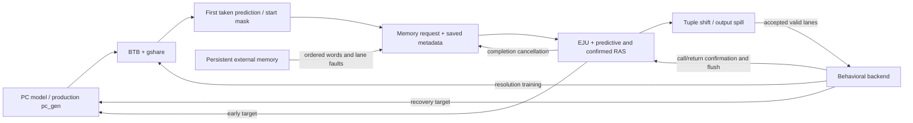

# Complete frontend: closed-loop verification specification

Architecture findings established 2026-10-15 on `feat-verification`.
**Implementation and executed evidence are recorded in §21–22, [README.md](README.md)
and [COMPLETION_AUDIT.md](COMPLETION_AUDIT.md).
Full specification sign-off remains incomplete.** The original architecture findings
and planned acceptance criteria below are retained; they are not all passing claims.
The DUT is the production `fetch_stage`, including its real PC generator, BPU,
BTB, gshare, validity generator, memory interface, EJU/RAS, mixer and storage.
Only its public ports and elaborated static configuration may be observed.
No internal predictor tables, RAS entries, FIFO pointers, masks, early-correction
wires or storage-valid bits may be exposed by a test wrapper.

The purpose is to verify learning and subsequent use of predictions in persistent
programs, not simply to supply plausible independent feedback bits. A synthetic
backend executes a defined instruction subset, preserves operand dependencies,
orders branch feedback, cancels wrong-path work and refetches the correct stream.
It is an environment model, not a replacement DUT or a full processor verifier.

## 1. Evidence, scope and source map

Evidence classes retain their existing meaning: **A** architectural relationship;
**D** explicitly approved/documented requirement; **I** inferred interface contract
or named provisional policy; **O** implementation observation only; **Q** unresolved
decision. Exact values can have several dependencies. For example, the JAL sum is
A, its selected lane is I, and its correction lifetime is I/EQ05. A passing test
does not promote those dependencies to D. O alone is characterization, not a
golden requirement. New IDs are `FE01` onward, `FEQ01` onward and `FEV01` onward;
existing C/EJ/RA/FM/Q/EQ/FQ IDs retain their original provenance.

The following active sources establish the connections and policies used below.
Line ranges refer to the source reviewed for this document; changes require a
source-fingerprint review, not blind reliance on these numbers.

| Ref | Source and locations | Evidence supplied |
| --- | --- | --- |
| S01 | [fetch_stage.sv](../../../rtl/frontend/fetch_stage.sv):15–58, 141–282 | Public boundary, explicit BPU initialization, all frontend connections, final spill. |
| S02 | [pc_gen.sv](../../../rtl/frontend/pc_gen.sv):16–111; [PC specification](../pc_gen/VERIFICATION.md) approved contract | Redirect arbitration, bundle progression, independent early redirect, residual acknowledgment qualifications. |
| S03 | [bpu.sv](../../../rtl/frontend/bpu.sv):39–82 | Gshare/BTB composition, resolution qualification, BTB deletion, per-lane PCs. |
| S04 | [btb.sv](../../../rtl/frontend/btb.sv):35–107 | Direct mapping, full remaining source tag, replacement/deletion, target word representation. |
| S05 | [gshare.sv](../../../rtl/frontend/gshare.sv):33–114 | Resolution-driven global history, saturation, read/update indexes, reset and flush. |
| S06 | [gen_valid_instr.sv](../../../rtl/frontend/gen_valid_instr.sv):16–66 | Start-lane and first qualified taken prediction define inclusive input interval. |
| S07 | [fetch_mem_if.sv](../../../rtl/frontend/fetch_mem_if.sv):13–170 | Ordered saved metadata and response/error association, request/answer channels. |
| S08 | [early_jump_unit.sv](../../../rtl/frontend/early_jump_unit.sv):99–138, 149–222, 244–271 | Recognition, earliest recognized lane, correction lifecycle, metadata rewrite. |
| S09 | [ras.sv](../../../rtl/frontend/ras.sv):22–168 | Two histories, confirmation, restoration, reset and boundary observations. |
| S10 | [instr_mixer.sv](../../../rtl/frontend/instr_mixer.sv):18–61 | Leading-invalid-lane removal of complete tuples. |
| S11 | [spill_cell_flush.sv](../../../rtl/common/spill_cell_flush.sv):22–101; [spill_cell_flush_cu.sv](../../../rtl/common/spill_cell_flush_cu.sv):22–171; [fifo_nohs.sv](../../../rtl/common/fifo_nohs.sv); [modn_counter.sv](../../../rtl/common/modn_counter.sv) | Real buffering dependencies; registered two-record storage, no full-state ready lookahead, flush/release timing. |
| S12 | [fetch_pkg.sv](../../../rtl/packages/fetch_pkg.sv):29–89; [len5_config_pkg.sv](../../../rtl/packages/len5_config_pkg.sv):28–37, 100–165; [len5_pkg.sv](../../../rtl/packages/len5_pkg.sv) | Packed prediction/resolution/error types, active widths, source-selected configuration. |
| S13 | [branch_unit.sv](../../../rtl/expipe/exec-units/branch_unit.sv):109–172, 184–211, 278–281; [branch_cu.sv](../../../rtl/expipe/exec-units/branch_cu.sv):53–121 | Actual outcome, misprediction, registered feedback, confirmation versus training timing. |
| S14 | [branch_rs.sv](../../../rtl/expipe/exec-units/branch_rs.sv):125–141, 280–305; [exec_stage.sv](../../../rtl/expipe/exec-units/exec_stage.sv):154–177 | Ordered execution cursor and branch feedback routing. |
| S15 | [issue_stage.sv](../../../rtl/expipe/issue-unit/issue_stage.sv):185–235, 548–559; [issue_cu.sv](../../../rtl/expipe/issue-unit/issue_cu.sv):83–100, 150–175, 207–272; [issue_queue.sv](../../../rtl/expipe/issue-unit/issue_queue.sv):74–123, 153–164 | Dispatch versus scalar issue, effective prediction, fault qualification, frontend flush and resume. |
| S16 | [backend.sv](../../../rtl/expipe/backend.sv):233–246, 415–445, 492–519, 590; [commit_cu.sv](../../../rtl/expipe/commit-unit/commit_cu.sv):353–370, 409–465; [commit_stage.sv](../../../rtl/expipe/commit-unit/commit_stage.sv):330–420 | Distinct early frontend and later backend recovery; delayed exception redirect; producer limitations. |
| S17 | [datapath.sv](../../../rtl/datapath.sv):97–132, 197 | `flush=branch|exception`, predictor flush only exception, external memory flush includes early correction. |
| S18 | [memory_bare_emu.sv](../../memory/memory_bare_emu.sv):17–38, 147–203, 340–393 | Ordered/cancelable memory, registered responses, per-lane error codes. |
| S19 | [EJU architecture audit](../early_jump_unit/ARCHITECTURE_AUDIT.md):A1–A3, B, C, E1–E8 | EQ03/EQ04 approvals, EQ07 evidence, demonstrated EQ08 and separate recovery-window observation. |
| S20 | [PC README](../pc_gen/README.md), [EJU README](../early_jump_unit/README.md), [EJU specification](../early_jump_unit/VERIFICATION.md), [memory README](../fetch_mem_if/README.md), [memory specification](../fetch_mem_if/VERIFICATION.md) | Existing contracts, actual implementation limits, report and replay conventions. |

This review inspected the existing pure models, instruction helpers, causal
environments, phase drivers, scoreboard/confidence logic, random generators,
directed catalogs, source/configuration guards and Python orchestration. Section 19
identifies concrete reuse points and limitations. Historical standalone counts and
full-core traces belong to S19/S20; they are not results for this proposed DUT.

## 2. Production boundary and configuration

### 2.1 Configuration must describe the instantiated design

Initial architecture snapshot: N=`LEN5_MULTIPLE_ISSUES`=4, ILEN=32, XLEN=ALEN=64,
RAS depth=4, HLEN=4, BTB_BITS=4, request SKIP=1, answer SKIP=0. Therefore B=4N=16,
BTB has 16 direct-mapped rows, and PHT has 16 two-bit counters. **The integrated
counter initialization is WT (2), not the WNT default of the leaf modules:**
`fetch_stage` explicitly binds `fetch_pkg::INIT_C2B` (S01:141–145, S12:86).

Metadata capacity defaults to `fetch_stage.MEMIF_FIFO_DEPTH=2`. The final output
spill is registered, default SKIP=0, with capacity two bundles. The normal physical
memory contract permits two accepted but not yet response-accepted requests.
IQ depth16, branch RS depth4 and ROB depth32 inform backend capacity constraints;
they do not turn the testbench into the production backend.

Default commands build only the currently selected N. The subsequent explicitly
authorized §22 audit built N=1/2/4/8 in disposable production source copies; live
source on audit entry is N=2. No default automatic width sweep is introduced.
Loops, masks, starting lanes, program placement and coverage adapt mathematically.
No runtime issue-width selector or automatic RTL edit/sweep. Guard unsupported
depth/spill settings rather than silently use the existing models with wrong timing.
The current gshare declarations also require positive HLEN−log2(N) and HLEN>=2;
do not claim arbitrary predictor parameter support from the selected configuration.

BOOT_PC deserves separate treatment: the package contains 0x180, while
`fetch_stage` and `datapath` have their own BOOT_PC parameters, default0. The
package literal is not automatically wired into those parameters. The proposed
adapter must record its effective parameter binding, defaulting to the production
top-level parameter default, and expose that elaborated value. An optional BOOT_PC
build parameter may follow pc_gen's existing workflow; it is not a second N
selector. Include the effective boot value in the build fingerprint and program
manifest. Partial-bundle boot tests require distinct parameterized builds, explicitly
requested later; they cannot be achieved by resetting to a runtime C++ address.

### 2.2 Complete public-port inventory

P=`prediction_t`=130 bits (`pc`, `hit`, `target`, `taken`); resolution is also
130 bits (`pc`, `mispredict`, `taken`, `target`). E=5 cause bits. All synchronous
input transactions are stable around the consuming rising edge. Physical
setup/hold timing is outside Verilator verification.

| Port | Width/direction | Real producer/consumer and contract |
| --- | --- | --- |
| `clk_i` | in1 | Shared system clock; rising-edge consumption. |
| `rst_ni` | in1 | Active-low asynchronous reset; resets PC, predictor and registered histories. Exact cell/EJU release timing remains I/Q. |
| `flush_i` | in1 | Issue frontend misprediction OR commit exception flush. Clears memory path, EJU pending state and output spill; restores predictive RAS. Does not directly reset PC or BPU. |
| `flush_bpu_i` | in1 | Commit exception flush in S17. Resets BTB/history/counters; independent public pin, not ordinary branch flush. |
| `instr_valid_o` | out1 | Memory request offer. |
| `instr_ready_i` | in1 | Memory grant/readiness; K=request-valid AND grant. |
| `instr_addr_o` | out64 | Bundle lane0 address, not necessarily logical starting PC. Meaningful on request offer. |
| `instr_we_o` | out1 | Always0, read-only instruction requests. |
| `instr_valid_i` | in1 | Memory response offer for oldest accepted request. |
| `instr_ready_o` | out1 | Memory response admission; R=response-valid AND ready. |
| `instr_rdata_i` | in N×32 | Persistent memory's raw words, held with response through stall. |
| `instr_except_raised_i` | in N | Per-physical-lane fault flags, same response identity. |
| `instr_except_code_i` | in N×E | Per-lane causes; cause0 is meaningful when raised1. |
| `early_jump_mem_flush_o` | out1 | EJU correction completion; environment ORs with external flush for physical memory cancellation, as S17:197. Not a frontend/RAS flush. |
| `issue_ready_i` | in1 | Real issue-queue bundle admission capacity, modeled by behavioral backend. Does not directly gate predictive RAS updates. |
| `issue_valid_o` | out1 | Output-spill bundle offer. D=valid AND ready at a live edge. |
| `issue_valid_instr_o` | out N | Retained/mixed lanes, not independent per-lane handshakes. |
| `issue_instr_o` | out N×32 | Raw instruction words after leading-lane shift. |
| `issue_pred_o` | out N×P | Saved request predictions, possibly rewritten by EJU, shifted with words. This is not a direct current-BPU observation. |
| `issue_except_raised_o` | out N | Fault flags shifted and buffered with their instruction PCs. |
| `issue_except_code_o` | out N×E | Causes relevant on valid raised lanes. No mtval/fault-address port. |
| `bu_pcgen_ready_o` | out1 | Branch redirect acknowledgment, independent of memory grant. Current level is1; meaningful acknowledgment checks retain pc_gen Q5 qualifications. |
| `bu_bpu_valid_i` | in1 | One-edge branch-resolution update. No ready pin; every qualified edge trains. |
| `bu_pcgen_valid_i` | in1 | Recovery request; effective only with `bu_res_i.mispredict`. Hold payload if awaiting acknowledgment. |
| `bu_res_i` | in130 | Registered branch result. One shared record for update and redirect, not two independent branch IDs. Target is computed branch destination even for a not-taken branch; fallthrough recovery uses PC+4. |
| `bu_call_confirm_i` | in1 | Qualified nonfaulting executed BU_CALL pulse. No acknowledgment/retry. |
| `bu_ret_confirm_i` | in1 | Qualified nonfaulting executed BU_RET pulse, mutually exclusive with call. |
| `bu_link_addr_i` | in64 | PC+4 for confirmed call; no meaning for ordinary branch/return-only confirmation. |
| `comm_except_raised_i` | in1 | Commit redirect command, distinct from earlier exception flush. Highest non-reset PC priority. |
| `comm_except_pc_i` | in64 | Supplied trap/MRET-shaped address passed through by PC generator. Its production calculation is outside this DUT. |

An offered output is stable while stalled absent cancellation. Inactive data and
unraised causes are don't-care unless a named raw-transport I check is enabled.
Do not demand every valid signal becomes combinationally0 on flush: old output
valid may remain asserted until the edge. An electrical D on frontend flush is
canceled by the backend IQ flush and creates no executable instruction.
The actual IQ ready is not combinationally flush-gated (S15:issue_queue:75,97,122).
An environment choosing ready0 on that edge is a legal subset, not the only
architectural behavior.

## 3. Transaction flow, masks and buffering



The diagram describes model composition as well as real connections; it does not
authorize observing internal DUT wires. Distinguish K (memory request acceptance),
R (memory response acceptance), A (answer/EJU transfer into final output spill),
and D (public output accepted by backend). A is a **model event**, not a public
handshake. For a given record these occur on different edges under current
registered storage. All four may overlap for different records.

For independent current PC p, derive B=4N, base=floor(p/B)B, start=(p−base)/4.
Architectural executable PCs are instruction-aligned. Lane k's PC is base+4k;
for N=1 the public BPU uses p. Let end be the first k>=start with hit[k] AND
taken[k], else N−1. The memory mask is the inclusive interval [start,end].
Prediction miss/taken1 is not a taken branch; hit/not-taken is still a prediction
record and does not exclude later instructions. Raw predictions can exist in
several lanes; only the first eligible qualified taken record controls the path.

On K, freeze this request's complete predictions/mask in the reused memory model.
Later BPU updates must never alter those records. On R, attach words/errors to the
oldest prior request, not a simultaneously accepted new one. EJU chooses the oldest
retained recognized JAL/canonical RET, truncates younger lanes and may correct its
prediction. It still truncates at a predicted JAL or an empty-RAS RET. Other JALR
does not get an invented early cutoff; backend recovery handles its actual jump.
That incomplete early recognition is intentional for RAS policy, while generic
JALR cutoff remains EQ03's separate unresolved detail.

Mixer removes the leading invalid prefix and shifts **the entire tuple**: word,
prediction PC/hit/direction/target, fault flag and cause. It is not a general
hole-compaction engine (S10). Coherent masks produce contiguous low valid lanes.
All-zero/holey masks cannot be directly injected at the complete frontend boundary;
keep those in standalone tests unless a real reachable producer defect creates one.

The memory answer queue and final output queue each hold two bundles. Both use
registered outputs and no full-state combinational ready lookahead under the I
cell contract. Full final output queue means A=0 even if D frees a slot this edge;
capacity becomes available afterward. External ready0 does **not** imply A=0:
EJU can accept a call and push predictive RAS while the output queue has room.
At most two physical outstanding requests, two answered bundles and two final
output bundles are retained in the selected frontend, excluding backend records.
Do not report all six as metadata FIFO occupancy.

Early correction can be offered while A is stalled. pc_gen accepts it independent
of memory readiness, potentially repeatedly. EJU completion/memory flush occurs
when A happens, not necessarily on D. Under coordinated memory cancellation,
preserve the current A record and all older final-spill records, cancel younger
memory work. Repeated requests to the same early target can therefore be legitimate
physical requests before completion; they must not become duplicate dynamic
dispatch of the same accepted correction. Track identities, not unique PCs.

## 4. Independent BPU behavioral contract

### 4.1 Policy and abstract state

There is no existing pure BPU model to reuse. Add a small independent semantic
predictor model later, under named **I** policy `resolution-indexed-gshare-v1`.
S03–S05 establish the implemented algorithm, but exact predictor timing and all
replacement choices have not independently been approved as D. Keep a predictor-
agnostic safety profile alongside exact I comparisons. Do not call ISA correctness
dependent on a particular prediction accuracy.

Abstract state: global outcome history H, ordinal confidence counters 0..3, and
a direct-mapped dictionary of source tags and destination word addresses. Derive
this state exclusively from reset, predictor flush and emitted qualified resolution
inputs. No internal RTL arrays, pointers or DUT predictions initialize it.
Mathematical table indexing is necessary to specify an indexed predictor; copying
RTL state enums, loops, concatenation networks or muxes is not the oracle design.

For word PC w=floor(pc/4), T=2^BTB_BITS and G=2^HLEN:

```text
BTB row = w mod T; source tag = floor(w/T)
hit = row occupied by this exact tag
qualified direction = hit AND (counter[H XOR (w mod G)] >= 2)
raw direction = counter[H XOR (w mod G)] >= 2
prediction target = stored word target * 4, meaningful as a prediction on hit
```

All lanes read with the same pre-edge H. Reset/predictor flush empties BTB, sets
H=0 and every counter to integrated INIT_C2B=WT. Thus cold raw direction is taken,
but cold qualified direction is not taken because the BTB misses. A test that
expects all cold `.taken` fields to be0 is incorrect.

### 4.2 One qualified update

For `bu_bpu_valid_i=1`, absent reset/predictor flush:

1. Select counter at **old H XOR resolution word-PC index**.
2. Move its confidence one step toward taken or not-taken, saturating at 3 or0.
3. Append actual taken to H, keeping the last HLEN outcomes.
4. If `mispredict && !taken`, invalidate the indexed BTB row; otherwise install
   the source tag and supplied target word there, replacing the prior row.

The deleted row is indexed without a tag check (S04:61–67). This can evict an
unrelated occupant, but does not create a false source-tag hit. All emitted branch
results, including JAL/JALR/call/return, update global history and direction
counters; it is not a conditional-branch-only history. A correct not-taken result
can install a BTB entry. A not-taken misprediction instead deletes it.

This is **resolution-time** history indexing, not the history saved when the
branch was predicted. The public resolution carries no prediction-time history
or table index. Pending branches and intervening updates can change the update
index. Never add an imagined history checkpoint to make a textbook predictor.

Valid is an update pulse, not a ready/valid transaction: holding it for three
edges trains three times. The architectural backend emits exactly one pulse per
eligible dynamic resolution. A held redirect can persist independently without
repeating that pulse. Reset/`flush_bpu_i` dominates same-edge training.

Target storage discards two low bits; executable successful target programs use
four-byte alignment. Misaligned resolution-target behavior is not pc_gen's
approved pass-through rule: it is a separate BPU representation observation
(FEQ02/FQ09). Do not change the PC model to match BTB truncation.

### 4.3 Simultaneous read/update and observability

A request accepted on an update edge snapshots **pre-edge** predictions. The new
counter/history/BTB is available for the following combinational interval. If a
request was stalled before that edge, its final grant can instead snapshot newer
predictions. Frozen outstanding metadata does not change. Predictor flush without
frontend flush similarly leaves prior snapshots intact; that separated-pins case
is stress, since exception recovery normally asserts both.

Raw BPU outputs are internal. For conditional branches and non-rewritten lanes,
public `issue_pred_o` directly witnesses the saved fields, including raw direction
on a miss. For EJU-corrected JAL/RET, hit/direction/target have been rewritten:
they do **not** directly witness cold versus warm BPU state. Prove these cases with
combined request-path, public early-memory-flush, output-metadata and later
execution witnesses, and retain their inferred nature. A model-side table visit
alone earns no observed-training coverage. Unused target on a miss is don't-care
in the main profile; optional raw-bus checks are I and may use a separately named
retained-row policy, not an architectural prediction requirement.

Metamorphic properties supplement exact I checks: no eligible update/flush means
no trained-state change; a later saved prediction cannot reflect a future update;
flush returns to independently established cold state; replacing a different
source tag yields a miss; repeated updates saturate instead of wrapping; a
canceled backend event cannot produce training. These still identify their
predictor-policy dependencies.

## 5. Persistent executable programs and training

### 5.1 Program construction

Use an immutable address-to-word image and explicit fetch-fault map for each
program instance. Every refetch of a PC returns the same word until an explicit
new-program reset. Static PC/word identity differs from dynamic execution ID.
Do not rewrite an immutable JAL to create a convenient stale target. Instruction
addresses/branch displacements must be encoded and independently decoded using
the existing EJU helpers, with checked label relocation, alignment and range.

Place text at effective BOOT_PC, install initialization instructions for every
live operand, and map intentional fallthrough/wrong-path regions. Ordinary NOP
padding must have distinct PCs; use diverse harmless words when data identity
needs additional observability. Finite programs end at a designated marker PC
recognized by the environment, not a new RTL signal. Infinite-loop tests end by
an explicit test stop/reset with cancellation accounting, never pretend a naturally
running fetch pipeline drained itself.

Program parameters: repetition count, phase lengths, branch placement, block
spacing, start lane, call sites/depth, register allocation, fault regions and
bounded termination. Randomize at construction; the program stays persistent
during learning. All control operations in warm-up, including helper backedge
JALs, contribute actual feedback and must be included in predictor history.

### 5.2 Concrete program vocabulary

The following assembly templates are specifications for later encoders, not new
firmware files. Labels are relocated within encoding range; `li`/`mv` below must
be expanded into supported real instructions before execution.

```asm
# P-A: bounded mostly-taken loop; R>=2
    addi x10,x0,R
L:  addi x10,x10,-1
    bne  x10,x0,L
Done: addi x0,x0,0

# P-B: mostly not-taken, no random outcome pin
    addi x10,x0,0
    addi x11,x0,R
L:  beq  x10,x11,Done
    addi x10,x10,1
    jal  x0,L
Done: addi x0,x0,0

# P-C/D: same static branch with phases or parity
    addi x10,x0,0
    addi x11,x0,R
L:  andi x12,x10,1       # D: alternating condition
    beq  x12,x0,Even     # C: replace predicate with x10 < threshold
Odd:  addi x13,x13,1
    jal x0,Join
Even: addi x14,x14,1
Join: addi x10,x10,1
    blt x10,x11,L
Done: addi x0,x0,0

# P-F: shared canonical return, two valid dynamic targets
A:  jal x1,F
Aret: addi x20,x20,1
B:  jal x1,F
Bret: addi x21,x21,1
    jal x0,A             # or bounded outer loop
F:  addi x22,x22,1
    jalr x0,0(x1)

# P-N: nested calls without pretending x1 is a stack
Main: jal x1,F
MainRet: jal x0,Done
F:  addi x20,x1,0        # save MainRet
    jal x1,G
Fret: addi x1,x20,0
    jalr x0,0(x1)
G:  addi x21,x1,0        # save Fret
    jal x1,H
Gret: addi x1,x21,0
    jalr x0,0(x1)
H:  jalr x0,0(x1)
Done: addi x0,x0,0
```

Initialize x13/x14/x20/x21/x22 where used as counters. P-N save registers belong
to distinct static nesting levels; recursive reuse needs an independently modeled
data stack and is not in the initial subset. Generalize P-N with one save register
per depth up to the planned depth budget, including RAS_DEPTH+1. x1 restoration
is real program execution, independent of predictor history.

P-C uses a loop counter and `blt x10,xThreshold,TakenBlock`, then rejoins and
increments, producing a run of taken outcomes followed by a run of not-taken
outcomes at one static branch. Reinitialize for repeated phases only through
executed instructions. P-E adds a second conditional using another counter/bit,
with explicit joins, so branch outcome order is known from operands.

For P-I interference, choose two branch word addresses with equal index modulo
2^BTB_BITS and different source tags, e.g. separation 4×2^BTB_BITS bytes;
pad/join so both execute repeatedly. This proves replacement/miss, not a false
hit. Gshare collision needs **history as well as PC**: choose/update a program
schedule whose independent pre-resolution states satisfy
`H_a XOR (PC_a/4 mod G) = H_b XOR (PC_b/4 mod G)`.
Record the actual qualifying updates; placement alone is insufficient. Different
history can also give different counters for the same static branch.

### 5.3 Required training phases and trace

Every learning episode has cold, warm-up, independently established trained,
perturbation, adaptation and recovery/refetch phases where applicable. A phase
ends on a model state/witness criterion, not an arbitrary iteration count.
For a particular counter initially q, consecutive updates **to that counter** need
3−q taken updates to reach ST, or q not-taken updates to reach SNT. GHR changes
which counter receives an iteration: these counts are not universal loop counts.
From ST, one NT stays predicted taken (WT), a second NT becomes WNT, if both
updates reach that same counter without interference. Trace actual indexes.

| Family | Executable construction and perturbation | Required learned-state witness |
| --- | --- | --- |
| LOOP-A | P-A backward conditional, large R, final exit NT | Cold miss; qualified taken on a later visit only when history/table establish it; exit direction error/recovery if predicted taken. |
| LOOP-B | P-B repeated mostly NT conditional, helper JAL included | Hit+NT installation and counters affected by actual update order; rare taken exit. |
| LOOP-C | P-C threshold phases at same immutable branch | Before/after confidence crossings for visited indexes; no fixed universal training length. |
| LOOP-D | P-D parity branch | Alternating semantic outcomes and history-conditioned predictions, including join/backedge feedback. |
| LOOP-E | P-E interacting conditional branches | Ordered histories, multiple pending records, per-site predictions before/after the other's updates. |
| LOOP-F | P-I BTB index collision and separate history-aware PHT collision | Tag replacement causes miss; direction interference causes documented counter change; distinguish causes. |
| LOOP-G | Long P-A/P-F/P-E repetitions with stalls and delayed feedback | Stable immutable memory, one update per emitted branch, no duplicate confirmations, recovery/refetch completion across delays. |

Each dynamic branch trace records ID/epoch/static PC/iteration, raw request-time
prediction (oracle-known, explicitly labeled), publicly observed attached
prediction, EJU rewrite/witness, semantic operand values/result, prediction-time
and update-time model H/index, BTB tag/row provenance, update edge, subsequent
request/dispatch witness, correctness and recovery. Report both raw BPU accuracy
where observable and **effective attached prediction** accuracy. Never count an
EJU-repaired prediction as proof the BPU predicted correctly.

## 6. JAL/EJU interaction matrix

Actual JAL target=its own PC+signed J immediate modulo XLEN; link=PC+4 (A).
Approved EQ03/D: only JAL rd=x1 pushes, all other JAL (including x5) are direct
jumps without RAS push. Exact canonical RET alone pops. Approved EQ04/D:
hit AND taken suppresses a JAL correction even if the target differs. This does
not remove backend execution or wrong-target recovery.

In this matrix, J is internal modeled correction offer, A is acceptance into
output spill, X is public early-memory flush; attached prediction is what the
backend receives. Unless stated, ready eventually permits A, no higher recovery
overrides, and all listed outputs are checked at their qualified phases. J cannot
be independently probed through a new port.

| Case | Request prediction / actual result | J / X and effective metadata | Backend misprediction and path | Reachability/program |
| --- | --- | --- | --- | --- |
| EJ-A | Miss, JAL actual taken to T | J; at A, X; selected metadata becomes hit/T/T | Effective prediction correct, normally no BU misprediction; fetch T early | Architectural: first JAL in P-F or a forward JAL. Cold raw direction may be1. |
| EJ-B | Hit/T/T, actual T | No J or X for this JAL; preserve metadata | Correct; predicted path T | Architectural: repeated same JAL, wait for qualifying learned state; P-F/P-A helper jumps. |
| EJ-C | Hit/NT, actual T | J and X at A; rewrite to T | Normally correct after rewrite | Architectural only with demonstrated PHT history/interference; use P-E/P-I training search with immutable text. If no witness, report gap, do not force metadata. |
| EJ-D | Hit/T/U, actual T != U | No J/X under approved D policy | Wrong-target misprediction, recover T | Not reached by normal feedback for immutable JAL. Full-boundary stress can supply deliberately poisoned resolution target; standalone EJU retains raw-metadata test. |
| EJ-E | JAL rd=x0 or x5 | As A/B/C; no P push | Same direct jump outcome | Architectural explicit program with x5 link used only as ordinary register; later RAS witnesses. |
| EJ-F | JAL rd=x1 | At A push PC+4 exactly once, whether J or suppression | Confirm on execution; train on proper later edge | Architectural P-F/P-N; stalls and refetch use new dynamic IDs. |
| EJ-G | Several eligible jumps | Oldest recognized survives; younger lanes truncated | Only dispatched survivor can later execute/confirm | Architectural place back-to-back JALs, vary start/lane and training. |
| EJ-H | Earlier conditional hit/T before later JAL | Request mask excludes JAL; no correction/push from it | Earlier branch determines correct/recovery stream | Architectural train first branch taken; deliberately place younger call word in physical bundle. |
| EJ-I | Earlier conditional hit/NT before later JAL | Later JAL eligible, J/X if needed; P push if call | If older branch actually taken, squash younger call and restore P on branch recovery | Architectural P-C phase change; delay older branch. |
| EJ-J | Applicable JAL with full output spill / memory stall | J may repeat while A=0; X only completion; one push at A | No duplicated dispatch; provisional held-lifecycle timing | Architectural long ready0 episode after filling final spill; distinguish memory grant from spill capacity. |
| EJ-K | BPU update concurrent with answer containing JAL | EJU uses saved predictions; current BPU update changes only future snapshots | Feedback attached to that JAL stays its own | Architectural older branch resolves while younger response reaches EJU. |
| EJ-L | Early correction followed by later BU execution | Backend checks effective attached prediction, not pre-rewrite BPU fields | Direct JAL normally correct after repair; a wrong RAS RET can still mispredict, or artificial overwritten feedback can disagree | Architectural witness via return cases below; do not demand a second JAL misprediction merely because cold BPU missed. |

The final correct path property is exact independently of whether a correction
was needed for performance. A selected return may cause a redundant X even when
BTB already predicted correctly; do not label redundancy an architectural bug.
Commit/branch redirects win over J by the approved PC order. Canceled metadata
on a frontend flush has no consumer significance, but surviving older spill
records still require exact comparisons.

## 7. RAS learning and dynamic return targets

Reuse the EJU model's two abstract histories with independent source IDs and
addresses. P changes on selected accepted frontend call/return at A, not D or
execution. C changes on qualified BU confirmation, not retirement. Normal branch
flush restores P from C. A memory-only early flush does not restore either.
Check old P top for the current return, then apply its pop at the consuming edge.

| Case | Coherent executable history | Required outcome / evidence |
| --- | --- | --- |
| RAS-A | Initialize x1 to a mapped destination, canonical RET with no prior recognized call | Empty P causes no invented RAS target; cold BPU miss leads to actual BU target/recovery. Link operand remains independent of P. |
| RAS-B | P-F one caller then F returns | P receives caller+4; return uses that link, C push/pop follows execution; each pulse once. |
| RAS-C | Repeat caller/F with bounded outer loop | Compare cold JAL/RET and trained BTB visits; record actual target/direction per execution. |
| RAS-D | Same caller repeats, BTB and P top both correct | Current I RET policy still offers correction/X; exact path and no duplicated operation. Optimization remains EQ04 residual. |
| RAS-E/F | P-F: F's RET trained returning to A, then called from B | Same static RET, stale BTB target Aret, P top Bret; EJU repairs to Bret before BU; effective attached prediction can be correct despite wrong raw BTB target. |
| RAS-G | Indirect `jalr x1,...` call into F (no predictive push) with stale BTB RET target; or coherent history loss after overflow | Empty/wrong RAS cannot be assumed correct; BU operands determine real return and recover. Never seed P from a desired address. |
| RAS-H | P-N with explicit save/restore registers | Nested links unwind in order; PC+4 is caller-specific; C and P can differ while confirmations lag. |
| RAS-I | P-N depth D−1, D, D+1 and more, then unwind | Recent-D and empty-pop I policy; all actual register-based returns remain semantically correct even when predictor entries are lost. |
| RAS-J | Older delayed conditional predicts NT, younger call is accepted, older actually T | Speculative push can occur before older recovery; younger confirmation must not occur after ordered older misprediction; restore independent surviving C. |
| RAS-K | Prior legitimate call, delayed older conditional, wrong-path canonical RET | Speculative pop then restoration; later surviving return exposes restored entry. |
| RAS-L | Several calls/returns dispatched with different sampled delays | Ordered branch cursor and one confirmation per eligible execution; no younger feedback overtakes blocked older branch. |
| RAS-M | Shared F called from >=3 distinct sites in deterministic sequence | BTB target alternates with last confirmed target; P tracks newest call; all useful correctness combinations witnessed separately. |
| RAS-N | Train P-F/P-N, reset or normal branch recovery, refetch | Cold reset empties histories; normal recovery uses C; exception episodes retain EQ08 uncertainty/known-defect evidence. |
| RAS-O | Recognized call returns through noncanonical JALR (e.g. saved link +4), leaving a stale P entry; later canonical RET has an independently prepared x1 and previously trained matching BTB | Coherent BPU-correct/P-stale candidate. Prove concrete history and sampled trained state; EJU may override good BTB with wrong P, then BU must recover. No arbitrary RAS injection. |

For RAS-O, a program builder must preserve the canonical RET static PC while
changing its dynamic caller context through ordinary indirect paths, and record
the stale unmatched call. Treat the row as a reachability obligation until an
encoded execution supplies that witness; not as already achieved coverage.

P/C depth visits are not tests of hidden history by themselves. Each selected
push/pop, confirmation/restoration and overflow episode creates an obligation for
a later distinguishing return sequence, or an explicit cancellation/unknown
disposition. Distinct link values and sufficient pops expose lower entries and
ordering. No peeking at RAS storage, and no repair from observed return targets.

EQ07 same-edge confirmation/restoration stays I/Q. The normal producer confirms
one edge **before** misprediction frontend flush (§8), avoiding the ambiguity.
Stress runs retain `updated`, `previous` and `unknown` hypotheses; the historical
102 provisional differences do not approve either hypothesis as D.

## 8. Behavioral backend, semantic state and recovery scheduling

### 8.1 Recommended initial semantic engine

Use constrained executable templates plus a small **versioned integer semantic
engine**, rather than arbitrary branch-outcome bits or a full ISA simulator.
Templates make coverage reachable; the engine independently evaluates operands
and controls, catching errors in template assumptions. Initial executed subset:
ADDI/ANDI/ORI/XORI, LUI/AUIPC, selected ADD/SUB/logical operations, all six integer
conditional branches, JAL and JALR. Expand every pseudo-instruction. Arithmetic
wraps at XLEN; x0 is always0; signed comparisons use explicit signed ordering;
JALR target clears bit0; misaligned taken targets are fault episodes, not normal
program destinations. Reuse EJU `decode`, `jal`, `jalr`, `branch`, `outcome` for
their supported semantics; add independent register-write semantics and fixtures.

The existing broad ordinary-word generator is not a complete execution engine.
FP, CSR, multiply, loads/stores and raw words may be transport-only scenarios with
no unsupported semantic dependencies. Do not execute such words as NOPs if their
result influences a later branch. Optional data memory/stack and richer ISA support
can follow with its own semantic tests. Nested calls initially use explicit save
registers, not an imaginary automatically stacked x1.

Maintain committed register state plus ordered speculative register versions,
operand producer IDs and recoverable checkpoints. A read binds to the newest
older surviving writer (or committed value); completion availability is distinct
from its already calculable semantic value. Wrong-path execution can create
versions, but squash removes those versions and their dependent younger records.
Commit in order only after completion, no earlier fault/unresolved older control,
and correct-path validation. Preserve a mispredicted JAL's own link write when
discarding its younger instructions. A global register array updated on dispatch
without rollback is prohibited.

Two related traces are necessary: speculative dispatched order, which may contain
wrong-path instructions, and surviving architectural order. Do not reject a
wrong-path instruction merely for dispatching before recovery. Conversely a
matched instruction word is not sufficient to approve a wrong-epoch execution.
At recovery, restore semantic versions to the appropriate surviving prefix and
create a new fetch epoch; unaffected older instructions remain live.

### 8.2 Dynamic records and independent validation

Each accepted valid output lane gets a monotonic dynamic ID, program instance,
epoch, static PC, raw word, class, program-order rank, physical response ancestry,
attached prediction, independently decoded operands/result, latency sample,
dispatch/issue/ready/completion/feedback/retirement cycles, confirmation/update
counts and canceled status. New execution of the same PC gets a new ID.

The physical backend ledger records actual accepted tuples. A separate expected
ledger is populated by independently expected output tuples. Compare them before
dependent feedback is allowed. Actual output may establish physical acceptance,
but may never set expected PC, expected RAS entry, golden instruction semantics or
golden prediction metadata. If a control/data mismatch prevents correspondence,
preserve it and stop/quarantine dependent execution; do not feed fabricated
feedback for an instruction the physical frontend never delivered. Unaffected
known frontend checks continue. The environment checks IDs/ages/operands/order
itself, rather than relying on the generator to have behaved correctly.

### 8.3 Dispatch is not issue or confirmation

Public D admits a bundle into the real instruction queue; production issue is
scalar (S15:207–234). Branch RS executes only its current execution cursor; a
younger ready branch cannot bypass it (S14:132,141,297). Branch completion and CDB
head movement are separate. Model an IQ/ROB/branch-capacity envelope sufficient
to make admission and scheduling causal, not the production storage algorithms.
Use source-derived capacity limits, at most one new scalar issue and at most one
branch feedback record per cycle. Dependencies and recovery stalls can delay
otherwise mature work. External output ready may additionally stall in bursts.

The branch cursor and BU feedback freeze, not ordered allocation alone, justify
ordered confirmations. After an older misprediction, younger physical branch
execution may have begun, but CU no longer captures/emits their normal resolution
or confirmation before cancellation. Do not require an invented instantaneous
stop of every backend execution signal to justify suppressing younger feedback.

### 8.4 Signal-level feedback schedule

Let edge e capture an eligible branch execution result under current BU_SPILL_SKIP=1.
Table entries name inputs stable before the indicated **subsequent** consuming
edge. Payload is that same dynamic branch unless explicitly a later correct one.
This is an inferred producer contract, not an implementation of the CU state enum.

| Edge | Correct prediction | Misprediction |
| --- | --- | --- |
| e | Compute/capture result in environment; no immediate invented training | Compute/capture result; stop future younger feedback scheduling |
| e+1 | `bu_bpu_valid=1`; eligible call/return confirmation=1; no PC redirect/flush | Eligible confirmation=1; internal issue notification; `bu_bpu_valid=0`, `bu_pcgen_valid=0`, frontend flush still0 |
| e+2 | Next independently eligible branch can emit its result | `flush_i=1`, `bu_bpu_valid=1`, `bu_pcgen_valid=1`, `res.mispredict=1`; no repeated confirmation, no predictor flush |
| Following | Continue normal ordered feedback | If redirect not acknowledged, hold only PC request/payload; BPU update does not repeat. Backend execution remains stopped until modeled in-order branch completion/commit releases it. |

Actual BU misprediction is
`effective_pred_taken != actual_taken || (effective_pred_taken && pred_target != actual_target)`,
where effective_pred_taken=`attached.hit && attached.taken`. For NT resolution,
target remains the computed branch destination, while PC recovery is res.pc+4.
EJU-repaired predictions feed this test; using raw cold BPU prediction instead
would invent a misprediction that real LEN5 does not report (S13/S15).

Confirmation is emitted once for executed, qualified call/RET with no target
alignment fault. Ordinary conditional/JAL-x0/noncanonical JALR does not confirm
RAS. An accepted frontend call is not yet a confirmation. Correct branch feedback
can train without any RAS operation. Confirmations proceed while frontend output
is stalled. Both confirmation bits at once are producer-invalid characterization.

Normal frontend flush starts new fetch work before later branch retirement clears
backend execution state. The synthetic IQ can buffer that new path while scalar
issue remains stopped. Later backend resume is an environment scheduling event,
**not a second frontend flush**. Do not discard correctly refetched instructions
at that later time. Keep old canceled execution entries separate from new-path
IQ records until resume.

### 8.5 Exceptions and delayed redirects

A precise synthetic exception must have a real earlier dynamic source: a delivered
fetch fault or supported semantic fault/context. At the modeled in-order recovery
point drive `flush_i=flush_bpu_i=1`, cancel younger execution/queue work and suppress
boundary confirmations from squashed records. Drive commit redirect later, using
the separately specified target; S16 shows intervening CSR cycles. These events
must not be collapsed into one convenient edge in every architectural test.

A known fetch fault stops scalar issue of younger instructions in the actual issue
controller. It cannot be used to manufacture the EQ08 history of a younger
**executed/confirmed** call. That historical witness used an older delayed data-load
fault after younger scalar issue, not an already-known fetch fault. Until an
optional data-fault execution model exists, the corresponding synthetic backend
episode must be labeled backend-context characterization, anchored to the prior
audit's instruction-age timeline. It is not a newly reproduced full-core defect
or an executable case of the initial integer-only subset.

No public fetch-enable input exists here. The frontend can resume fetching between
exception flush and later commit redirect. Do not secretly gate memory grants or
discard all new output simply to hide that known recovery window. Record physical
dispatch and semantic eligibility separately; use a dedicated known-defect episode
with expected surviving instruction order. This harness cannot establish actual
ROB/CSR retirement or mtval correctness. Interrupt/MRET-shaped externally supplied
controls are protocol stress/characterization unless a supported backend semantic
program establishes their producer contract; no fictitious interrupt pin.

## 9. Execution latency: deterministic exact specification

Defaults: `EXEC_LATENCY_MIN=1`, `EXEC_LATENCY_MAX=64`,
`EXEC_LATENCY_DIST=uniform`. Let a=min, b=max, M=b−a+1; require 1<=a<=b and a
validated implementation bound to prevent overflow. K=b is configurable. Sample
once per accepted dynamic instruction, including subsequently squashed ones;
never redraw because a branch is blocked. At dispatch edge d, earliest readiness
is d+L. Scalar issue, operand availability, older branch order, port occupancy and
recovery can make actual feedback substantially later than d+K.

Use a dedicated latency stream derived by the existing splitmix seed scheme,
independent of program/event/memory streams. Define integer rejection sampling
for unbiased U(n) in [0,n−1], not unspecified library distribution behavior. Record
distribution revision and every normalized parameter. Proposed distributions:

| Distribution | Exact discrete sampling rule |
| --- | --- |
| uniform | L=a+U(M). |
| fixed | L=f; validate a<=f<=b. Default fixed value is b when selected without f. |
| triangular-early | Weight w(k)=b−k+1 for k=a..b; integer CDF draw over sum weights. |
| triangular-late | w(k)=k−a+1. |
| triangular-mode | Mode m in [a,b]. For k<=m, w(k)=(k−a+1)(b−m+1); for k>m, w(k)=(b−k+1)(m−a+1). CDF draw; peak agrees at m. End modes exactly reduce to early/late up to scale. |
| truncated-geometric | Rational p=u/v, 0<u<=v, default1/8. Draw independent Bernoulli U(v)<u for k=a..b, return first success; if all fail, retry the block. This conditions geometric on L<=b, with mass p(1−p)^(k−a)/(1−(1−p)^M). It is not a cap that piles all overflow probability at b. Validate parameter/retry budgets and fail clearly rather than biasing a stalled sampler. |
| bimodal | Rational short probability s/t, default1/2; choose a uniform short interval or uniform long interval. Default at [1,64]: [1,8] and [48,64]. For other bounds derive short [a,a+floor((M−1)/8)] and long [a+floor(3(M−1)/4),b], or use explicit validated intervals. M=1 degenerates to fixed. |

Use checked wide arithmetic for CDF totals. Unit fixtures cover M=1, endpoints,
mode at each endpoint, geometric p=1, reproducible sequences, range preservation
and deterministic histogram bounds with appropriate tolerance. Record requested
L, earliest ready, operand/order/port/recovery delays, completion, and actual
feedback latency separately. Coverage bins outside sampled [a,b] apply only to
actual delayed latency, never imply the sampler violated its bound.

## 10. Composed independent oracle and phase schedule

### 10.1 Four independent responsibilities

1. **Golden frontend**: reused PC, EJU/RAS and fetch-memory models; new BPU,
   producer-mask adapter, tuple mixer and final abstract output queue.
2. **Physical stimulus ledger**: actual public memory requests, stable responses,
   cancelable physical obligations and public backend handshakes.
3. **Backend dynamic ledger**: instruction versions, order, latency, feedback and
   cancellation, with separate expected and actual correspondence.
4. **Persistent program/semantic state**: immutable words/fault map, initialization,
   legal outcomes, speculative versions and surviving-path trace.

No ledger is populated from internal DUT signals. Actual memory request address
may select the physical memory response, as a real memory would; the oracle's
expected request address, saved prediction snapshot and identity are independently
calculated. A mismatch stops dependent feedback, rather than converting the actual
address into a new expected PC. Actual observed output predictions may explain
physical backend behavior but never train the golden model retroactively.

### 10.2 Combinational dependency order

Use immutable pre-edge state for every model. A two-pass composition avoids the
apparent EJU/PC metadata feedback loop:

1. Derive final-spill head/valid/capacity from its independent old queue and external
   ready/flush. Derive old memory answer from reused memory state.
2. Map that answer into EJU inputs: frozen words/predictions/mask, internal expected
   spill-ready, public confirmations and frontend flush. Independently select
   correction and its operands using reused EJU selection/output logic; target
   feedback is not needed to discover the decoded target.
3. Compute BPU predictions from independent PC and old predictor state; derive mask
   and oldest qualified taken prediction. Combine with external branch/commit and
   EJU correction in reused PC model to obtain next-PC selection/meaningful feedback.
4. Feed that independent feedback into EJU metadata output calculation, then shift
   complete tuples and form the prospective final-spill input record.
5. Compute memory-path flush = external flush OR independently expected early
   completion; derive request/response controls with reused memory model. Under
   bypass, expected memory grant is the public input after coordinated cancellation.
6. Calculate all pre-edge handshakes and transitions. Apply every state update from
   the same snapshot; do not let one model's post-edge state influence another
   model's pre-edge acceptance. Recompute outputs after the edge.

Physical memory grant is withdrawn on **observed** public early flush or supplied
external flush, just as S17/S18. Settle this combinational interaction before
sampling; do not consume an edge while iterating. The oracle separately checks
early flush and uses its own expected cancellation. A disagreement cannot be
resolved by substituting actual flush into golden queues. A bounded settle loop
may read public outputs for environment responses, never internal EJU state.
Early completion depends on output-spill capacity, not grant, avoiding an intended
combinational grant/early-valid loop; unexpected failure to settle is a harness/
integration failure with retained evidence.

Existing models accept plain bool/address inputs, so add narrow **confidence
adapters**: unknown upstream fields cannot silently become value0 and then known
downstream expectations. Gate affected model transitions or carry a bounded set of
independent states until a justified reset/absolute redirect establishes them.
Preserve unaffected checks such as readonly, independently known clean words,
qualified fault causes and exact supplied commit target. Never use `feedback()`'s
numeric fallback as proof an unknown EJU target is known.

### 10.3 Driver phases and comparisons

Adapt current native driver: deterministic initialization of every public input,
clock-low drive/settle/input readback, independent pre-edge expected and actual
snapshots, rising-edge consumption, post-edge settle/comparison and falling-edge
comparison. Asynchronous reset probes occur without a rising edge. Context ticks
and consuming-cycle numbers remain distinct. Only credit handshake coverage after
the edge really occurred, following the fetch-memory confidence fix.

Compare all meaningful external controls, request address, early memory flush,
output valid/mask, each valid lane's word and prediction fields, raised flags and
qualified causes. Predicted valid-low cannot hide an unexpected DUT valid-high;
DUT valid-low cannot suppress comparison of a known expected live record. Keep
exact field checks after divergence; qualify secondary priority/association blame
if preceding PC/valid/lane context was not independently matched. Internal model
signals are diagnostics and obligations, never claimed directly checked RTL ports.

Field provenance includes inherited requirement, assumptions, dynamic instruction,
physical request, source lane before/after shift, predictor update ancestry and
RAS causal operation. Distinguish don't-care, unknown, provisional mismatch,
confirmed mismatch, invalid environment, harness error and incomplete evidence.
The predictor-agnostic profile must not disable approved PC, EQ03/EQ04, memory
association or instruction-semantic checks merely because predictor details are I.

## 11. Memory, faults and cancellation

Reuse the complete FM model and its ordered-positive-latency, depth2, coordinated
cancellation contract. Physical memory returns immutable program words and explicit
per-lane faults for oldest prior K; it holds response payload until R or reset/
memory flush. No IDs exist on the pins; independent IDs/epochs belong to ledgers.
Default exact-emulator admission is conservative when its physical capacity is
full, even if an R will free a slot on this edge. Full-q same-edge turnover is
explicit protocol stress. Empty-q zero-latency response (FQ03), grant-on-flush
(FQ02) and late noncancelable response (FQ04) remain characterization.

Adapt one standalone environment restriction: an unaccepted bypass request can
change address when independent pc_gen early/branch/commit redirect changes PC.
Do not reuse `Environment::validate`'s ordinary held-address rule unconditionally.
This is not cancellation of an accepted physical request. Current predictions can
also change before grant through BPU updates; freeze only the accepting-edge
snapshot. A held **response** cannot similarly mutate its words/errors/metadata.
FQ01 remains an explicit external-memory contract decision for a stricter bus.

Faults: access fault cause1; supplied instruction misalignment cause0 with raised1;
mixed clean/fault lanes, all fault, inactive fault and clean-after-fault. A fault
still completes one request. Track source request/lane PC through saved metadata,
EJU truncation, mixer shift and final spill. No valid retained lane may inherit
another response's error or stale cause. Faulting instruction word and unraised
cause are don't-care architecturally, with optional I raw-bit checks. No mtval
output exists. Do not claim supplied cause0 tests prove a production misalignment
detector or a page-fault mechanism.

EJU does not receive exception flags. Faulting raw words can therefore resemble a
call/RET and affect prediction before the backend sees the fault. Plan distinct
EQ11 characterization and preserve meaningful fault transport checks; do not
invent fault gating in the EJU oracle. Normal training programs avoid faulting
semantic instructions; dedicated fault programs exercise this unresolved path.

Early completion consumes current A before canceling younger memory obligations;
final output spill is not flushed. External frontend flush cancels both answer
and final-spill records; its internal spill-ready is0. Memory faults belonging to
canceled requests cannot become new live-epoch faults under atomic cancellation.
This says nothing about safety of a noncancelable physical memory, which requires
a different adapter/protocol. The external memory receives combined flush; the
fetch_stage port exposes only its early component.

## 12. Event catalog and interaction matrix

All synchronous events below use stable pre-edge inputs and one consuming edge;
held offers are not repeated acceptances. Z dominates state. Independent events
can overlap; causes/IDs and prior state determine reachability, not pin bit patterns.

| Event | Source/representation, qualification | Effect, stall and visibility |
| --- | --- | --- |
| Z/U | System reset assert/release | Async empty/reset histories and BOOT_PC; startup readiness named I; cancel prior physical/backend obligations. |
| K / request wait | Public request-valid/grant; capacity available | Freeze expected BPU/mask; create physical response obligation; no K while grant0 or active cancellation profile. |
| R / response wait | Public response-valid/ready; oldest prior request | Attach payload/faults to its metadata; stable while stalled; variable positive latency. |
| A / EJU wait | Independently modeled memory-answer/final-spill admission | Select/truncate/rewrite/mix; one P action; not external D. Held bundle stays stable. |
| D / output wait | Public issue-valid/ready and valid lanes | Allocate dynamic backend records once; during external flush treat electrical transfer as canceled, no execution. |
| BP | Model current predictor read at each fetch candidate | Changes with PC/history/training, not a standalone external stimulus pin. Saved K metadata freezes. |
| Vmask | Model start/first-hit-taken interval | No separate mask input; multiple raw predictions allowed, only qualified eligible first taken redirects. |
| J / X | Modeled applicable correction / public early-memory flush | J can redirect PC under stall; X at A cancels younger memory; no RAS restoration. |
| P+ / P− | Accepted selected JAL-x1 / exact RET | Speculative history update at A; return consumes old top. Invalid/unselected lanes cannot act. |
| EX | Backend eligible scalar/branch execution | Outcome from operands; sample latency already fixed; ordered branch cursor. No direct frontend pin. |
| C+ / C− | Public confirmed-call/return pulse and link | C update independent of frontend stalls, only eligible prior execution; no ready handshake. |
| T | `bu_bpu_valid_i` with resolution | One training update; may coincide with unrelated K/R/A/D. Wrong-path canceled events excluded. |
| M | Backend misprediction discovery | Schedule confirmation then F/T/B; does not itself change frontend before actual input controls. |
| B | `bu_pcgen_valid_i && res.mispredict` | Branch target or PC+4 recovery independent of memory grant; hold if unacknowledged. |
| F | `flush_i`, independently tagged branch/exception reason | Clear memory/output pending records and EJU correction; P restoration; no implicit BPU flush or PC target. |
| FB | `flush_bpu_i` | Clear trained BPU state; normally exception F; dominates T. |
| E | `comm_except_raised_i` and target | Highest non-reset PC redirect; separate from earlier F/FB. |
| BR | Synthetic later backend resume | Allows execution of already refetched IQ records; no added frontend input. |
| Fault | Per-lane error response or supported backend fault | Transport/semantic obligation; schedule precise exception later, not on raw response offer. |
| Drain/stop | Harness control, not DUT pin | Fair bounded completion or explicit final cancellation; preserve pending/unwitnessed counts. |

Normal K/R/A/D combinations are generated from independent old outstanding q,
answer a and output o occupancies. K requires physical capacity; R requires q>0
and a<2; A requires a>0 and o<2; D requires o>0 and external ready. Full queues
do not gain same-edge ready lookahead. These predicates enumerate the complete
feasible 16-row channel matrix without assuming every row at every occupancy.
For example R+A requires a=1, A+D requires o=1, and K+R+A+D can involve four
different records. Forbid R to the just-enqueued K when q was0. Cross with clean/
fault response and stalls without treating fault as an extra transaction.

| Overlap | Priority/effect and prior-state requirement | Reachability classification |
| --- | --- | --- |
| Z + anything | Reset all relevant independent state; no live carryover | Architectural shared reset; contradictory producer inputs stress. |
| K + T | Save pre-update predictor snapshot; T affects following reads | Architectural older executed branch while new request accepts. |
| Stalled K offer + T | Current prediction/mask can change; no queued record until grant | Architectural; response metadata cannot change. |
| R + T | R uses saved metadata despite current predictor change | Architectural with older request and older feedback. |
| A + T/C | Frontend speculative operation and older confirmed/training operation independent | Architectural; maintain distinct dynamic identities. |
| J + current predicted taken | Approved early-over-current-prediction PC priority | Architectural older fetched correction versus newer speculative fetch. |
| J + B or E | B/E wins; external F normally cancels correction consumer for B | Architectural causal overlap or priority stress; no loser acknowledgment invented. |
| X + D | Old final-spill head may dispatch; current correction A enters final spill; younger memory canceled | Architectural with distinct old/current records. |
| X + R offer | Registered response ready0; no R; memory drops pending response at edge | Architectural, including fault offer. |
| X + K offer | Grant0 under coordinated cancellation; no K | Architectural; grant1 overlap FQ02 characterization. |
| F + X offer | F prevents A; memory cancellation once, no speculative P action | Architectural independent older recovery; canceled output fields don't-care. |
| F + D electrical | IQ flush discards transfer, no dynamic execution; final spill clears | Architectural actual ready may remain1; don't count as normal dispatch. |
| F + C | Proposed updated-C then restore; surviving identity must be established | Same-edge normal-BU row excluded by default schedule; interface stress EQ07; exception coincident C requires cancellation analysis EQ08/EQ12. |
| B + T + F | One registered mispredicted result, trained and redirected at recovery edge | Architectural e+2, not independent branch IDs. |
| C at e+1 then F at e+2 | C already includes surviving mispredicted call/return | Architectural default; no EQ07 same-edge ambiguity. |
| FB + T | Flush wins BPU, no surviving update credit | Exception boundary when justified, otherwise pin-level stress. |
| F without FB | Preserve BPU learning while restoring P/clearing wrong path | Architectural branch recovery. |
| FB without F | New predictor cold, already saved metadata/output unchanged | Interface stress; not normal commit recovery wiring. |
| E + B | Commit target wins; losing branch acceptance/cancellation separate | Priority stress or documented coincident recovery; exact target D, losing acknowledgment Q5. |
| Multiple branches same bundle | NT branches allow later lanes; first qualified taken cuts; first recognized jump further truncates | Architectural through persistent prior training; not free metadata injection. |
| Younger branch ready before older | Delay feedback until older execution cursor advances | Architectural latency ordering, never illegal overtaking to close a bin. |
| Older misprediction + younger P update before F | Younger speculative history may change then be restored; no later younger confirmation | Architectural wrong-path window. |
| Fault response + K/R/A/D | Normal association and tuple shifting; backend exception later | Architectural supported supplied causes; no immediate fabricated trap. |
| Fault + F/X | Cancel unconsumed wrong path, preserve permitted early current head; no new-epoch error leak | Architectural under atomic memory contract. |
| Late response after cancellation | No pin ID/stale filter; association unknown | FQ04 characterization, not default architectural denominator. |
| BPU/confirm feedback for absent or squashed ID | Reject causal environment; optionally observe raw interface | Invalid architectural history; explicit stress/characterization only. |
| Both confirmation bits / shared res for two IDs | No supported producer semantics | Characterization; preserve independent known checks. |
| Repeated T held while B held | Every T edge trains; architectural environment must pulse T once | Malformed-producer characterization, not a desired DUT debounce feature. |

Combinations not explicitly listed compose independent rows only if all predicates
hold. Publish exclusion reasons dynamically from N, capacities, profile and
producer schedule. Do not require direct injection of internal prediction masks,
EJU early-valid or RAS operations at this public boundary.

## 13. Requirement ledger

| ID | Requirement | Provenance / dependencies |
| --- | --- | --- |
| FE01 | Real complete frontend and production dependencies, public dynamic ports only, source/elaboration/replay agreement | D task; FM19. |
| FE02 | Independent PC state, approved reset/redirect priority and sequential bundle progression | D inherited C1–C9; control acknowledgment qualifications retained. |
| FE03 | Lane PCs/start interval and first qualified hit/taken cutoff | I S03/S06; no miss/taken conflation. |
| FE04 | Independent exact BTB tag/target/update/deletion model | I proposed predictor policy, S03/S04; FEQ01/02. |
| FE05 | Resolution-time gshare history/index/saturation/init, one update per eligible pulse | I S05/S12; FEQ01/02. |
| FE06 | Pre-edge request snapshot independent of same-edge/later training | D saved-metadata intent; I synchronous predictor timing, FM03–05. |
| FE07 | Persistent immutable instruction image, dynamic identity per execution | D task. |
| FE08 | Meaningful cold/training/perturbation/adaptation traces with later public witnesses | D task; exact predicted states I. |
| FE09 | Approved JAL-x1/canonical-RET RAS recognition, exclusions and hit+taken JAL suppression | D EQ03/EQ04; other lifecycle/RET policies I/Q. |
| FE10 | Actual accepted EJU selection/metadata/correction composed with PC; no duplicate P operation from held bundle | I EJ02–07/RA04, EQ01/05/10. |
| FE11 | Separate independent P/C; branch confirmation != retirement; normal recovery restores C | D high-level RA01/08; acceptance/order/boundaries I/Q. |
| FE12 | Entire tuple shifted together; final output buffering conserves record/lane identity | I S10/S11; D data/fault association intent. |
| FE13 | Ordered positive-latency capacity-limited memory, exact data/metadata/error transport | D FM association/capacity; I selected timing/cancellation. |
| FE14 | Early flush preserves current A and older output records; external F cancels relevant frontend work | I FM14/15/EQ06, S01/S17. |
| FE15 | No canceled fault becomes a valid new-epoch fetch exception under active memory contract | A/D task; I atomic cancellation. |
| FE16 | Backend actual outcomes from operands, correct JAL/JALR/branch arithmetic, x0 and rollback | A semantics; D independent environment requirement. |
| FE17 | Causal ordered branch feedback, no duplicate/stale training or confirmation, actual split timing | I S13–S16/EQ12; D causal-testing requirement. |
| FE18 | Sample latency once; preserve specified distributions, order delays and reproducibility | D task; named generation policy. |
| FE19 | Track speculative and surviving instruction streams independently, refetch correct target after misprediction | A/D correctness; I producer timing. |
| FE20 | Every accepted request/dispatch/training/RAS witness obligation accounted for | D task; explicit fairness/cancellation assumptions. |
| FE21 | Exact known comparisons remain active; no output-derived oracle repair; provisional confidence retained | D verification policy, FM20 and prior confidence fixes. |
| FE22 | EQ08 and recovery-window evidence remain visible; no exception clear policy silently approved | D scope/evidence preservation; intended fix Q. |
| FE23 | Report only actually observed/checked training, per-profile/campaign coverage and exclusions | D task. |
| FE24 | Reproducible build/program/seed/policy, native LEN5 logs, meaningful checks and nonzero failures | D task and existing infrastructure. |

## 14. Directed catalog: concrete programs and observable checks

This is the original **planned catalog**. Implemented monitor outcomes, execution
evidence and remaining subcases are recorded in §21 and [README.md](README.md).
P-A/B/C/D/E/F/I/N refer to §5 programs.
For variable placement, emit a fresh persistent image before reset and retain
that image throughout its episode. One scenario can contain several independently
reset program variants. Do not count generator-only setup as a completed test.

| Scenario | Concrete episode and required public/temporal checks |
| --- | --- |
| FE-T01 | Sequential initialized ADDI/NOP text at effective boot; stopped-clock reset, release, first request/output, readonly and no old carryover (FE01/02/12/13). |
| FE-T02 | JAL-x0 into each lane of a later bundle, then sequential text; partial masks, aligned memory address and shifted output PC/word tuples (FE02/03/12). Partial BOOT variant only in explicitly selected build. |
| FE-T03 | Distinct ordinary words across >capacity bundles; variable memory latency, K/R/A/D overlaps, exact order and no loss/duplication (FE06/12/13/20). |
| FE-T04 | Same program with prolonged backend ready0, full final/answer queues and memory backpressure; held records stable, full-release timing (FE10/12/13). |
| FE-T05 | Repeated P-A branch with delayed A/B memory responses while older branch trains; saved old predictions remain old (FE05/06). |
| FE-T06 | Access-fault hole at selected physical lane after a nonzero start, clean next response; fault PC/cause shifts with word, inactive faults excluded (FE12/13/15). |
| FE-T07 | Explicit supplied cause0/raised1, mixed faults and stall/flush; no cause0-as-clean bug; no mtval claim (FE13/15). |
| FE-T08 | Cold P-A conditional before any updates; check miss, raw WT direction and fallthrough until actual taken recovery (FE04/05/08/19). |
| FE-T09 | LOOP-A full warm-up/steady/exit trace with real decrement operands; correct training and exit recovery (FE05/08/16/17). |
| FE-T10 | LOOP-B mostly NT, later taken exit; BTB install-on-correct-NT and delete-on-NT-mispredict when reached (FE04/05/08). |
| FE-T11 | LOOP-C threshold change, counter transition witnesses per actually visited index, recovery/refetch (FE05/08/19). |
| FE-T12 | LOOP-D parity outcomes, companion JAL history included; compare per-history predictions (FE05/08/16). |
| FE-T13 | LOOP-E two conditional sites with multiple pending executions; prove feedback order and shared-history changes (FE05/17/18). |
| FE-T14 | P-I two tags at one BTB row; alternate execution, verify replacement causes miss rather than false hit (FE04/08). |
| FE-T15 | P-I history-aware gshare collision with opposing outcomes; matched before/after counter-threshold witnesses (FE05/08). |
| FE-T16 | LOOP-G long persistent run with stalls, variable feedback delay and repeated PCs across epochs; no duplicated training (FE07/08/17/20). |
| FE-T17 | Cold forward/backward JAL-x0 at every lane; immediate sign/boundary fixtures and exact early target/output sequence (FE02/09/10). |
| FE-T18 | Repeated same JAL loop, prove qualifying trained hit/taken then suppressed X; cold versus warm metadata distinguished (FE04/08/09). |
| FE-T19 | Coherent interference preparation for JAL hit/NT then refetch; EJU repairs. Require public reachability witness or report uncovered, not forced hit input (FE05/09). |
| FE-T20 | Interface stress trains a JAL source with intentionally wrong target then refetches immutable JAL; suppression followed by semantic BU recovery; label invalid architectural training (FE09/16/19). |
| FE-T21 | JAL-x1 versus x0/x5 variants followed by independent return witnesses; no hidden extra push (FE09/11). |
| FE-T22 | Back-to-back jumps/calls across start lanes; only oldest eligible reaches public output; younger raw words cause no P action (FE03/09/10). |
| FE-T23 | Train earlier conditional T before younger JAL in same bundle; JAL physically returned but masked, no correction/push (FE03/09). |
| FE-T24 | Train earlier conditional NT, phase-change actual T, delay it while later call corrects; later normal recovery removes wrong-path call effects (FE10/11/17/19). |
| FE-T25 | Applicable JAL response after final spill fills; repeated early PC offers under memory stalls, completion X, one eventual dispatch/push (FE10/14/20, EQ05). |
| FE-T26 | Older correct branch training simultaneous with a younger JAL response/early completion; old saved versus new current predictions exact (FE06/10/17). |
| FE-T27 | RAS-A initialized x1, empty return and real backend fallback target; no invented early return (FE09/11/16). |
| FE-T28 | RAS-B one call/RET, then RAS-C repetitions; predictive/confirmed timing and BTB training trace (FE08/11/17). |
| FE-T29 | RAS-D matching BTB/P return, observe redundant correction under I policy and exact dispatch (FE10/11, EQ04 residual). |
| FE-T30 | RAS-E/F shared F from A then B; stale BTB target repaired by correct P, no later artificial misprediction from raw metadata (FE08/11/16). |
| FE-T31 | RAS-M three caller sites and randomized legal iteration order encoded by counters/branches, repeated dynamic return targets (FE07/08/11). |
| FE-T32 | P-N nesting depths1..D+1 with real x1 save/restore; unwind distinguishable links, overflow and empty fallback (FE11/16/20, EQ09). |
| FE-T33 | RAS-J wrong-path call before older recovery, then surviving return probe; no late canceled confirmation (FE11/17/19). |
| FE-T34 | RAS-K wrong-path return and restoration; drain enough probes to expose lower entries (FE11/20). |
| FE-T35 | RAS-G indirect call/no push with stale trained RET target; BU corrects actual register target (FE09/16/19). |
| FE-T36 | RAS-O candidate good BTB/stale P after noncanonical return; establish actual history or report reachability gap (FE08/11/19). |
| FE-T37 | Older branch L=64, younger L=1 in P-E; younger feedback waits, with causal IQ/RS capacities (FE17/18). |
| FE-T38 | Each latency distribution on fixed P-A/P-F image, fixed seed replay; histogram/range units plus requested-versus-actual traces (FE18/24). |
| FE-T39 | Correct call/return confirmation during frontend output/memory stalls; C updates independent of P acceptance (FE11/17). |
| FE-T40 | Mispredicted call/RET: confirm e+1, F/T/B e+2, hold redirect in synthetic acknowledgment negative fixture; update exactly once (FE11/17). Real always-ready DUT cannot be forced unready. |
| FE-T41 | Public same-edge C+F alternate hypotheses after distinguishable C/P histories; later return witness, provisional EQ07 classifications (FE11/21). |
| FE-T42 | Trained P-A then normal branch F without FB; learned predictor persists while wrong-path memory/RAS restores (FE04/05/11/14). |
| FE-T43 | Train, then controlled F+FB exception episode and delayed E; predictor cold witness, exact fault transport, EQ08/window separately classified (FE05/15/22). |
| FE-T44 | Supplied E simultaneous with B and independently pending early correction; distinct targets prove approved PC priority; canceled feedback don't-care (FE02/10/21). |
| FE-T45 | Flush with held fault/clean responses, same address refetched; no stale metadata/fault across atomic epochs (FE13–15/20). |
| FE-T46 | Early X with older final-spill D, current A and younger physical work; old/current survive once, younger canceled (FE12/14/20). |
| FE-T47 | Reset during trained predictor, populated P/C, full queues and scheduled feedback; restart cold, no canceled update resurrects (FE02/05/11/20). |
| FE-T48 | EQ08-shaped older delayed data fault + younger branch-confirmed call/return using an explicitly tagged backend-context characterization episode; observe later RET, distinguish inherited full-core evidence from this behavioral experiment. Do not substitute a known fetch fault (FE22). |
| FE-T49 | Exception F then several-cycle delayed E with mapped distinguishable intervening PCs; record any public wrong-stream deliveries, no hidden grant suppression (FE19/22, FQ12). |
| FE-T50 | Faulting raw JAL/RET response with retained fault flag; transport exact, speculative effects and confirmation suppression characterized (FE13/15/22, EQ11). |
| FE-T51 | Isolated FQ02/03/04 alternative memory episodes; known checks remain, reset between ambiguous associations (FE13/21). |
| FE-T52 | Predictor-only FB while older saved responses wait, and inactive resolution payload changes without valid; unchanged saved fields/no spurious update (FE04–06, stress). |
| FE-T53 | Negative backend histories: duplicate/squashed confirmation, out-of-order branch feedback, incorrect operands, raw invalid opcode dependency; environment rejects before clock (FE16/17/21). |
| FE-T54 | Framework confidence: public field injections, unknown-P with exact unrelated JAL/fault checks, empty run, timeout, pending learning witness, replay/configuration mismatch (FE20/21/24). |

N=1 excludes multiple-lane rows but retains sequential multi-request/multi-branch
versions. Neither a planned scenario ID nor a broad random counter is evidence
that a rare training state was reached.

## 15. Random campaigns and reachable interaction goals

Architectural campaign generates persistent initialized programs, then varies
memory stalls, backend readiness and execution latency while executing them.
Program-level choices include branch directions derived from counters/registers,
placement/aliasing, call sites/nesting, deliberate safe termination and supported
fault maps. Feedback comes only from eligible live dynamic records. Randomized
programs may run for thousands of iterations; do not reset every 512 cycles as
standalone campaign rotation does, which would erase learning.

Interface stress uses public pins with explicit alternative producer schedules:
same-edge C+F, predictor-only flush, distinct-target redirect overlaps, poisoned
training payloads and held feedback. It cannot directly force internal BPU masks
or RAS contents. Independent known PC/transport/recognition rules still apply;
stress is not a waiver for failures.

Characterization includes FQ02/03/04, unsupported faults, EQ05 release windows,
EQ07 alternatives, EQ08 exception survival, EQ11 faulting jump effects and
delayed-redirect stream observations. Separate confirmed errors from model/policy
differences. Reset or another independently justified event reestablishes state;
matching a later DUT output does not.

Use distinct deterministic streams for program layout/instructions, event scheduling,
memory payload/fault timing, execution latencies and optional coverage choices.
Keep the current split-seed/mt19937_64 convention with a new versioned policy
`fetch-stage-closed-loop-v1`. Coverage guidance can choose the next persistent
template or extend a legal training phase, delay a specific older branch, or
introduce a legal competing branch history. It cannot change an instruction at
the same PC, randomize a resolved outcome independently of operands, or synthesize
a nonexistent confirmation. Log selected goals and blocked prerequisites.

| Interaction goal | Architectural witness | Exclusion/limit |
| --- | --- | --- |
| Conditional miss/T raw, actual T or NT | Cold P-A/P-B | Miss target correctness not meaningful. |
| Conditional hit/T correct versus direction wrong | P-A steady then exit, P-C phase change | Need observed saved hit/taken and actual operands. |
| Conditional hit/NT correct versus actual T | P-B and P-C perturbation | Same static target, direction learning distinct from BTB replacement. |
| JAL miss or hit/NT repaired | EJ-A and witnessed EJ-C | Corrected metadata masks raw fields; public X/path witnesses required. |
| JAL hit/T correct, correction suppressed | EJ-B with completed training witness | Not merely generator-designated warm phase. |
| Immutable JAL hit/T wrong target | None under correct ordinary updates | Poisoned-feedback stress/standalone EJU only; no fake self-modifying program. |
| RET BPU wrong / P correct | Same static RET, A then B callers | Real stale target, not a BTB tag collision. |
| RET BPU correct / P correct | Repeat same caller | Redundant correction remains I policy. |
| RET BPU wrong / P empty | Indirect unrecognized call with stale RET entry | Initialize x1 through real instruction semantics. |
| RET BPU correct / P stale | RAS-O encoded witness required | Coverage gap until proven; no manufactured top. |
| Several hit/NT then hit/T lanes | Train static conditional sites in P-E, revisit coherent bundle | First eligible taken alone limits path; may need targeted layout/history search. |
| Several raw taken predictions | Previously trained neighboring branch/jump PCs, first executes and masks others | Later masked records are not independently dispatched. |
| P diverges from C then normal restore | Wrong-path call/RET with ordered older branch | Younger confirmation-before-older-branch forbidden by actual cursor/CU scheduling. |
| C contaminated by older precise exception | Prior audit/full backend-shaped synthetic episode | Known EQ08; not an approved passing recovery policy. |

Report distinct training setups and matched temporal witnesses per row. Use a
bounded sparse cross of instruction class, hit/raw/effective direction, target
correctness, P-top relation, J/X, actual outcome, backend misprediction, F and
surviving stream. Unobservable raw fields remain `inferred`, not `observed`.
Impossible combinations are excluded with proofs/predicates; unproven reachable
cases remain explicit coverage gaps, not silently removed to reach 100%.

## 16. Functional coverage and temporal obligations

Counters distinguish intended setup, sampled public offer, consumed edge,
matched output and completed temporal witness. No handshake credit for a pre-edge
sample when the driver stops before clocking. Keep campaign/profile/configuration
statistics and directed versus random contributions separate.

| ID | Required coverage and witness |
| --- | --- |
| FEV01 | Every external event and feasible K/R/A/D row; A labeled model-derived and closed through later public output. |
| FEV02 | N starting lanes, partial lengths, first taken cutoff, EJU cutoff and output lane remapping; nonexistent N=1 crosses excluded. |
| FEV03 | Physical q=0/1/2, answer/output occupancy0/1/2, fill/drain/full-release; predicted occupancy witnessed by controls and delivery. |
| FEV04 | Memory/answer/output stalls, latency bins, canceled/consumed held offers and simultaneous clean/fault transfers. |
| FEV05 | Cold, warm-up, trained, perturbation/adaptation for each training family with actual later prediction witness. |
| FEV06 | Per-static-PC dynamic executions and update counts; history/index classes; confidence threshold transitions and saturation. |
| FEV07 | BTB miss/hit/replacement/deletion, equal-index different-tag interference; no false-hit claim. |
| FEV08 | Gshare same-PC/different-history and different-PC/same-index interference, actual update order, all trained branch classes. |
| FEV09 | Raw versus attached hit/direction/target correctness; corrected versus preserved metadata, including miss/taken1. |
| FEV10 | EJ-A–L: needed, suppressed and redundant correction; observed X versus model J; correct final stream. |
| FEV11 | RAS-A–O: P/C empty/nonempty/depth boundaries, diverged/restored, old-top return witness and distinct link ordering. |
| FEV12 | BPU/P target correctness cross with executable witnesses and reachability status; count no target comparison on a miss as correctness. |
| FEV13 | Call/RET acceptance, confirmation, squash and later witness per ID; no blanket `restored` flag. |
| FEV14 | Requested L/distribution, earliest-ready versus actual feedback, operand/order/port/recovery delays, multiple pending branches. |
| FEV15 | Correct feedback versus misprediction two-edge schedule, confirmation before recovery, canceled younger feedback, one training pulse. |
| FEV16 | Same PC revisited across iterations/epochs; misprediction source → redirect → correct refetch → surviving dynamic execution. |
| FEV17 | Every lane error flag, raised cause0/1, mixed/masked faults; shifted fault PC and no stale error on later clean record. |
| FEV18 | X versus F versus FB versus E, memory cancellation, preserved current A/older D, canceled public D on F. |
| FEV19 | Reset with trained/occupied states, asynchronous probes, release, independent knowledge restoration. |
| FEV20 | Known/unknown/don't-care fields, inherited A/D/I/Q dependencies and exact checks after unrelated uncertainty. |
| FEV21 | EQ07/EQ08/EQ11 and FQ02/03/04/12 observations, excluded assumptions and known-defect witnesses. |
| FEV22 | Program checksum, seed/policy replay, all public lanes checked, nonzero comparison and temporal completion gates. |

Bounded crosses: branch class×hit/direction×rewrite; BTB row relation×tag match×
later prediction; PHT collision×outcome pair×threshold witness; P/C relation×F×
return witness; source/destination lane×fault flag; outstanding boundary×R×ready;
memory error×flush×new-epoch clean delivery; sampled-delay order×actual-feedback
order. Avoid Cartesian products of all addresses, instructions and histories.

Maintain explicit obligations:

- Memory K must reach R then A then D, or a legitimate cancellation at its current
  stage. Record per-stage exits so an early current A is not canceled twice.
- Each D-valid lane is eventually semantically completed/retired in the synthetic
  surviving stream, squashed by an identified older event, or reported pending.
- Each eligible branch has at most one training pulse and at most one applicable
  confirmation; suppressed/canceled events have zero later normal feedback.
- A training claim includes the actual update sequence and a later matched public
  witness. Cancellation of that later fetch leaves learning evidence incomplete.
- A RAS operation/recovery claim includes a distinguishing future return sequence;
  a reset may cancel the obligation but cannot count it as verified.
- Recovery closes only when the target stream is refetched and surviving records
  execute correctly; issuing a redirect input alone is not completion.

Conservation is recorded separately for physical requests, frontend records and
dynamic instructions. For example K_total = dispatched_bundle_records +
canceled_frontend_records + pending_frontend_records (count a bundle once,
regardless of valid-lane population). D lane totals have their own retired/
squashed/pending equation. Record model-derived intermediate stages separately
from public counts and independently reconstruct the public identities/journal.

Termination must be explicit. When a finite program reaches its marker, stop new
physical grants, fairly drain accepted responses/outputs and eligible feedback,
then use a declared final reset/cancellation for residual speculative fetch work.
If an early flush occurs during draining, apply its normal accounting. A
deliberately infinite program uses a bounded observation window and explicit end
cancellation; training/witness goals still need completion before it. Timeout,
zero meaningful comparisons, zero actual branch training in a training scenario,
or pending required witnesses is incomplete, not PASS.

## 17. Confidence validation and mutation plan

Pure tests must validate model composition before trusting RTL runs:

- Reuse PC/EJU/FM units unchanged; adapter fixtures exercise every supported
  mathematical N, not four RTL elaborations.
- Independent fixed instruction words and expected operands/links/displacements,
  not just encoder/decoder round trips. Test x0, signed boundaries, JALR bit0 clear,
  rollback of wrong-path arithmetic and nested x1 save/restore.
- Predictor fixtures use hand-calculated tag conflicts and counter/history
  sequences; test read-old/write-new, resolution-time rather than prediction-time
  index, NT deletion and JAL/RET history updates. Cross-check a second simple
  offline event-sequence oracle, never a dump of DUT tables.
- Backend negative units reject duplicate/late/squashed confirmations, younger
  overtaking, feedback for merely fetched instructions, invalid operand bindings
  and same shared resolution bus assigned to different IDs.
- Composition fixtures fill both queues, overlap K/R/A/D, hold correction before
  A, distinguish A from D, exercise early-preserved head and F-canceled D.
- Confidence injections show unknown P does not disable known JAL arithmetic or
  fault-PC association; a mismatched pre-edge PC does not earn definitive
  secondary priority blame. No placeholder unknown numeric value becomes known.
- Independent public-journal reconstruction verifies response/dispatch identities,
  cancellation, training pulse counts, physical handshake coverage and matched
  retained tuples. Reconstruct learning with a separate public-feedback replay,
  not native coverage labels.

Disposable mutations must compile and execute meaningful tests; compile failure,
unreachable change or N=1 equivalent lane swap is not a kill. Preserve production
hashes and original-before/after runs. Planned integration-specific targets:

| Mutation | Expected discriminating witness |
| --- | --- |
| Disconnect/invert BPU update valid | Cold→trained loop never reaches expected saved predictions, FE-T09/18. |
| Train from PC-recovery valid instead of BPU valid | Correct-branch updates lost; FE-T10/16. |
| Duplicate training during held recovery | Wrong history/counters after recovery; pure scheduler fault plus available public stress, FE-T40. |
| Omit/invert history shift or train wrong PC index | P-E/P-I before/after trace, FE-T13/15. |
| Wrap rather than saturate counter / wrong INIT_C2B | Cold raw direction and sustained training, FE-T08/09/11. |
| BTB wrong target/tag or omit replacement/deletion | FE-T14 and multi-caller RET target history; distinguish provisional policy detection. |
| Save current rather than request-time BPU metadata | Delayed A/B responses across updates, FE-T05/26. |
| Use taken without hit for mask/PC | Cold WT miss and miss/T saved fields, FE-T08. |
| Select youngest taken/jump | Multi-lane FE-T22/23/24. |
| Current prediction overrides early correction | Delayed older EJU correction versus newer fetch, FE-T25/26. |
| EJU acceptance uses external ready instead of spill-ready | Stalled output with available spill slot, FE-T04/25/39. |
| Disconnect call/RET confirmation or corrupt link | Restore then distinct return witnesses, FE-T28/33/34. |
| Early memory flush incorrectly restores RAS or clears final spill | Preserved call/older output disappears, FE-T28/46. |
| Ordinary branch flush also resets BPU / exception misses BPU reset | Cold/warm contrast, FE-T42/43. |
| Mixer shifts words without PC/prediction/fault | Partial bundle with mixed faults, FE-T02/06/07. |
| Flush leaves memory/output record live | Wrong-epoch duplicate or fault, FE-T45/46/49. |
| Data/error association moves to next response | Distinct successive words/faults, FE-T03/06/45. |

Scoreboard fault injections (wrong field, valid, mask, cause, callback identity)
are confidence tests, not RTL mutation coverage. Expected-negative validators
pass only on the specified nonzero classification. Known-defect scenarios do not
convert an unexpected ordinary DUT failure into an expected success.

## 18. Known defects, unresolved policies and approval boundaries

### 18.1 Preserve the actual audit evidence

S19 §E reproduced EQ08 in disposable full-core N=2/N=4 experiments, both push and
pop contamination. In the push trace, legitimate call link0x1010 is followed by
older faulting load at0x1054 and younger JAL at0x1058. Younger call confirms at
cycle32, older exception flush is cycle101, and handler RET later predicts stale
0x105c rather than surviving0x1010. The pop witness removes a link that should
survive. Branch-confirmed C is not retirement-confirmed. These are historical
demonstrations, not new traces produced in this phase.

The recommended reason-specific exception clear of both histories remains a
**proposal**. It would sacrifice useful old committed call history but empty RAS
can fall back to actual branch execution. Normal branch recovery is different:
ordered branch execution and suppressed younger confirmation support P←C.
This document does not implement or approve the redesign. A complete frontend
has only shared RAS flush, no exception-clear input. The expected uncertainty
profile must mark both P and C unknown after ambiguous exception recovery, as
the audited EJU model now does; later F cannot magically restore known C.
An additional observation-only current-policy shadow may explain the known stale
target, but must not become the architectural golden history.

S19 §E5 separately observed unexpected NOP stream commits between exception
flush and delayed target recovery. Causation and general harmful-state effects
were not fully established. Public frontend tests can expose delivered records
in that window; they do not prove processor retirement correctness or resolve
mtval. Do not conceal the window by artificially withholding memory grants in
every exception test. Preserve independently checkable fault transport and target
selection even while exception RAS semantics are unknown.

### 18.2 Decision register

| ID | Decision/uncertainty and evidence | Proposed implementation treatment; approval needed |
| --- | --- | --- |
| FEQ01 | Current direct-mapped BTB and resolution-indexed gshare algorithm, initialization, replacement/deletion and update/flush priorities are approved implementation targets D by the completion-audit instruction; they are not ISA-wide requirements | Algorithm approval closes this part. Keep exact-I profile naming and I dependencies for sampling, integrated timing and observability; predictor-agnostic path checking remains incomplete. |
| FEQ02 | Same-edge predictor read/update, deletion without tag check, target low-bit truncation, predictor-only flush | Pre-edge snapshots and reset-dominates-update I; raw malformed-target stress. Do not extend approved pc_gen pass-through onto BTB storage. |
| FEQ03 | EJU lifecycle, redundant RET correction, reset-release and canceled feedback windows (EQ01/02/04 residual/05/06/10) | Reuse named existing policies and unknown tracking. No new release bubbles or acknowledgment. Explicit architectural decisions needed for sign-off. |
| FEQ04 | Same-edge confirmation/restoration EQ07 | Default producer separates edges; stress retains updated/previous/unknown profiles. Historical provisional differences are not confirmed defects. |
| FEQ05 | Exception-contaminated confirmed RAS EQ08, exception/MRET recovery reason not distinguished at RAS | Preserve known-defect episodes and unknown intended recovery; require approved architecture before selecting clear-both/retirement/checkpoint rule. |
| FEQ06 | Faulting raw jumps and suppressed confirmation EQ11; fetch-fault mtval FQ10 | Exact public error/PC transport; prediction-side effects characterized, no invented EJU fault detector or CSR checker. Known fetch faults block younger scalar issue; delayed data-fault EQ08 histories require separate backend context. |
| FEQ07 | Delayed exception redirect window FQ12; correct acceptance/execution of intervening new fetches | Record physical delivery and independent surviving semantic trace; no full-core sign-off. Fix requires separate architecture decision. |
| FEQ08 | Memory cancellation and changing unaccepted request address FQ01/02/03/04/08/13 | Ordered positive-latency depth2 atomic-cancel default; redirect can replace unaccepted offer, saved responses remain stable. Stricter/noncancelable memory needs an approved adapter contract. |
| FEQ09 | Residual branch/commit acknowledgment and losing-event cancellation Q5/EQ12 | Model known producer schedule; raw simultaneous losing requests stress; exact PC priority remains D. |
| FEQ10 | Complete frontend cannot directly expose raw BPU or J offer, and corrected metadata hides some predictions | Public temporal witnesses and explicit inferred bins. Do not add internal wrapper ports to close observability gaps. |
| FEQ11 | BOOT_PC parameter versus package literal and supported alternate spill/depth parameters | Bind/report effective production parameter, source-only N. Unsupported model timing fails configuration guard. Do not silently pick package0x180 as top BOOT. |
| FEQ12 | Minimal semantic engine/capacity envelope versus cycle-exact backend, unsupported ISA and interrupts | Adopt template+versioned integer engine as initial verification strategy, clearly labeled I scheduling abstraction. Richer execution/retirement validation is separate scope. |
| FEQ13 | Rare trained-state reachability: JAL hit/NT now established by coherent `jal-nt` history at N=1/2/4/8; good-BTB/stale-P has the earlier RAS-O witness | Partial closure only. Raw selected predictions remain hidden by EJU; retain FEQ10 and unproven combinations. Require actual program/training/public-effect witnesses, never injected internal state. |

Inherited Q1–Q10, EQ01–EQ12 and FQ01–FQ13 remain linked to their current status;
this document does not reopen approved PC semantics or EQ03/EQ04. In particular,
x5/coroutine expansion, wrong-target JAL early comparison, exception clear-both,
alternative same-edge RAS restoration, zero-latency memory and noncancelable
response handling are **not authorized design changes**. The initial framework
can be implemented with named I/Q contracts without waiting to invent answers;
full architectural sign-off cannot close these decisions merely through passing.

## 19. Concrete reuse and implementation layout

Compile the three actual pure models into the new executable unchanged where their
defined interfaces apply. Do not copy a new PC priority function, JAL selector,
RAS implementation or metadata queue merely to avoid an adapter. No large shared
framework refactor is justified for this phase.

| Existing files/functions | Reuse/adaptation decision |
| --- | --- |
| [pc_gen_model.hh](../pc_gen/pc_gen_model.hh):18–84; [pc_gen_model.cpp](../pc_gen/pc_gen_model.cpp):66–143, `ReferenceModel`, `Field`, `plan`, `sequential` | Compile directly. Map expected internal PC inputs; preserve all approved transitions and known status. Reuse Campaign, hex/JSON/provenance helpers. |
| [early_jump_model.hh](../early_jump_unit/early_jump_model.hh), [early_jump_model.cpp](../early_jump_unit/early_jump_model.cpp), `select/outputs/plan`, `History::apply` | Compile directly for selected-lane, correction and P/C histories. Add typed confidence/record adapters; map internal spill readiness, not public backend ready. Never use `feedback` fallback to recover unknown state. |
| [early_jump_instructions.cpp](../early_jump_unit/early_jump_instructions.cpp):15–155, `decode/outcome/jal/jalr/branch/ordinary` | Direct reuse of encoders/classification/outcomes with fixed-word fixtures. New program builder and versioned register semantics; broad ordinary generation is transport-only beyond supported subset. |
| [fetch_mem_model.hh](../fetch_mem_if/fetch_mem_model.hh), [fetch_mem_model.cpp](../fetch_mem_if/fetch_mem_model.cpp):37–127, `ReferenceModel::outputs/plan` | Compile directly for outstanding/answer queues and FM contracts; adapt expected BPU/mask inputs and expected final-spill ready. Transfer its delivery identity at A into new final-output ledger. |
| [fetch_mem_environment.cpp](../fetch_mem_if/fetch_mem_environment.cpp):18–100 | Reuse ordered-response/capacity/held-payload/identity concepts and validation fixtures. New physical adapter accepts actual public requests and persistent memory. Do not reuse abstract `early_context`, arbitrary words/PCs, or unconditional held-address validation as complete frontend semantics. |
| [early_jump_environment.cpp](../early_jump_unit/early_jump_environment.cpp):17–125; [pc_gen_environment.cpp](../pc_gen/pc_gen_environment.cpp):14–137 | Reuse epoch, causal ID and cancel concepts; replace local guessed execution histories with real dispatched program semantics and independently validated ordered backend. |
| [fetch_mem_driver.cpp](../fetch_mem_if/fetch_mem_driver.cpp):11–99; PC/EJU driver equivalents | Adapt public-port drive/readback, pre/post/falling/async phases, context time, FST, source guards and stop-on-control-divergence. New settle step for public early memory cancellation; no DUT-handle access in models. |
| [fetch_mem_scoreboard.cpp](../fetch_mem_if/fetch_mem_scoreboard.cpp):119–230; [pc_gen_scoreboard.cpp](../pc_gen/pc_gen_scoreboard.cpp):382–482; [early_jump_scoreboard.cpp](../early_jump_unit/early_jump_scoreboard.cpp):204–304 | Adapt field comparisons, confidence dependencies, bounded history and error categories. Add public frontend outputs/temporal witness ledger; do not run standalone scoreboards on invented internal observations. |
| Existing `*_directed.cpp`, `*_random.cpp`, `*_unit.cpp`, `*_scoreboard_unit.cpp` in the three directories | Reuse fixtures/patterns, split seeds, weighted guidance and negative validators. Program-level scheduling replaces independent event labels and frequent reset rotation. Preserve old suites unchanged. |
| [fetch_mem validate_random.py](../fetch_mem_if/validate_random.py):15–74, `reconstruct`; [validate.py](../fetch_mem_if/validate.py):15–90 | Adapt independent public-journal reconstruction, injection/exit/log/replay/configuration validation; add backend/training identities and immutable image digest. |
| [regress.py](../fetch_mem_if/regress.py), [suite.py](../fetch_mem_if/suite.py), [suite_unit.py](../early_jump_unit/suite_unit.py), [mutate.py](../fetch_mem_if/mutate.py):39–109 | Adapt isolated parallel process orchestration, merge actual schema keys, continue independent groups after failures, disposable exported mutations and baseline hashes. Keep exact existing suite behavior. |
| [configuration.py](../fetch_mem_if/configuration.py):13–96; [pc_gen configuration.py](../pc_gen/configuration.py); [check-fetch-mem-if.sh](../../../scripts/sim/check-fetch-mem-if.sh) | Reuse source literal/parser/fingerprint/export/lock patterns, add all frontend sources/effective boot/predictor settings/model dependencies. Avoid prior source-path alias bug and stale cache. |
| [tb_macros.hh](../../verilator/tb_macros.hh), [tb_macros.cpp](../../verilator/tb_macros.cpp), [verilator-common.core](../../verilator/verilator-common.core) | Direct unchanged TbLogger/TB_* reuse; no new logging framework. |

Do not inherit known EJU audit reporting gaps: its broad restored flag is not a
per-operation witness ledger; regression reset fields and `assumptions` versus
native `assumption_checks` must not be copied incorrectly. Fetch-memory's newer
edge-committed coverage, lifecycle conservation and public reconstruction are the
starting point. A shared helper extraction, if later necessary, needs independent
old-suite equivalence checks and should be small; none is made here.

Suggested **future** files under this directory:

```text
fetch_stage_tb.sv / fetch_stage_tb.core / fetch_stage_waivers.vlt
fetch_stage_types.hh / fetch_stage_composition.cpp/.hh
fetch_stage_bpu.cpp/.hh                 # new semantic predictor
fetch_stage_program.cpp/.hh             # immutable image, labels, templates
fetch_stage_backend.cpp/.hh             # versioned operands and ordered feedback
fetch_stage_memory.cpp/.hh              # public physical memory adapter
fetch_stage_driver.cpp/.hh / fetch_stage_scoreboard.cpp/.hh
fetch_stage_directed.cpp/.hh / fetch_stage_random.cpp/.hh
fetch_stage_unit.cpp / fetch_stage_scoreboard_unit.cpp
fetch_stage_tb.cpp / fetch_stage_configuration.cpp / configuration.py
validate.py / validate_random.py / regress.py / mutate.py / suite.py
README.md
```

The test-only wrapper flattens only existing packed public ports and exposes
static N/XLEN/ILEN/cause-width/BOOT_PC/HLEN/BTB_BITS/INIT_C2B/RAS_DEPTH/MEMIF depth/
spill settings. Instantiate production `fetch_stage`; use `polito:len5:frontend`
plus actual common/package dependencies or a focused fileset containing every
real source, including RAS priority encoder, FIFO/counter and spill controller.
No mocked submodules. Link the existing pure C++ source files directly through
explicit FuseSoC include/source entries; avoid duplicate definitions.

Suggested commands, **not installed by this specification**:

```text
fetch-stage-build
check-fetch-stage-run
check-fetch-stage-framework
check-fetch-stage-random
check-fetch-stage-random-framework
check-fetch-stage-regression
check-fetch-stage-mutations
check-fetch-stage                  # build once, independent groups parallel
```

Preserve SEED/SEEDS/CYCLES/JOBS/TEST_JOBS/SCENARIO/LOG_LEVEL/DUMP_WAVES/GUIDED/
WEIGHTS/JOURNAL/REQUIRE_MATRIX/BUILD_DIR conventions. Add program manifest/template/
repetition controls and §9 latency parameters; policies are recorded, not implicit.
Fingerprint active packages and every production/frontend/common dependency,
compiled reused model/helper, wrapper/core/waiver, build helper, effective parameters
and harness sources. Program image/configuration gets a separate content digest
in replay. Per-model build lock and FuseSoC source export prevent stale/aliased
builds; check source snapshots and elaborated static constants at startup.

Use `build/fetch-stage/model/<configuration-fingerprint>/` and isolated unique
`run`, `validation`, `regression`, `mutation`, `suite` directories. Keep program
image/labels, normalized semantic/latency policy, source manifest, console.log,
logs/report.json, coverage.json, samples.jsonl, training.jsonl, obligations.json,
characterization.jsonl and optional waves.fst. Public-boundary waves only are
sufficient for this black-box harness. No shared worker output paths.

## 20. Logging, completion criteria and phase outcome

Preserve TbLogger prefixes/colors/levels, CONFIG messages without timestamps,
context-tick timestamps for logs and explicit consuming-cycle/phase. Keep REQ >,
RSP > and SCB >; PC/target fields use zero-padded 16-digit hex. Ordinary regressions
do not print every cycle. Detailed failure history includes source requirement,
evidence/assumptions, program digest, seed/policy/configuration, dynamic/static IDs,
iteration/epoch, pre-edge predictor and RAS provenance, accepted channels, expected
versus actual tuple, earliest divergence and exact replay command.

```text
TEST SUCCEEDED > errors: <failed checked records>/<checked records>
TEST FAILED > errors: <failed checked records>/<checked records>
Test successfully passed > <scenario/group>
Test failed > <scenario/group>
All tests passed
```

Final aggregate success requires every required group to succeed. Native exits
retain 0 checked success, 1 comparison failure (confirmed/provisional distinguished),
2 invalid environment/configuration/harness and 3 empty/incomplete/timeout.
Expected-negative validation is explicitly reported as successful detection, never
mixed with ordinary DUT PASS. Count cycles, samples, field comparisons, accepted
requests/bundles/lanes, emitted updates, confirmations, canceled IDs and completed
training/RAS/refetch obligations separately. Provisional comparisons remain visible
and nonzero on mismatch; unknown observations are not passing checks.

Future implementation acceptance gates:

1. Default targets build only active source-selected N (explicit disposable width
   audits are permitted); static source/elaboration agreement,
   stale-cache rejection, immutable RTL hashes and existing standalone suites
   unaffected. Pure all-N mathematical fixtures are not four RTL executions.
2. Reused models are actually compiled/composed; no output-derived oracle state,
   no internal probes, independently validated confidence propagation.
3. All applicable FE-T01–54 run with meaningful comparisons and closed required
   temporal obligations, or explicit failure/unresolved evidence. No silent skip
   of known defect or unreachable-looking training row.
4. LOOP-A–G, EJ-A–L and RAS-A–O have recorded reachable program witnesses or
   justified exclusions/gaps. Exact I predictor checks and approved D checks are
   reported separately. Warm phase labels alone cannot satisfy coverage.
5. Small smoke tests first, then approximately 100 seeds×10,000 cycles on the
   selected configuration, with longer per-program runs where training requires
   them. Parallel workers reuse one build. Report seeds, actual cycles, checked
   comparisons, updates, matches, canceled/pending witnesses and every discrepancy.
   Do not repeatedly run full regressions while fixing local harness errors.
6. Compare guided/unguided coverage without claiming exhaustive verification;
   required public event matrix and temporal feature closure are separate gates.
7. Same image/seed/configuration/policy reproduces journal digest and first failure
   with verbose logs/FST and across worker counts. Failure injections, zero-check
   cases and pending witness cases return expected nonzero statuses.
8. Disposable applicable mutations compile and are detected by identified public
   witnesses. Surviving/equivalent/unexecutable mutations are separately reported;
   original before/after passes and production hashes match.
9. EQ07/EQ08/FQ12 and remaining questions retain status. Full frontend prediction
   verification under named contracts is not proof of whole-processor exception,
   retirement, CSR or memory-system correctness.

**Original architecture-phase result (historical):** this document was the only new deliverable. No new
testbench/model/program/regression script, Make target or FuseSoC core is implemented
in that phase. No production RTL/configuration or existing verification behavior was changed.
No new frontend simulation, width sweep or mutation execution was claimed then. The
implementation phase was planned to begin with model-adapter/unit fixtures and a minimal real-DUT
wrapper, then persistent cold/trained programs, before expanding randomized runs.


## 21. Historical implementation and validation record (2026-10-15)

This section preserves the original N4 evidence. Section22 records the subsequent
focused audit and supersedes its missing-case/configuration statements.

The architecture findings above are preserved. Native implementation now exists
in this directory, with exact reuse of the unchanged PC/EJU/fetch-memory pure
models and instruction helpers. See [README.md](README.md) for the individual
FE-T01–54 monitor outcomes, counts, replay commands, traces and remaining gaps.
**This is a working but incomplete verification implementation, not complete
FE01–24/FEV01–22 architectural sign-off.**

### 21.1 Actual composition and evidence boundary

- `fetch_stage_tb.sv/.core` compile the production frontend, every real predictor,
  RAS, FIFO, counter, spill controller and mixer. Wrapper dynamic signals are public
  ports only; static outputs report effective elaborated parameters. Only selected
  N=4 was executed; no production configuration edit or width sweep occurred.
- `fetch_stage_composition.cpp` compiles/adapts `pcgen::ReferenceModel`,
  `early::ReferenceModel` and `fetchmem::ReferenceModel` directly. Expected A/spill
  readiness, BPU state, masks and tuple shifting are derived independently. No DUT
  handle or observed prediction/PC/RAS value enters these pure models.
- The physical ledger accepts observed K/R/D only after all known pre-edge
  comparisons. Actual early-memory-flush can withdraw an external memory grant;
  it never repairs the golden PC/history. A wrong public control output fails its
  comparison before dependent feedback is clocked.
- The versioned integer backend supports the specified semantic subset, scalar
  issue and ordered branch cursor. Actual operands/encoded immediates determine
  outcomes. Wrong-path versions and scheduled events are canceled; instruction
  IDs are distinct for repeated PCs. Backend retirement is an abstraction, not
  processor ROB verification. Unsupported opcodes are rejected, not NOPs.
- PC/gshare/BTB policy remains exact-I, with named predictor-agnostic checking
  explicitly incomplete. The latter still has a path shadow and cannot claim
  predictor-independent completion. Approved PC priorities and EQ03/EQ04 remain D.
- Request-time raw, saved and post-EJU effective predictions are distinct. Matched
  public preserved metadata can witness training. Overwritten raw predictions,
  RAS occupancy/top and internal A remain inferred; public flush/path/effective
  metadata are their witnesses, not direct internal observations.

### 21.2 Demonstrated training and reachability

The catalog implementation executes operand-derived conditional loops, phase and
alternating outcomes, interacting branches and distinct-tag same-BTB-row branches.
Cold miss/rawWT, actual training, subsequent hit metadata and loop-exit recovery
are witnessed. A separate 1,024-iteration persistent loop completed 5,644 cycles,
290,999 comparisons and 1,025 actual updates without periodic reset.

Immutable JAL cold correction → real execution/update → refetch → correction
suppression has public witnesses. Same static RET with multiple real x1 links
shows stale BTB versus correct predictive RAS. RAS-O now has a coherent program
witness: train RET with empty P, execute x1 call/noncanonical JALR that leaves P
unchanged, revisit canonical RET with real x1=0x100 and stale P=0x110. The model's
correct BTB target is hidden by EJU; X/public effective 0x110 and later semantic
recovery 0x100 are observed. This closes **existence of that case under exact-I**,
not FEQ13's other rare states or a new D rule. JAL hit/NT remains unachieved; wrong
immutable-JAL BTB target is explicitly poisoned-feedback stress.

### 21.3 Confidence fixes and lifecycle checks

The new adapter originally computed a numerical FM response-ready expectation
when early-flush applicability was unknown. This was a verification bug. It now
propagates unknown only to cancellation-dependent readiness; current-address and
readonly checks remain exact. A pure fixture and EQ07 unknown run exercise it.
No existing standalone model changed. EQ07 previous remains a provisional failing
hypothesis; default producer separation/updated profile passes.

Every request has K/R/A/D stage times and a delivery/cancellation/pending status.
Early flush preserves current A and older final output. Every dynamic instruction
has terminal retirement/cancellation, training/confirmation and reset-window IDs.
Uniqueness, registered timing, conservation, wrong epochs and duplicate feedback
are checked. Learning records distinguish public/inferred/canceled/unwitnessed.
Controlled stop resets pending speculative work explicitly and does not claim a
naturally drained frontend. The per-RAS-operation → distinguishing future return
ledger is still incomplete; scenario-level return checks are not its substitute.

Public journals are independently reconstructed by Python using immutable words
and independently evaluated operands/feedback. The auditor does not pretend to
observe private A or rewritten raw BPU state. Framework negatives cover wrong
fields, source/configuration/replay mismatches, stale snapshots, empty/incomplete
runs, malformed options, invalid histories and nonzero exits. Repeated seed/FST
journals and first failure match exactly.

### 21.4 Validation scope and remaining gaps

The canonical substantial regression is 100 seeds×10,000 cycles under exact-I and
all three campaigns; see README for final artifact paths/counts. Declared 16-row
K/R/A/D closure is separate from feature closure. A paired guided/unguided campaign
improved targeted JAL/return/public-learning witnesses, not every activity count.
The directed command runs 54 IDs/75 variants, has zero mismatches, and returns 3
for incomplete witnesses/characterization. No all-tests-passed claim is made.

Explicit incomplete IDs: FE-T19,43,48,49,50,51,54. Passing monitors also have
remaining subcases documented in README: richer gshare threshold crosses, random
caller order, multi-entry wrong-path return draining, held acknowledgment fixture,
three-way priority witness, reset at simultaneous full/populated boundaries.
Random template construction is bounded, not arbitrary ISA/dataflow generation.
FEV categories have foundations and many observed bins, but FEV11/13/21 and the
full cross/temporal matrix are not closed.

Twelve noncyclic integration mutations compiled and failed meaningful public
checks, all conservatively provisional under I context. No surviving applicable
mutation. One discarded ready/flush cyclic candidate compiled but aborted without
checked evidence; it is explicitly invalid, not a kill. Original-before/after
match and protected production/previous-framework SHA256 hashes are unchanged.
The native target uses -fno-dfg after an independently retained Verilator 5.040
optimization discrepancy (default failed; -O0 and -fno-dfg passed identical public
stimulus). This is simulator/tool evidence, not a proven hardware defect.

EQ08 remains the prior demonstrated full-core defect; no new delayed data-fault
reproduction or clear-both fix was implemented. Exception histories stay unknown
in the intended oracle, with independently known checks retained. FQ02/03/04
alternative memory protocols and full delayed-exception-window obligations remain
incomplete. FEQ01–13 and inherited unresolved policies remain in native reports.
Standalone frontend passing traffic proves neither mtval nor CSR/trap/ROB/full-core
exception correctness. Production RTL/configuration and prior frameworks remain
unchanged.


## 22. Focused completion audit and requirement updates

The detailed [completion audit](COMPLETION_AUDIT.md) is the executed evidence
ledger for this phase. Production RTL/configuration and the previous three
standalone frameworks remain unchanged relative to audit entry. A pre-existing
user N=2 configuration edit was retained. The explicit private-source workflow
compiled all four N values consistently and checked elaborated constants.

### 22.1 Approved scope and confidence

The current BTB/gshare algorithm is now **D: approved implementation target**:
direct mapping/full source tag, current replacement/deletion, resolution-time
history/indexing, two-bit saturation, integrated WT initialization and current
update/flush priorities. This approval does not resolve physical timing, producer
schedule, EJU lifecycle, canceled consumer windows or overwritten-raw-prediction
observability. Their I/Q dependencies remain; native output comparisons therefore
retain conservative provisional classification and exact-I naming. No oracle
transition was changed to match a simulator result.

FE-T19 now uses a persistent program with real not-taken branches that lower the
JAL's direction counter while preserving its BTB row. All four N executions reach
modeled hit/NT, checked EJU correction, effective metadata and the correct final
stream. The raw selected prediction is inferred from accepted independent training,
not read from DUT state. FEQ13 is only partially closed.

### 22.2 Scenario gates strengthened

* FE-T15 requires public pre/post direction witnesses around model-indexed up and
  down saturation thresholds, beyond merely sharing a gshare index.
* FE-T31 encodes seed-selected legal shuffled visits to three callers of one RET.
  Persistent code and real link semantics are preserved.
* FE-T32 requires every nested return target plus the final semantic marker,
  below/at/above RAS depth.
* FE-T34 has one older always-taken branch, multiple wrong-path return pops, then
  three distinguishing returns immediately after restoration. A subsequent flush
  cannot repair the state before the required probes.
* FE-T40 includes a negative repeated-redirect/acknowledgment fixture. The backend
  validator now rejects duplicate/unqualified redirects after acknowledgment;
  no extra ready input is invented.
* FE-T44 waits for a genuinely pending modeled early correction, then supplies
  distinct commit and branch targets. Competing inputs, priority, target request
  and later delivery must all be witnessed. Reachability remains interface stress.
* FE-T47 requires trained predictor, populated P/C, two outstanding requests,
  full answer/output queues and a pending control obligation simultaneously
  before reset. Occupancy remains externally inferred.
* FE-T54 is a composite of executed independent units and24 native validators,
  including public injected errors, cause0, invalid backend history, unknown-P
  independence, configuration/replay/stale guards, zero-comparison empty run,
  timeout and missing learning witness. Make/catalog orchestration consumes actual
  evidence; a raw native placeholder alone cannot pass.

Finite ordinary programs now also require their marker. Missing training/probe
witnesses and budget expiration remain incomplete/nonzero, despite zero mismatches.
New focused CLI budget/repetition/variant options are preserved by replay.

### 22.3 RAS temporal provenance

The new ledger observes only independent EJU model transitions and previously
compared public transactions. P/C push/pop/restore records retain instruction or
request/lane identity, frontend epoch, address and event/cancellation cycles.
Later public return probes must distinguish the relevant entries. Witness credit
occurs after the consuming edge, not on generator attempts. Partial restoration
obligations are canceled as unwitnessed if another recovery supersedes them.
A dedicated negative unit prevents such later recovery from completing the older
obligation. Controlled stop/reset never counts as a state witness.

The final ordinary run has142 publicly witnessed RAS operations out of644 recorded
operations. The remaining records are497 unwitnessed cancellations and3 unknown
exception transitions; this is not exhaustive FEV13 closure. Independent exact
comparisons continue alongside unobserved or unknown state. No DUT state repairs P/C.

### 22.4 Executed results and limitations

The final four-width short matrix passed27,190 cycles and719,188 comparisons,
including12 seed/configuration runs totaling18,000 random cycles. The final N2
ordinary scope passed47 native IDs/62 executed variants in11,508 cycles and323,790
comparisons, plus FE-T54's24 validators. New pure units70,579 and inherited
PC341/EJU16,931/FM8,310 assertions pass. Exact artifact paths, counters and commands
are in the audit. No million-cycle regression or full mutation campaign was run.

FE-T43/48/49/50/51 retain deferred/incomplete declarations. EQ07 alternatives,
EQ08, the delayed exception window, FQ02/03/04, full retirement/CSR/mtval and all
unclosed FEV crosses remain unresolved. `check-fetch-stage-core` declares ordinary
scope exclusions before execution; it is not a substitute for the full target.
Full specification sign-off remains false. Historical mutation kills are not
claimed as new validation of the additional witness infrastructure.

Verilator5.040 default DFG has a retained public-only165-sample/cycle54 JAL taken-bit
reproducer; O0/no-DFG agree, extra eval calls do not fix it. Static generated-code
ordering copies the prediction into a mixer temporary before the taken rewrite.
This supports a simulator defect for the pattern, not an RTL fix or a weakened
expected value. `-fno-dfg` remains the documented workaround. Other widths did not
reproduce it in their bounded500-cycle history; immunity is not claimed.

Training accounting additionally tracks each BTB row's overwrite/deletion window.
A later request cannot witness an older superseded update unless its saved
prediction was sampled before/on that overwrite edge. Pre-reset learning records
are archived with window IDs rather than dropped. The independent auditor checks
accepted-update/record conservation across reset. Canonical ordinary evidence has
335 public and73 inferred source-PC/BTB reuse witnesses,181 superseded unobserved
updates,183 controlled-stop cancellations and one populated-reset cancellation.
These773 records do not prove every individual hidden PHT/GHR transition. All45
architectural-controller lifecycle audits pass.
