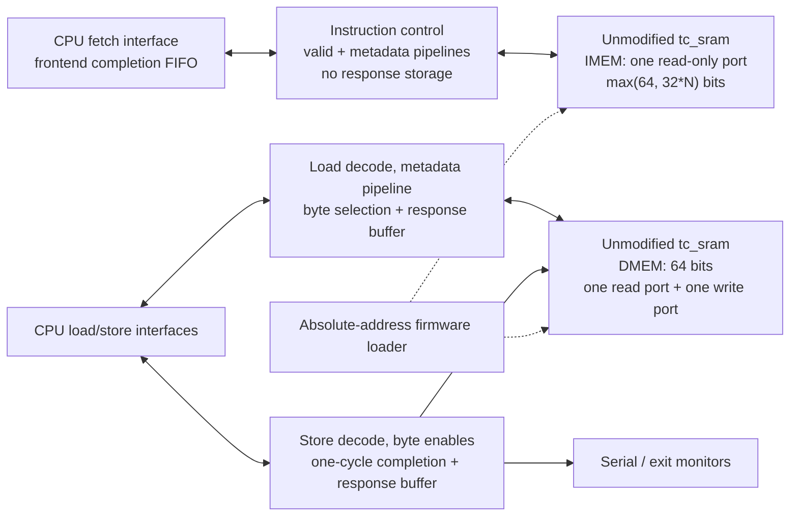

# Simulation memory backends

`tb_bare` selects the existing associative-array emulator or the Harvard TC_SRAM
backend through `tb/packages/tb_config_pkg.sv`. The CPU retains its instruction,
load and store interfaces. `MEM_BACKEND_AXI_SIM` remains reserved and fails at
elaboration; it does not fall back to another backend.

## Harvard organization



There is no arbitration between instruction and data accesses. IMEM and DMEM
are separate arrays instantiated through the parameterized simulation-only
`tc_sram_storage` wrapper. IMEM write-enable is tied low. DMEM port 0 is read-only;
port 1 is write-only. Neither the vendor SRAM source nor CPU RTL is changed.

| Fetch width N | IMEM word width | SRAM accesses per bundle |
| --- | --- | --- |
| 1 | 64 bits | 1; PC bit 2 selects the 32-bit half containing the instruction |
| 2 | 64 bits | 1 |
| 4 | 128 bits | 1 |
| 8 | 256 bits | 1 |

All words use eight-bit byte granularity. Native addresses are word indices;
CPU addresses and firmware addresses are absolute byte addresses. For N>1 the
requested PC is aligned down to the N-instruction bundle. The original PC's
four-byte alignment is checked before alignment, and every returned lane retains
its own address check and exception. N=1 retains the requested instruction PC.

## Configuration

The testbench configuration is the single source for the memory map:

| Parameter | Default | Requirements |
| --- | --- | --- |
| `IMEM_BASE_ADDR` | `0x10000` | Aligned to the IMEM word size |
| `IMEM_SIZE_BYTES` | 256 KiB | Positive integral number of IMEM words |
| `IMEM_LATENCY` | 1 | Unsigned read latency, including zero |
| `DMEM_BASE_ADDR` | `0x50000` | Eight-byte aligned |
| `DMEM_SIZE_BYTES` | 768 KiB | Positive integral number of 64-bit words |
| `DMEM_LATENCY` | 1 | Unsigned read latency, including zero |
| `SRAM_SIM_INIT` | `"none"` | Native `none`, `zeros`, `ones`, or `random` initialization |
| `SERIAL_ADDR` | `0x20000000` | Distinct, eight-byte-aligned output-only MMIO address |
| `EXIT_ADDR` | `0x20000100` | Distinct, eight-byte-aligned output-only MMIO address |

The adapter checks memory alignment, size, 64-bit address overflow, independent
memory overlap, and overlap with either eight-byte MMIO window at startup.
Non-power-of-two word counts are supported. Decoding precedes native address
truncation, so invalid requests cannot alias a valid SRAM location. MMIO addresses
must remain excluded from store-to-load forwarding by the CPU's `MMAP_MASK`.

The CPU's `len5_config_pkg::FETCH_MEMIF_FIFO_DEPTH` independently configures the
frontend completion FIFO (default eight, positive power of two). Its size is not
derived from either memory latency. The adapter does not contain that FIFO.

`LEN5_C_EN` and `ONLY_DOUBLEWORD_MEM_ACCESSES` remain explicitly unsupported by
the native adapter. Fetch widths must match the CPU configuration and be one of
1, 2, 4 or 8. There is no silent substitution of latency or word width.

## Instruction responses without an adapter FIFO

Every accepted instruction request already owns a result slot in the frontend's
completion FIFO. IMEM can therefore accept one request per cycle whenever the
frontend supplies one, independently of the configured latency. Downstream
instruction stalls eventually exhaust frontend credits and backpressure requests
through `fetch_mem_if` toward PC generation; they do not block results for
previously accepted requests.

For positive latency, valid bits and per-request lane exceptions/N=1 half selection
advance through exactly `IMEM_LATENCY` stages alongside the native SRAM data.
Multiple reads can be in flight and return in order. There is no instruction data
holding register, response FIFO, or reservation counter in the adapter. A protocol
assertion checks that each live result has its reserved frontend destination.

Latency zero uses the native asynchronous read and delivers the result on the
acceptance cycle. The completion FIFO supports simultaneous allocation and result
insertion. Grant remains independent of response-ready, avoiding combinational
feedback through that same-cycle path.

FIFO depth does not impose a maximum IMEM latency. For example, depth four with
latency ten accepts four consecutive requests and then waits for frontend credits.
Those four results still arrive exactly ten cycles after their respective requests.
A small FIFO can limit sustained throughput at long latency without affecting
correctness. The existing full-FIFO recovery bubble is unchanged.

Instruction flush immediately suppresses grants and response-valid, then clears
all latency valid bits together with frontend reservations. Already issued native
reads finish, but their canceled validity cannot escape or complete a newer request.
CPU reset clears protocol state without resetting or reloading SRAM contents.

## Data requests and exceptions

Loads and stores access DMEM exclusively. Data access to IMEM, instruction access
to DMEM, gaps, and addresses outside the configured windows return access faults.
Original misalignment priority is retained: a misaligned address produces the
corresponding misalignment exception before destination/access-fault selection.
Unsupported size masks remain access faults. Faulting requests never access an
array or produce MMIO side effects.

The load metadata pipeline has exactly `DMEM_LATENCY` stages, or combinational
metadata for latency zero. Tags, size masks, offsets and exceptions follow the
same timing as native read data. Byte selection right-justifies and zero-extends
the requested value; sign extension remains in the LSU.

Stores shift data and byte enables into the selected 64-bit word. SRAM writes
and serial/exit side effects occur only on accepted, legal write requests.
Store completions retain their tag and arrive one cycle after acceptance,
independently of DMEM read latency. A store request with write-enable low still
returns the original store access fault.

Load and store response buffers remain independent. Each has
`max(DMEM_LATENCY, 1) + 1` reservations, covering reads and one-cycle store
completion. Reservations include operations in flight and buffered results.
The existing fall-through path and full-buffer recovery bubble are preserved.
Latency-zero loads can reserve and complete a slot on the same edge.

DMEM retains upstream read-before-write behavior for simultaneous read/write
collisions. At latency zero the adapter samples the pre-edge asynchronous read;
any stalled result is captured before the write's nonblocking update.
For DMEM latency greater than one, backend flush cancels load reservations and
pending results before LSU tags can be reused. Latency zero/one retain the
existing short-latency drain-on-flush contract. Stores are not canceled.

## Firmware and linker integration

`sw/makefile` invokes `scripts/gen-memory-map.py` to generate both the MMIO C
header and `len5_memory_regions.ld` in the firmware build directory. The latter
is included by `sw/linker/len5-sim.ld`; there are no second hardcoded ROM/RAM
origins or capacities. Applications and benchmarks depend on the linker inputs,
so map changes relink firmware. `TB_CONFIG=/absolute/tb_config_pkg.sv` selects an
alternate configuration for firmware generation. Addresses use literal `64'h...`
values; capacities use unsigned decimal literals or products (`32'd...` is also
accepted). Unsupported expressions are rejected rather than approximated. SRAM
word alignment is additionally checked by RTL for the selected fetch width.

Executable text, vectors, initialization and trap handlers live in IMEM.
Read-only data, initialized data, `.tohost` mailboxes, BSS, heap and stack live
in DMEM. `tohost_exit` explicitly uses an executable text section; the original
assembly accidentally placed its instructions in the writable mailbox section,
which a shared array concealed. Initial data has equal load/run addresses, so
the loader deposits it directly into DMEM; no reset-time ROM-to-RAM copy is needed.
Startup still zeros BSS. The testbench boot PC defaults to `IMEM_BASE_ADDR + 0x180`
and can still be overridden explicitly.

Each storage instance reads the same firmware file and deposits only bytes in
its own region. A byte in the other configured region is skipped by that
instance; a byte outside both regions aborts loading. Bounds checks occur before
index calculation and catch sparse-image aliases, overflow and cross-boundary
words. Supported formats remain byte-wide absolute-address `.hex` with Verilog
comments, address/32-bit-word `.txt`, and raw binary with `+firmware_base=<hex>`.
A raw binary spanning an unmapped gap is rejected; use a sparse image instead.

The wrapper gives native initialization its own one-time power-on reset and loads
firmware afterward. Both memories must finish before the adapter grants anything.
CPU reset neither clears nor reloads the arrays. With `SimInit="none"`, untouched
bytes retain the vendor model's uninitialized-memory semantics.

## Modified components

| Files | Responsibility |
| --- | --- |
| `tb/packages/tb_config_pkg.sv`, `tb/tb_bare.sv`, `len5.core` | Independent memory settings, two SRAM instances, automatic boot address and unchanged backend selection |
| `tb/memory/tc_sram/tc_sram_adapter.sv` | Full-width pipelined instruction reads, independent read latencies and native ports |
| `tb/memory/tc_sram/{memory_backend_pkg,memory_access_check,memory_response_buffer}.sv` | Geometry and overlap checks, per-region permissions, latency-zero reservation assertion |
| `tb/memory/{tc_sram_storage.sv,tc_sram_loader.svh}` | Generic word/port geometry and absolute-address deposits into the correct array |
| `sw/linker/len5-sim.ld`, `scripts/gen-memory-map.py`, `sw/{makefile,benchmarks/makefile}`, `sw/device/runtime/spike.S` | Generated map, data placement, rebuild dependencies and executable host-exit routine |
| `tb/verilator/diff/{monitor.cpp,spike_adapter.cpp,spike_adapter.hh,signals.vlt}` | Two-region reference map, DMEM-specific flush handling, required interface observation |
| `tb/memory/tc_sram/{tc_sram_adapter_tb,tc_sram_config_tb,tc_sram_loader_tb}.sv`, `scripts/sim/check-tc-sram{.sh,-config.py,-loader.py}` | Native-response and frontend-reservation scoreboards, configuration/firmware checks and deterministic fixtures |
| `tb/memory/tc_sram/waivers.vlt`, `tb/frontend/fetch_mem_if/fetch_mem_waivers.vlt` | Narrow upstream latency-zero and intentionally unused counter-pin diagnostics |

## Verification and reproduction

```sh
SEEDS=100 CYCLES=10000 JOBS=4 bash scripts/sim/check-tc-sram.sh
python3 scripts/sim/check-tc-sram-config.py
python3 scripts/sim/check-tc-sram-loader.py
make verilator-build-debug
```

For alternate configurations, copy the CPU and testbench packages, edit only the
chosen settings, and pass `TC_SRAM_CONFIG=/absolute/len5_config_pkg.sv` and
`TC_SRAM_TB_CONFIG=/absolute/tb_config_pkg.sv` to `check-tc-sram.sh`.
`TC_SRAM_BUILD_DIR` selects the result directory. Configuration and loader checks
also accept `TC_SRAM_CONFIG_BUILD_DIR` and `TC_SRAM_LOADER_BUILD_DIR`.

The adapter scoreboard observes the public CPU/native interfaces directly, with
an independent byte-address/exception oracle. It checks ordered and stalled
responses, all byte lanes, read/write collisions, wrong-memory access, bounds,
tags, invalid masks, disabled write-enable, flush/reset, full data buffers and
frontend reservation exhaustion. A separate native-response scoreboard checks exact
IMEM latency, order and payload before the frontend FIFO, so buffering cannot hide
adapter stalls or incorrect responses.
The upstream latency-zero pipeline declaration has narrowly scoped simulator
waivers; its source is unchanged.

Spike receives the identical firmware image and generated memory map. Its common
read callback covers both instruction fetch and data reads, so it validates the
union of readable regions; the adapter scoreboard independently proves Harvard
access permissions. Writes are restricted to DMEM and supported MMIO. Existing
checker limitations on uninitialized reads and architectural trap recovery remain.
There is no claim of formal equivalence, synthesis timing/PPA sign-off or complete
four-state/X-propagation verification.

## Harvard split baseline results (2026-10-20)

All full-core runs use N=4 and identical rebuilt firmware for the shared-SRAM,
Harvard and legacy comparisons. Read-only data is in DMEM in every compared image.
The relocated-map runs use a separately linked image at IMEM `0x400000`, DMEM
`0x600000`, serial `0x30000000`, and exit `0x30000100`.

| Program | Shared L=4 cycles | Shared L=1 cycles | Harvard I=1/D=1 cycles | Harvard IPC |
| --- | ---: | ---: | ---: | ---: |
| hello_world | 32,175 | 26,570 | 24,074 | 0.5866 |
| load_store | 3,804 | 3,724 | 2,859 | 0.9500 |
| shift | 2,959 | 2,877 | 2,856 | 0.9503 |
| crc32 | 33,107 | 31,719 | 30,837 | 0.9529 |

The shared latency-one comparison isolates the instruction-width/controller
change from the default latency reduction. At N=4 the old SRAM needs two reads
per bundle; the new IMEM needs one. Measured fetch response latency falls from
two cycles to one at the same native latency. The shared L=4 baseline has a
five-cycle fetch response and four-cycle load response. Harvard I=1/D=1 has
one-cycle fetch/load responses; I=0/D=0 has zero-cycle fetch/load responses.
Stores complete in one cycle in all native configurations.

| Program | Shared L=1 accepted fetch bundles/cycle | Harvard I=1/D=1 accepted fetch bundles/cycle |
| --- | ---: | ---: |
| hello_world | 0.4931 | 0.7986 |
| load_store | 0.4997 | 0.6852 |
| shift | 0.3563 | 0.3869 |
| crc32 | 0.3195 | 0.3327 |

Accepted-fetch rates include speculative requests and cancellations; they are not
retired-instruction throughput. With continuous valid/ready, the directed adapter
test originally proved one whole bundle per cycle at IMEM latency zero/one.
The baseline controller serialized reads at L>1; the pipelined controller described
above removes that restriction. The legacy emulator passes all four programs and takes
one more measured cycle than Harvard I=1/D=1 for each program.

Behavioral verification covers:

- Shared-SRAM baseline: 100 seeds × 10,000 random cycles.
- Harvard adapter: N=1/2/4/8 × (I,D) latency pairs `(0,0)`, `(0,3)`, `(1,0)`,
  `(1,1)`, `(2,4)`, `(4,1)`, `(8,2)`, `(1,8)`, each with 100 seeds × 10,000 cycles.
  The `(1,8)` cases also relocate memory and MMIO regions.
- 33 configuration/generator cases and 63 loader cases, including expected
  rejections, all native initialization modes, sparse boundaries and nonbinary capacities.
- Linker/ELF checks for all four programs at default and relocated addresses:
  executable sections in IMEM, allocated data in DMEM, equal load/run addresses,
  correct boot/vector addresses, and executable `tohost_exit`.
- A backdated configuration-file switch in one firmware build directory verifies
  map/MMIO regeneration and relinking; unchanged settings do not rebuild outputs.
- Four programs (`hello_world`, `load_store`, `shift`, `crc32`) pass full-core Spike
  checking at I/D `(1,1)`, `(0,0)`, `(2,4)`, and relocated `(0,3)`, plus legacy and
  both shared-SRAM baselines. Default-map retirement traces through accepted exit
  match the shared baseline; relocated execution is checked against its own Spike image.
- Existing fetch-memory directed scenarios (44) and 100 × 10,000-cycle random
  regression pass. Full-frontend random verification passes 901 selected cases;
  its directed catalog has 47 passing, six pre-existing incomplete, and one
  provisional scenario, with no comparison mismatches. This is not full frontend sign-off.
- Verible lint, full-core Verilator lint, Python compilation, `git diff --check`,
  and explicit unsupported/invalid backend selection checks pass.

Logs, model builds, source snapshots, performance reports and the consolidated
receipt are under `build/harvard-sram/`. No formal or PPA claims are made. Full-core
execution is tested at N=4; all supported fetch widths are covered at the adapter boundary.

## Pipelined instruction verification (2026-10-20)

The instruction controller now accepts consecutive requests for every supported
latency while frontend credits remain available. Verification checks adapter
responses before frontend buffering as well as subsequent ordered delivery:

- N=1/2/4/8, each with I/D latency pairs `(0,0)`, `(0,3)`, `(1,0)`, `(1,1)`,
  `(2,4)`, `(4,1)`, `(8,2)`, `(1,8)`, `(12,0)`, `(3,1)`: 100 seeds and 10,000
  random cycles per configuration, totaling 40 million random cycles plus directed
  tests. Frontend depth is two for `(4,1)`, one for `(3,1)`, and eight otherwise.
  This covers full reservation queues, latency greater than depth, consecutive
  returns, faults, flush/reset cancellation, data collisions and relocated MMIO.
- All 35 configuration/generator checks pass, including IMEM latency 17 with
  DMEM latency one, and IMEM latency 12 with asynchronous DMEM.
- `hello_world`, `load_store`, `shift`, and `crc32` pass Spike at I/D `(1,1)`,
  `(2,4)`, `(12,1)`, and `(0,0)`. Retirement traces and serial output match the
  previous Harvard baseline. The latency-12 run reaches eight outstanding fetches
  with zero adapter instruction buffering; measured read latencies remain 12/1.
- Existing fetch-memory and complete-frontend randomized regressions each pass
  100 seeds and their required matrices. These are selected-scope regression
  results, not full-contract or formal sign-off.
- Verible lint and `git diff --check` pass. CPU/vendor RTL and firmware are unchanged.

At I/D `(2,4)`, identical firmware gives the following execution-cycle comparison:

| Program | Previous serialized IMEM controller | Pipelined IMEM controller |
| --- | ---: | ---: |
| hello_world | 28,654 | 27,180 |
| load_store | 3,745 | 2,897 |
| shift | 2,897 | 2,893 |
| crc32 | 33,019 | 32,161 |

Cycles at `(1,1)` and `(0,0)` match the previous Harvard controller. Evidence and
source/configuration snapshots are under `build/pipelined-imem/`; the consolidated
receipt is `verification-summary.json`. Full-core runs use N=4. There is no formal
equivalence, synthesis/PPA, or complete four-state verification claim.
