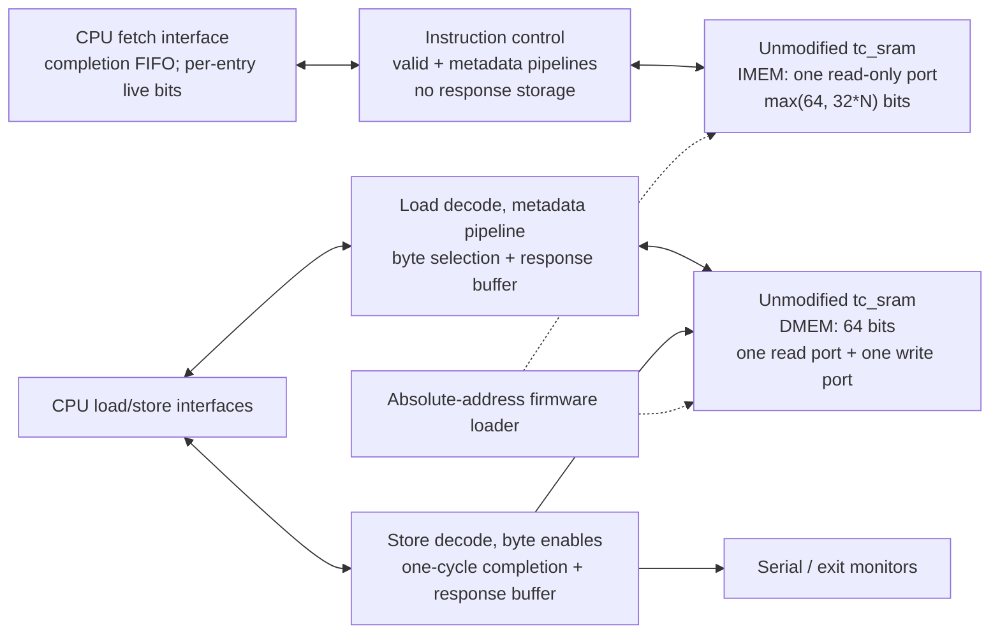
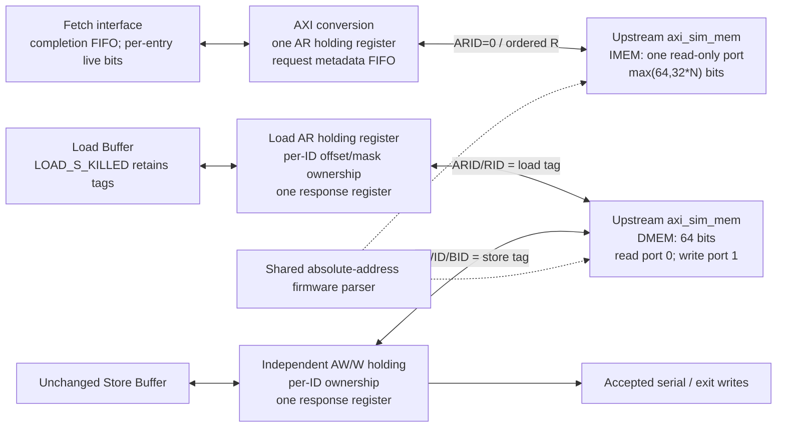

# Simulation memory backends

`tb_bare` selects LEGACY, TC_SRAM, or AXI_SIM through
`tb/packages/tb_config_pkg.sv`. Adapters and memory models live outside the
datapath. The CPU retains its instruction, load and store interfaces.

For an isolated AXI build, use:

```sh
python3 scripts/sim/prepare-memory-backend.py AXI_SIM build/axi-source
make -C build/axi-source verilator-build-debug
```

The snapshot helper sets the testbench backend and two CPU protocol options:
`FETCH_MEM_DRAIN_ON_FLUSH` is enabled for TC_SRAM and AXI_SIM, while
`LOAD_BUFFER_DRAIN_ON_FLUSH` is enabled only for AXI_SIM. LEGACY retains its
cancel-on-flush fetch contract; LEGACY and TC_SRAM retain their original Load
Buffer behavior. `tb_bare` rejects inconsistent combinations at elaboration.
These CPU options describe response ownership without importing the testbench's
backend selector into the CPU.

The CPU, frontend and memory transaction state share `rst_ni`. System reset
cancels outstanding transactions and clears the completion FIFO pointers and live
bits together. There is no separate memory-reset input or reset-event capture
pipeline. Fetch flush remains a separate event: it invalidates reserved entries
without clearing their ownership or resetting the memory system.

The original upstream AXI model only observes its first reset release and does
not restart its internal transaction queues on a later reset. Native-model runs
therefore cover startup and quiescent reset; reset with pending AXI transactions
is checked using the reset-capable variable-latency slave. Runtime reset with
pending transactions in the upstream AXI model is not supported.

## TC_SRAM organization



There is no arbitration between instruction and data accesses. IMEM and DMEM
are separate arrays instantiated through the parameterized simulation-only
`tc_sram_storage` wrapper. IMEM write-enable is tied low. DMEM port 0 is read-only;
port 1 is write-only. The vendor SRAM and TC_SRAM adapter are unchanged by the
AXI_SIM integration.

| Fetch width N | IMEM word width | SRAM accesses per bundle |
| --- | --- | --- |
| 1 | 64 bits | 1; PC bit 2 selects the 32-bit half containing the instruction |
| 2 | 64 bits | 1 |
| 4 | 128 bits | 1 |
| 8 | 256 bits | 1 |

All words use eight-bit byte granularity. Native addresses are word indices;
CPU addresses and firmware addresses are absolute byte addresses. For N>1 the
requested PC is aligned down to the N-instruction bundle. The original PC's
four-byte alignment is checked before alignment, and every returned lane retains
its own address check and exception. N=1 retains the requested instruction PC.

## Configuration

The testbench configuration is the single source for the memory map:

| Parameter | Default | Requirements |
| --- | --- | --- |
| `IMEM_BASE_ADDR` | `0x10000` | Aligned to the IMEM word size |
| `IMEM_SIZE_BYTES` | 256 KiB | Positive integral number of IMEM words |
| `IMEM_LATENCY` | 4 | TC_SRAM read latency, including zero |
| `DMEM_BASE_ADDR` | `0x50000` | Eight-byte aligned |
| `DMEM_SIZE_BYTES` | 768 KiB | Positive integral number of 64-bit words |
| `DMEM_LATENCY` | 1 | TC_SRAM read latency, including zero |
| `SRAM_SIM_INIT` | `"none"` | TC_SRAM-only `none`, `zeros`, `ones`, or `random` initialization |
| `AXI_CLOCK_HALF_PERIOD_PS` | 1000 | AXI harness/model clock phase; at least 3 ps |
| `SERIAL_ADDR` | `0x20000000` | Distinct, eight-byte-aligned output-only MMIO address |
| `EXIT_ADDR` | `0x20000100` | Distinct, eight-byte-aligned output-only MMIO address |

The adapter checks memory alignment, size, 64-bit address overflow, independent
memory overlap, and overlap with either eight-byte MMIO window at startup.
Non-power-of-two word counts are supported. Decoding precedes native address
truncation, so invalid requests cannot alias a valid SRAM location. MMIO addresses
must remain excluded from store-to-load forwarding by the CPU's `MMAP_MASK`.

The CPU's `len5_config_pkg::FETCH_MEMIF_FIFO_DEPTH` independently configures the
frontend completion FIFO (default eight, positive power of two). Its size is not
derived from either memory latency. The adapter does not contain that FIFO.
In drain mode this depth bounds all reserved entries, including canceled entries
and completed entries waiting behind the head. Flush clears their live bits but
preserves head/fill/tail positions. Space becomes available as completed heads
retire; a canceled entry waiting for its response remains reserved.

`LEN5_C_EN` and `ONLY_DOUBLEWORD_MEM_ACCESSES` remain explicitly unsupported by
both native adapters. Fetch widths must match the CPU configuration and be one of
1, 2, 4 or 8. There is no silent substitution of latency or word width.

## TC_SRAM instruction responses without an adapter FIFO

Every accepted instruction request already owns a result slot in the frontend's
completion FIFO. IMEM can therefore accept one request per cycle whenever the
frontend supplies one, independently of the configured latency. Downstream
instruction stalls eventually exhaust frontend credits and backpressure requests
through `fetch_mem_if` toward PC generation; they do not block results for
previously accepted requests.

For positive latency, valid bits and per-request lane exceptions/N=1 half selection
advance through exactly `IMEM_LATENCY` stages alongside the native SRAM data.
Multiple reads can be in flight and return in order. There is no instruction data
holding register, response FIFO, or reservation counter in the adapter. A protocol
assertion checks that each live result has its reserved frontend destination.

Latency zero uses the native asynchronous read and delivers the result on the
acceptance cycle. The completion FIFO supports simultaneous allocation and result
insertion. Grant remains independent of response-ready, avoiding combinational
feedback through that same-cycle path.

FIFO depth does not impose a maximum IMEM latency. For example, depth four with
latency ten accepts four consecutive requests and then waits for frontend credits.
Those four results still arrive exactly ten cycles after their respective requests.
A small FIFO can limit sustained throughput at long latency without affecting
correctness. The existing full-FIFO recovery bubble is unchanged.

The TC_SRAM adapter has no instruction-flush input. Its valid/metadata pipeline
returns every accepted request, including requests canceled by frontend flush.
System reset clears its instruction valid/metadata pipeline together with the
frontend FIFO. SRAM contents are neither cleared nor reloaded by reset.

`fetch_mem_if` connects memory responses directly to `completion_fifo`; it has no
outstanding or stale counters. In drain mode the FIFO adds one live bit per entry.
Allocation sets that bit, and flush clears all live bits while preserving the three
existing modulo pointers: tail reserves, fill records completion, and head retires.
An invalid head retires only after its response exists, without waiting for issue
readiness or publishing data/metadata. Each cycle retires at most one entry.

A response may be accepted on the flush edge. It completes its existing reservation
and can retire immediately if it is the head. Other canceled results can be stored
behind older entries and discarded later. New allocations use free tail slots while
older canceled entries drain; repeated flushes invalidate those newer allocations
as well. Local access faults follow the same ordered completion path. Full-queue
recovery retains its existing bubble. With `DRAIN_ON_FLUSH=0`, the FIFO keeps the
original clear-on-flush behavior for memories that cancel outstanding requests.

## TC_SRAM data requests and exceptions

Loads and stores access DMEM exclusively. Data access to IMEM, instruction access
to DMEM, gaps, and addresses outside the configured windows return access faults.
Original misalignment priority is retained: a misaligned address produces the
corresponding misalignment exception before destination/access-fault selection.
Unsupported size masks remain access faults. Faulting requests never access an
array or produce MMIO side effects.

The load metadata pipeline has exactly `DMEM_LATENCY` stages, or combinational
metadata for latency zero. Tags, size masks, offsets and exceptions follow the
same timing as native read data. Byte selection right-justifies and zero-extends
the requested value; sign extension remains in the LSU.

Stores shift data and byte enables into the selected 64-bit word. SRAM writes
and serial/exit side effects occur only on accepted, legal write requests.
Store completions retain their tag and arrive one cycle after acceptance,
independently of DMEM read latency. A store request with write-enable low still
returns the original store access fault.

Load and store response buffers remain independent. Each has
`max(DMEM_LATENCY, 1) + 1` reservations, covering reads and one-cycle store
completion. Reservations include operations in flight and buffered results.
The existing fall-through path and full-buffer recovery bubble are preserved.
Latency-zero loads can reserve and complete a slot on the same edge.

DMEM retains upstream read-before-write behavior for simultaneous read/write
collisions. At latency zero the adapter samples the pre-edge asynchronous read;
any stalled result is captured before the write's nonblocking update.
For DMEM latency greater than one, backend flush cancels load reservations and
pending results before LSU tags can be reused. Latency zero/one retain the
existing short-latency drain-on-flush contract. Stores are not canceled.

## AXI_SIM organization



`rtl/memory_interface/axi_sim_adapter.sv` produces single-beat AXI4 requests
(`AxLEN=0`, `BURST_INCR`); `axi_memory_pkg.sv` defines widths and packed channel
types using upstream macros. IMEM and DMEM are independent instances of PULP
`axi_sim_mem`, with absolute 64-bit byte addresses. Loads use naturally sized
AXI reads; the adapter selects and zero-extends bytes from the returned 64-bit
word. Stores position data and strobes in that word. Invalid addresses/masks and
misalignment complete locally with the existing exception priority. Read errors
(`SLVERR`/`DECERR`) become instruction/load access faults; B errors become store
access faults. Locally rejected or MMIO requests do not access either array;
native write errors retain the upstream model's write side effects.

The upstream dependency is pinned at
`70b8e54fd460e3308e58be596ceb3566a6e3576e`. Its sources, headers, licenses and
checksums are in `rtl/vendor/pulp-axi/`; no upstream module is modified. The
metadata FIFO reuses the existing pinned common_cells `fifo_v3`.

### Fetch ownership and flush

Every accepted CPU fetch reserves a frontend result slot and one adapter
metadata entry (lane exceptions, local-fault classification, N=1 half selection).
The adapter stores no instruction data: AXI R holds data until the frontend
accepts or drains it. Local faults follow the same metadata order. Every AR uses
ID zero, so native instruction responses have one AXI ordering domain.

Fetch cancellation belongs entirely to the frontend completion FIFO. A CPU fetch
reserves a slot at its adapter handshake, including requests whose AR is held under
backpressure. The adapter has no instruction stale counter, stale AR flag, or
instruction-flush input. System reset clears its fetch metadata along with the
frontend FIFO and memory transaction state.

On flush, the FIFO clears per-entry live bits and retains all reservations. Ordered
responses still fill their original slots. Completed canceled heads are discarded
independently of issue readiness; pending canceled heads wait for their response.
New requests can occupy free slots while canceled entries drain. Repeated flushes
clear all current live bits without changing pointer ownership. No independent
outstanding/stale counter or instruction-data FIFO is needed in the adapter.

A live response publishes with its original prediction metadata when it reaches
the head. The existing answer spill cell retains issue timing and flush behavior.
Disabling `FETCH_MEM_DRAIN_ON_FLUSH` removes the live-bit hardware and selects the
original contract in which the memory cancels requests itself (LEGACY).

### Loads, killed tags, and store ordering

CPU acceptance owns a load tag even before its AR handshakes. Neither the AR nor
the eventual load completion is canceled by an architectural flush. `RID` maps
directly to the original load tag, allowing different IDs to complete out of
order. One response register applies CPU backpressure to R; each ID remains busy
until the CPU consumes its completion.

With drain-on-flush enabled, the Load Buffer behaves as follows:

| Event for an entry | Result |
| --- | --- |
| Flush without an accepted pending request | EMPTY |
| Flush with an accepted pending request, including acceptance on that edge | KILLED |
| Flush with matching response handshake | EMPTY; discard result |
| KILLED with matching response handshake | EMPTY |
| KILLED without matching response handshake | KILLED |

Allocation requires EMPTY. KILLED preserves the existing tag and cannot publish
to the CDB. Flush suppresses normal completion/publication. Existing pointer
counters skip killed entries and empty holes left by flush, without extra CPU
flags or epoch counters. Killed entries are excluded from the pending-load mask
and store-order checks: a store can proceed even if all load tags are killed.
Active-load ordering and forwarding are unchanged.

AW and W each retain their own VALID/payload until handshake; a new store cannot
overwrite either unaccepted channel. Their order matches CPU store order, and
the two channels may handshake in either order. `AWID`/`BID` are the original
store tags. CPU store authorization remains in the unchanged Store Buffer.
Already owned writes finish exactly once across recovery. Since that buffer
clears its tags on flush, the adapter drains and discards old B responses while
retaining their ID ownership; post-flush loads wait for these old writes to
drain. Local/MMIO stores wait for earlier native writes and execute their side
effect once, at legal CPU acceptance. The exit monitor is unchanged.

### Native model scheduling, reset, and initialization

The CPU, adapter and storage wrapper use the same `rst_ni`. Reset clears adapter
ownership, held requests and frontend reservations together; no cleanup cycle is
needed after release. This contract assumes the memory system also cancels all
outstanding transactions. The unmodified upstream model uses timed tasks and
only waits for its first reset release, so a later reset with native transactions
still pending is outside its supported usage. The variable-latency verification
slave resets its queues and covers that system-reset case. Memory contents are
neither cleared nor reloaded by reset.

`axi_sim_model.sv` includes the unchanged upstream source in a 1 ps time scope.
The storage wrapper applies responses 1 ps after the CPU falling edge. It snapshots
actual AXI handshakes at the CPU rising edge and lets the native model acquire
those snapshots 2 ps later. It never predicts an upcoming handshake from READY:
asynchronous reset and backpressure changes therefore cannot make the model
consume a different transaction from the adapter. This is simulation sampling,
without an additional CPU-visible request or response stage.

The shared `AXI_CLOCK_HALF_PERIOD_PS` setting clocks the harness and directed
AXI tests and places the native acquisition phase. The C++
harness services pending Verilator timed events between CPU edges, while cycle
limits, reset scheduling and Spike cycle counts retain logical cycle units;
event timestamps use physical simulation time to align with FST waveforms. LEGACY
and TC_SRAM keep their previous clock scheduling. AXI latency follows the native
protocol model, not `IMEM_LATENCY`/`DMEM_LATENCY`; those knobs remain TC_SRAM-only.
The randomized test slave independently varies channel readiness, delay and
cross-ID response order.

Both AXI instances use the same shared firmware parser as TC_SRAM, depositing
bytes directly into the appropriate native associative array at absolute
addresses. Untouched addresses remain absent/uninitialized. The linker, runtime,
LSU interfaces, Store Buffer, and datapath/fetch-stage reset interfaces are unchanged.

### AXI verification commands

```sh
SEEDS=100 CYCLES=10000 JOBS=4 bash scripts/sim/check-axi-sim.sh
AXI_NATIVE=1 SEEDS=100 CYCLES=10000 JOBS=4 bash scripts/sim/check-axi-sim.sh
LOADER_BACKEND=AXI_SIM python3 scripts/sim/check-tc-sram-loader.py
```

The adapter script accepts `AXI_CONFIG`, `AXI_TB_CONFIG`, `AXI_BUILD_DIR`, and
`VERILATOR` for isolated width/map builds. The default test slave has independent
AR/R/AW/W/B stalls, variable response delay, cross-ID read/B reordering, and
injected R/B errors; `AXI_NATIVE=1` runs against both original PULP memories.
Both adapter testbenches instantiate production `fetch_mem_if` in drain mode.
The oracle independently checks all raw responses, including canceled requests,
and separately checks live frontend delivery, native requests, payload stability
under backpressure, and exactly-once accepted writes. It covers byte lanes,
boundaries, wrong-memory access, unsupported masks, MMIO, simultaneous traffic,
flushes and CPU reset. Native loader checks cover HEX/TXT/BIN, sparse boundaries,
invalid images and absence of untouched bytes.

For the real-LSU killed-load test, copy `len5_config_pkg.sv`, enable
`LOAD_BUFFER_DRAIN_ON_FLUSH`, and run `check-load-store.sh` with
`LOAD_STORE_TOP=load_store_killed_tb` and `LOAD_STORE_CONFIG=/absolute/copy.sv`.
The default command still runs the original LSU regression. The new test delays
and reorders responses, checks no stale CDB publication, simultaneous
flush/request/response cases, repeated flushes, all-tags-killed capacity and store
progress. Its compiled model accepts `+seed=<decimal>` for reproducible runs.

### AXI_SIM integration baseline (before frontend drain migration)

- Fetch widths 1/2/4/8 against the variable-latency slave and original PULP
  models, plus N=8 with relocated memory/MMIO against each model: 10
  configurations, each with 100 seeds and 10,000 random cycles (10 million
  random cycles plus directed tests). The variable slave reaches eight owned
  fetches and exercises out-of-order tagged load completions.
- The variable fixture injects DECERR and native PULP error maps generate SLVERR,
  covering both error codes on instruction reads, loads and stores. Directed
  reset tests include a pulse entirely between clock edges while completions
  are held. That test failed before reset-event capture and passes afterward.
- Real LSU with killed-load retention: 100 seeds of 10,000 random cycles plus
  directed flush/accept/response races, tag reuse and store progress with all
  load tags killed. Original LSU regression also passes with retention off.
- TC_SRAM baseline and post-change adapter regressions: 100 seeds each, with
  identical per-port metrics and outcomes. All 35 existing configuration/map
  checks, 63 TC_SRAM loader cases and 36 AXI native-loader cases pass.
- Existing fetch-memory directed scenarios and 100-seed random regression pass.
  Complete-frontend random verification passes 901 selected cases with zero
  mismatches. Its directed catalog remains 47 passing, six incomplete and one
  provisional; this is not complete frontend sign-off.
- N=4 full-core Spike runs pass `hello_world`, `load_store`, `shift` and CRC32
  on AXI_SIM, TC_SRAM and LEGACY, with zero discrepancies. Identical images
  produce identical retirement traces through accepted exit and serial output.
- The ordinary AXI simulator builds and runs `hello_world` without Spike. A
  waveform-enabled `load_store` Spike run also passes; all 141,832 recorded
  events align with physical FST time and logical CPU cycles.
- Targeted Verible lint, Verilator compilation/lint, Python/shell syntax,
  backend-selection checks and `git diff --check` pass. Repository-wide
  `make lint` still fails on existing violations in 11 unchanged files; no new
  adapter or Load Buffer diagnostics are hidden by those failures. Six style
  waivers apply only to the unmodified pinned PULP AXI directory.

The comparison below uses the current TC_SRAM settings I=4/D=1 and the native
AXI model, without changing the firmware or frontend depth (eight). These are
CPU-cycle measurements, not wall-clock simulation speed or hardware timing.

| Program | TC_SRAM cycles | AXI_SIM cycles | LEGACY cycles | TC_SRAM IPC | AXI_SIM IPC |
| --- | ---: | ---: | ---: | ---: | ---: |
| hello_world | 27,367 | 27,714 | 24,075 | 0.5160 | 0.5096 |
| load_store | 2,912 | 2,911 | 2,860 | 0.9327 | 0.9330 |
| shift | 2,908 | 2,908 | 2,857 | 0.9333 | 0.9333 |
| crc32 | 30,915 | 32,176 | 30,838 | 0.9505 | 0.9132 |

TC_SRAM fetch/load/store completion latencies are 4/1/1 cycles in these runs.
AXI fetch latency is two cycles; measured mean load latency is 2.68–3.00 cycles
and store latency 3.96–4.00 cycles, including speculative accesses and local
MMIO completions. The longer data protocol offsets the faster native fetch in
memory-sensitive programs.

| Program | TC_SRAM accepted fetch bundles/cycle | AXI_SIM accepted fetch bundles/cycle |
| --- | ---: | ---: |
| hello_world | 0.8360 | 0.8062 |
| load_store | 0.6947 | 0.6884 |
| shift | 0.4027 | 0.3955 |
| crc32 | 0.3346 | 0.3205 |

Fetch acceptance includes speculation and canceled requests; it is not retired
instruction throughput. Evidence is under `build/axi-sim/`, including source
snapshots, seed logs, native-loader reports, full-core performance JSON and
`verification-summary.json`.

Only single-beat LEN5 transactions are generated; this is not a general AXI
bridge. Full-core execution is tested at N=4; all four widths are checked at
the adapter boundary. Architectural trap recovery and uninitialized-read
checking retain the existing Spike checker limitations. No formal equivalence,
synthesis/PPA, complete four-state simulation, or ModelSim validation is claimed.

## Frontend-owned instruction drain verification

`FETCH_MEM_DRAIN_ON_FLUSH` selects frontend-owned cancellation for both native
backends. The adapter benches use production `fetch_mem_if`, keep an independent
oracle for every raw response, and separately check live bundle data, exceptions
and PC metadata. They cover backpressure, repeated flushes, stalled AXI AR,
responses on flush edges, and system reset. TC_SRAM and the reset-capable AXI
slave cancel pending reads on reset; native AXI reset is tested only while
quiescent. Per-entry live-bit hardware is absent in LEGACY cancel-on-flush mode.

The shared spill controller now expresses its state-only valid/data-select
outputs separately from the Mealy write controls. This preserves its state
encodings, output truth table and cycle timing, while avoiding a false
process-level dependency through early-jump flush in traced Verilator builds.
A 10,000-cycle comparison against the committed controller passes.

The memory performance monitor retains native fetch timestamps across flush,
matching responses that the frontend drains. System reset clears all timestamp
queues together with the corresponding transactions.

The initial drain-ownership migration evidence, before the unified-reset
simplification, is under `build/instr-drain/`:

- 17 TC_SRAM configurations, each with 100 seeds and 10,000 random cycles:
  N=1/2/4/8 at instruction latencies 0/1/4/10 and data latencies 0/1/3,
  including latency 10 with a four-entry FIFO, plus the default I=4/D=1 case.
- Six AXI configurations with the same seed/cycle counts: all four widths with
  the variable-latency slave, N=4 with the original PULP models, and N=8 with
  relocated memory/MMIO. Together the native-memory benches execute 23 million
  random cycles plus their directed sequences.
- N=4 Spike execution passes hello_world, load_store, shift and CRC32 on all
  three backends. Retirement traces and serial output agree through accepted
  exit. LEGACY and AXI_SIM cycle counts are unchanged from the integration
  baseline. TC_SRAM gains one startup cycle while frontend reset bookkeeping
  completes; no instruction-response pipeline stage was added.
- The existing cancel-mode frontend suite passes all executed groups, with
  39,007,792 comparisons and no mismatches. Its directed catalog retains six
  incomplete and one provisional scenario; this is not complete frontend
  specification sign-off. Fetch-memory directed/random/framework and mutation
  checks separately exercise the retained cancel-mode contract.
- All 35 SRAM configuration/generator checks and eight backend-selection checks
  pass. Full-core Verilator lint and compilation pass. Targeted Verible finds
  only the same four existing fetch-stage style findings as the committed
  baseline; there are no new waivers or new lint findings.

| Program | TC_SRAM cycles | AXI_SIM cycles | LEGACY cycles |
| --- | ---: | ---: | ---: |
| hello_world | 27,368 | 27,714 | 24,075 |
| load_store | 2,913 | 2,911 | 2,860 |
| shift | 2,909 | 2,908 | 2,857 |
| crc32 | 30,916 | 32,176 | 30,838 |

In this earlier counter-based baseline, the outstanding limit included stale
requests until their responses arrived. Flush freed result storage immediately,
while old transactions could still backpressure requests. System reset cleared
both counters and frontend storage. The current per-entry cancellation scheme
above retains reservations until completed heads retire. Independent CPU-only
reset is not supported. Full-core execution is checked at N=4; adapter/frontend
benches cover all four widths. No formal equivalence, PPA, complete four-state
or ModelSim sign-off is claimed.

### Unified system reset verification

The separate memory-link reset and CPU-reset event capture have been removed.
`rst_ni` now resets the frontend, adapters and memory transaction state together;
`datapath` keeps its original reset interface. Fetch flush still marks accepted
requests stale and drains their ordered responses. The performance monitor clears
all timestamps on system reset.

Updated evidence is under `build/unified-reset/verification-summary.json`:

- The same 23 memory configurations pass 100 seeds of 10,000 random cycles each.
  Reset checks require zero outstanding transactions and empty response storage.
  The variable-latency AXI slave covers reset with requests pending; native AXI
  reset is quiescent because the upstream model only observes its first release.
- All 12 N=4 full-core Spike runs pass, with identical retirement traces and serial
  output across backends. Removing reset cleanup saves one startup cycle for both
  TC_SRAM and AXI_SIM relative to the separate-reset implementation; LEGACY is
  unchanged.
- The fetch-memory suite passes all seven groups. All five frontend execution
  groups pass, with 39,007,792 comparisons and zero mismatches; the existing six
  incomplete and one provisional directed scenario remain.
- All 35 configuration checks, eight backend-selection checks, current full-core
  Verilator lint, syntax checks and `git diff --check` pass. Verible reports only
  the four existing fetch-stage style findings. Upstream AXI checksums match.

| Program | TC_SRAM cycles | AXI_SIM cycles | LEGACY cycles |
| --- | ---: | ---: | ---: |
| hello_world | 27,367 | 27,713 | 24,075 |
| load_store | 2,912 | 2,910 | 2,860 |
| shift | 2,908 | 2,907 | 2,857 |
| crc32 | 30,915 | 32,175 | 30,838 |

### Per-entry fetch cancellation verification

Cancellation now uses a live bit in each completion FIFO entry, without separate
frontend outstanding/stale counters. The three existing modulo pointers are
preserved on flush; canceled heads retire only when complete. LEGACY retains its
clear-on-flush contract. The request and answer spill cells are unchanged.

Evidence is under `build/fifo-live/verification-summary.json`:

- An independent queue oracle passes depths 1/2/4/8 in both flush modes, with
  100 seeds of 10,000 random cycles each: eight million cycles plus directed
  bypass, full, stalled-head, repeated-flush, response-on-flush and reset cases.
- 17 TC_SRAM width/latency configurations and six AXI configurations each pass
  100 seeds of 10,000 random cycles. TC_SRAM uses the proposed verification-only
  timing oracle under `build/fifo-live/tc_sram_adapter_tb.sv`; its raw SRAM latency
  checks are unchanged. AXI uses the existing testbench without changes.
- The fetch-memory suite passes all seven groups, including mutations. The
  frontend suite has 39,007,792 comparisons and zero mismatches; its existing
  six incomplete and one provisional scenarios remain outside full sign-off.
- All 12 N=4 Spike runs pass for the four representative programs and three
  backends. Retirement traces and serial output match. LEGACY cycles are
  unchanged. Retained canceled slots add recovery cycles: hello_world changes
  from 27,367 to 27,780 cycles for TC_SRAM and 27,713 to 29,044 for AXI_SIM.
  Full program measurements are in `build/fifo-live/performance-comparison.json`.
- Targeted Verible, full-core Verilator lint and `git diff --check` pass.

The existing TC_SRAM testbench still assumes immediate frontend delivery after
flush and fails that timing assertion with retained entries. Applying the tested
replacement oracle to `tb/memory/tc_sram/tc_sram_adapter_tb.sv` awaits permission
under the two-module RTL scope restriction. The reviewable patch is
`build/fifo-live/testbench-timing.patch`. No other design RTL changed in this step.
No formal equivalence, synthesis/PPA or complete four-state sign-off is claimed.

## Firmware and linker integration

`sw/makefile` invokes `scripts/gen-memory-map.py` to generate both the MMIO C
header and `len5_memory_regions.ld` in the firmware build directory. The latter
is included by `sw/linker/len5-sim.ld`; there are no second hardcoded ROM/RAM
origins or capacities. Applications and benchmarks depend on the linker inputs,
so map changes relink firmware. `TB_CONFIG=/absolute/tb_config_pkg.sv` selects an
alternate configuration for firmware generation. Addresses use literal `64'h...`
values; capacities use unsigned decimal literals or products (`32'd...` is also
accepted). Unsupported expressions are rejected rather than approximated. SRAM
word alignment is additionally checked by RTL for the selected fetch width.

Executable text, vectors, initialization and trap handlers live in IMEM.
Read-only data, initialized data, `.tohost` mailboxes, BSS, heap and stack live
in DMEM. `tohost_exit` explicitly uses an executable text section; the original
assembly accidentally placed its instructions in the writable mailbox section,
which a shared array concealed. Initial data has equal load/run addresses, so
the loader deposits it directly into DMEM; no reset-time ROM-to-RAM copy is needed.
Startup still zeros BSS. The testbench boot PC defaults to `IMEM_BASE_ADDR + 0x180`
and can still be overridden explicitly.

Each storage instance reads the same firmware file and deposits only bytes in
its own region. A byte in the other configured region is skipped by that
instance; a byte outside both regions aborts loading. Bounds checks occur before
index calculation and catch sparse-image aliases, overflow and cross-boundary
words. Supported formats remain byte-wide absolute-address `.hex` with Verilog
comments, address/32-bit-word `.txt`, and raw binary with `+firmware_base=<hex>`.
A raw binary spanning an unmapped gap is rejected; use a sparse image instead.

The wrapper gives native initialization its own one-time power-on reset and loads
firmware afterward. Both memories must finish before the adapter grants anything.
CPU reset neither clears nor reloads the arrays. With `SimInit="none"`, untouched
bytes retain the vendor model's uninitialized-memory semantics.

## Modified components

| Files | Responsibility |
| --- | --- |
| `tb/packages/tb_config_pkg.sv`, `tb/tb_bare.sv`, `len5.core` | Independent memory settings, two SRAM instances, automatic boot address and unchanged backend selection |
| `tb/memory/tc_sram/tc_sram_adapter.sv` | Full-width pipelined instruction reads, independent read latencies and native ports |
| `tb/memory/tc_sram/{memory_backend_pkg,memory_access_check,memory_response_buffer}.sv` | Geometry and overlap checks, per-region permissions, latency-zero reservation assertion |
| `tb/memory/{tc_sram_storage.sv,tc_sram_loader.svh}` | Generic word/port geometry and absolute-address deposits into the correct array |
| `sw/linker/len5-sim.ld`, `scripts/gen-memory-map.py`, `sw/{makefile,benchmarks/makefile}`, `sw/device/runtime/spike.S` | Generated map, data placement, rebuild dependencies and executable host-exit routine |
| `tb/verilator/diff/{monitor.cpp,spike_adapter.cpp,spike_adapter.hh,signals.vlt}` | Two-region reference map, DMEM-specific flush handling, required interface observation |
| `tb/memory/tc_sram/{tc_sram_adapter_tb,tc_sram_config_tb,tc_sram_loader_tb}.sv`, `scripts/sim/check-tc-sram{.sh,-config.py,-loader.py}` | Native-response and frontend-reservation scoreboards, configuration/firmware checks and deterministic fixtures |
| `tb/memory/tc_sram/waivers.vlt`, `tb/frontend/fetch_mem_if/fetch_mem_waivers.vlt` | Narrow upstream latency-zero and intentionally unused counter-pin diagnostics |

## Verification and reproduction

```sh
SEEDS=100 CYCLES=10000 JOBS=4 bash scripts/sim/check-tc-sram.sh
python3 scripts/sim/check-tc-sram-config.py
python3 scripts/sim/check-tc-sram-loader.py
make verilator-build-debug
```

For alternate configurations, copy the CPU and testbench packages, edit only the
chosen settings, and pass `TC_SRAM_CONFIG=/absolute/len5_config_pkg.sv` and
`TC_SRAM_TB_CONFIG=/absolute/tb_config_pkg.sv` to `check-tc-sram.sh`.
`TC_SRAM_BUILD_DIR` selects the result directory. Configuration and loader checks
also accept `TC_SRAM_CONFIG_BUILD_DIR` and `TC_SRAM_LOADER_BUILD_DIR`.

The adapter scoreboard observes the public CPU/native interfaces directly, with
an independent byte-address/exception oracle. It checks ordered and stalled
responses, all byte lanes, read/write collisions, wrong-memory access, bounds,
tags, invalid masks, disabled write-enable, flush/reset, full data buffers and
frontend reservation exhaustion. A separate native-response scoreboard checks exact
IMEM latency, order and payload before the frontend FIFO, so buffering cannot hide
adapter stalls or incorrect responses.
The upstream latency-zero pipeline declaration has narrowly scoped simulator
waivers; its source is unchanged.

Spike receives the identical firmware image and generated memory map. Its common
read callback covers both instruction fetch and data reads, so it validates the
union of readable regions; the adapter scoreboard independently proves Harvard
access permissions. Writes are restricted to DMEM and supported MMIO. Existing
checker limitations on uninitialized reads and architectural trap recovery remain.
There is no claim of formal equivalence, synthesis timing/PPA sign-off or complete
four-state/X-propagation verification.

## Harvard split baseline results (2026-10-20)

All full-core runs use N=4 and identical rebuilt firmware for the shared-SRAM,
Harvard and legacy comparisons. Read-only data is in DMEM in every compared image.
The relocated-map runs use a separately linked image at IMEM `0x400000`, DMEM
`0x600000`, serial `0x30000000`, and exit `0x30000100`.

| Program | Shared L=4 cycles | Shared L=1 cycles | Harvard I=1/D=1 cycles | Harvard IPC |
| --- | ---: | ---: | ---: | ---: |
| hello_world | 32,175 | 26,570 | 24,074 | 0.5866 |
| load_store | 3,804 | 3,724 | 2,859 | 0.9500 |
| shift | 2,959 | 2,877 | 2,856 | 0.9503 |
| crc32 | 33,107 | 31,719 | 30,837 | 0.9529 |

The shared latency-one comparison isolates the instruction-width/controller
change from the default latency reduction. At N=4 the old SRAM needs two reads
per bundle; the new IMEM needs one. Measured fetch response latency falls from
two cycles to one at the same native latency. The shared L=4 baseline has a
five-cycle fetch response and four-cycle load response. Harvard I=1/D=1 has
one-cycle fetch/load responses; I=0/D=0 has zero-cycle fetch/load responses.
Stores complete in one cycle in all native configurations.

| Program | Shared L=1 accepted fetch bundles/cycle | Harvard I=1/D=1 accepted fetch bundles/cycle |
| --- | ---: | ---: |
| hello_world | 0.4931 | 0.7986 |
| load_store | 0.4997 | 0.6852 |
| shift | 0.3563 | 0.3869 |
| crc32 | 0.3195 | 0.3327 |

Accepted-fetch rates include speculative requests and cancellations; they are not
retired-instruction throughput. With continuous valid/ready, the directed adapter
test originally proved one whole bundle per cycle at IMEM latency zero/one.
The baseline controller serialized reads at L>1; the pipelined controller described
above removes that restriction. The legacy emulator passes all four programs and takes
one more measured cycle than Harvard I=1/D=1 for each program.

Behavioral verification covers:

- Shared-SRAM baseline: 100 seeds × 10,000 random cycles.
- Harvard adapter: N=1/2/4/8 × (I,D) latency pairs `(0,0)`, `(0,3)`, `(1,0)`,
  `(1,1)`, `(2,4)`, `(4,1)`, `(8,2)`, `(1,8)`, each with 100 seeds × 10,000 cycles.
  The `(1,8)` cases also relocate memory and MMIO regions.
- 33 configuration/generator cases and 63 loader cases, including expected
  rejections, all native initialization modes, sparse boundaries and nonbinary capacities.
- Linker/ELF checks for all four programs at default and relocated addresses:
  executable sections in IMEM, allocated data in DMEM, equal load/run addresses,
  correct boot/vector addresses, and executable `tohost_exit`.
- A backdated configuration-file switch in one firmware build directory verifies
  map/MMIO regeneration and relinking; unchanged settings do not rebuild outputs.
- Four programs (`hello_world`, `load_store`, `shift`, `crc32`) pass full-core Spike
  checking at I/D `(1,1)`, `(0,0)`, `(2,4)`, and relocated `(0,3)`, plus legacy and
  both shared-SRAM baselines. Default-map retirement traces through accepted exit
  match the shared baseline; relocated execution is checked against its own Spike image.
- Existing fetch-memory directed scenarios (44) and 100 × 10,000-cycle random
  regression pass. Full-frontend random verification passes 901 selected cases;
  its directed catalog has 47 passing, six pre-existing incomplete, and one
  provisional scenario, with no comparison mismatches. This is not full frontend sign-off.
- Verible lint, full-core Verilator lint, Python compilation, `git diff --check`,
  and explicit unsupported/invalid backend selection checks pass.

Logs, model builds, source snapshots, performance reports and the consolidated
receipt are under `build/harvard-sram/`. No formal or PPA claims are made. Full-core
execution is tested at N=4; all supported fetch widths are covered at the adapter boundary.

## Pipelined instruction verification (2026-10-20)

The instruction controller now accepts consecutive requests for every supported
latency while frontend credits remain available. Verification checks adapter
responses before frontend buffering as well as subsequent ordered delivery:

- N=1/2/4/8, each with I/D latency pairs `(0,0)`, `(0,3)`, `(1,0)`, `(1,1)`,
  `(2,4)`, `(4,1)`, `(8,2)`, `(1,8)`, `(12,0)`, `(3,1)`: 100 seeds and 10,000
  random cycles per configuration, totaling 40 million random cycles plus directed
  tests. Frontend depth is two for `(4,1)`, one for `(3,1)`, and eight otherwise.
  This covers full reservation queues, latency greater than depth, consecutive
  returns, faults, flush/reset cancellation, data collisions and relocated MMIO.
- All 35 configuration/generator checks pass, including IMEM latency 17 with
  DMEM latency one, and IMEM latency 12 with asynchronous DMEM.
- `hello_world`, `load_store`, `shift`, and `crc32` pass Spike at I/D `(1,1)`,
  `(2,4)`, `(12,1)`, and `(0,0)`. Retirement traces and serial output match the
  previous Harvard baseline. The latency-12 run reaches eight outstanding fetches
  with zero adapter instruction buffering; measured read latencies remain 12/1.
- Existing fetch-memory and complete-frontend randomized regressions each pass
  100 seeds and their required matrices. These are selected-scope regression
  results, not full-contract or formal sign-off.
- Verible lint and `git diff --check` pass. CPU/vendor RTL and firmware are unchanged.

At I/D `(2,4)`, identical firmware gives the following execution-cycle comparison:

| Program | Previous serialized IMEM controller | Pipelined IMEM controller |
| --- | ---: | ---: |
| hello_world | 28,654 | 27,180 |
| load_store | 3,745 | 2,897 |
| shift | 2,897 | 2,893 |
| crc32 | 33,019 | 32,161 |

Cycles at `(1,1)` and `(0,0)` match the previous Harvard controller. Evidence and
source/configuration snapshots are under `build/pipelined-imem/`; the consolidated
receipt is `verification-summary.json`. Full-core runs use N=4. There is no formal
equivalence, synthesis/PPA, or complete four-state verification claim.
